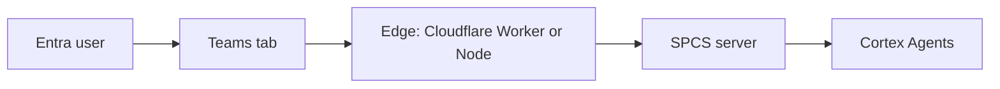

# Agents Embed authentication

How Snowflake Agents Embed proves who the end user is when Cortex agent chat runs inside Microsoft Teams.

In production, Teams always goes through an edge (a Cloudflare Worker, or the self-hosted Node edge) in front of the SPCS server.

This page is the security-facing overview. Operator install steps start in [install-guide.md](install-guide.md), then [install-teams.md](install-teams.md).

## Two questions every request answers

1. **May this person use Agents Embed in Teams?** Teams SSO (an Entra token).
2. **Which Snowflake user does Cortex run as?** The signed-in person, through Entra On-Behalf-Of (OBO).

Production answers both with the signed-in user: Teams SSO → Entra token → OBO → a per-user Snowflake token. There is no production mode in which Cortex runs as a shared service identity.

The only Snowflake PAT in production is the **ingress PAT**: `SNOWFLAKE_PAT` in `apps/teams/.env`, pushed to the edge as `SPCS_PAT` by `set-edge-secrets.sh`. It authenticates the edge → SPCS hop and is never the identity Cortex runs as. The container does not receive it. In `local-pat` (development only), the same `SNOWFLAKE_PAT` name is the Cortex identity, with no Entra check.

In production, browsers never hold a Snowflake PAT or Snowflake OAuth token. The Teams tab holds only an opaque, encrypted edge session (`X-Edge-Session`, a JWE); the edge's `/api/*` proxy decrypts it and injects the user's short-lived Snowflake token server-side, overwriting any browser-supplied `X-User-Access-Token`. The edge's `/token/exchange` returns only `{ edgeSession, expiresIn }`, and the edge refuses every `/api/token*` path, so the container's dev-only token route is unreachable through it. Keep per-user network policies restricted anyway.

## At a glance

| Mode | Snowflake identity | Entra check | Path |
| --- | --- | --- | --- |
| `production` | Mapped Entra user (OBO) | Yes | Edge hosts the tab, exchanges tokens, proxies `/api/*`, and holds bot links |
| `local-oauth` | Mapped Entra user (OBO) | Skipped on some routes | Edge or local server. The container's `/api/token/exchange` returns the raw Snowflake token |
| `local-pat` | The developer's PAT | None | Tab talks to the local server on loopback. The PAT is in the tab bundle and the browser |

`local-pat` and `local-oauth` are development modes, not customer production. `TEAMS_AUTH_MODE` has no default: a missing or unknown value fails startup. A non-production mode also refuses to start under `NODE_ENV=production`, or on a non-loopback address, unless `ALLOW_INSECURE_AUTH_MODE=1` is set.

---

## Microsoft Teams

The tab and the Azure Bot messaging endpoint are served from the edge (`packages/teams-edge`). The SPCS server talks to Cortex. In production the browser never calls SPCS; the edge does.

### Production (Entra SSO → On-Behalf-Of)

1. The user is signed into Teams. The tab asks Teams for an Entra token (`getAuthToken`).
2. The edge validates that token (signature, tenant, audience, scope, client ID) and exchanges it On-Behalf-Of for a Snowflake token (scope `session:role-any`, or `session:role:<ROLE>`, on the Snowflake resource app).
3. The edge seals the Snowflake token into the edge session. On each `/api/*` call it authenticates to SPCS with the ingress PAT and forwards the user's Snowflake token for Cortex.

Snowflake maps the Entra token through `CORTEX_TEAMS_OAUTH` (`TYPE = EXTERNAL_OAUTH`, Azure). The mapping claim is `upn` → `LOGIN_NAME`. The Entra user must already exist as a Snowflake user. Agents Embed does not create Snowflake users.

**Role.** Set `SNOWFLAKE_OAUTH_ROLE` in `apps/teams/.env` to request `session:role:<ROLE>`, with `EXTERNAL_OAUTH_ANY_ROLE_MODE = 'DISABLE'` on the integration (preferred). If it is blank, the token requests `session:role-any` and Snowflake may activate any role that user is granted.

**Network mode.** `NETWORK_MODE` changes the path, not the identities above. `public` (default) uses the public SPCS ingress. `hybrid` keeps that ingress but sends the container's Snowflake calls to the internal `SNOWFLAKE_HOST`, allowed by a `COMPUTE_POOL` network rule on `CORTEX_TEAMS_OAUTH`. `privatelink` (preview, not yet validated end to end) has the Worker reach the private ingress through a Workers VPC tunnel and restricts the ingress-PAT user to your private-endpoint IDs. See [Private connectivity](install-teams.md#7-private-connectivity-optional).

**Bot.** The edge verifies the Bot Connector JWT in every mode, and the container verifies it again. In `privatelink` the edge check is the only one in front of the PAT, since the private ingress has no public hop of its own.

The bot has no Teams SSO token, so each user links their identity once through the tab:

1. An unlinked user messages the bot. The edge mints a one-time sign-in code (10 minutes, bound to that user's Entra tenant and object ID), and the bot replies with a sign-in card.
2. The card opens the tab, which runs Teams SSO and posts the code plus the Entra token to the edge's `/token/link`. The edge requires both to name the same user and accepts each code once.
3. The edge runs OBO with `offline_access` and stores the Entra refresh token, encrypted with a key derived from `BOT_LINK_SECRET`, in the `BOT_LINKS` KV store.
4. On each bot turn the edge injects a fresh Snowflake token for that user. The SPCS server never sees the refresh token.

A link is dropped when Entra permanently rejects the refresh token (revoked, expired, password change), when the user sends `sign out`, or when `BOT_LINK_SECRET` is rotated (which signs every bot user out). The production bot never falls back to the shared PAT; that fallback exists only in `local-pat`.

### Local PAT (development only)

No Entra check. The developer supplies a PAT, which is built into the tab and sent by the browser to a server bound to loopback. Cortex runs as that PAT. Do not ship this mode to customers.

---

## Token lifetime

These numbers are the **Entra-issued Snowflake access token** and the sessions that carry it, not the Teams login session.

| Channel | Access token | Refresh / remint | User-visible sign-in again |
| --- | --- | --- | --- |
| Teams tab | Entra `expires_in`, typically 60–90 minutes. The edge session lasts the shorter of 1 hour or the token's lifetime minus 30 seconds | Tab re-runs Teams SSO + OBO 60 seconds before the edge session expires | Not while Teams can silently issue an Entra token. If its cached token has expired, Teams may prompt once |
| Teams bot | Same Entra `expires_in`, cached at the edge | Edge uses the stored refresh token 120 seconds before expiry, replacing the stored token each time | After 90 days without use, after `sign out`, a permanent Entra rejection, or a `BOT_LINK_SECRET` rotation |

`local-pat` has no per-user token to expire; the PAT lasts until you rotate it. The edge session is a non-revocable bearer for at most 1 hour; revoke all sessions by rotating `EDGE_SESSION_SECRET`.

## Configuring lifetimes

There is no setup-wizard field for these timeouts. Configure Entra access-token lifetime with a [Configurable token lifetime](https://learn.microsoft.com/en-us/entra/identity-platform/configurable-token-lifetimes) policy on the Snowflake resource app / OBO client. `CORTEX_TEAMS_OAUTH` has no access-token validity parameter.

---

## What to tell an auditor

- Cortex always runs as the signed-in user's mapped Snowflake identity in production. The browser holds only an encrypted edge session, never a Snowflake credential.
- The edge keeps the SPCS ingress PAT. That PAT opens the front door to the SPCS service; it is never the user Cortex impersonates.
- Bot users act as themselves after a one-time tab sign-in. The edge holds an encrypted refresh token per user in KV (90-day TTL, replaced on each refresh).
- `/token/exchange` and `/token/link` are rate-limited per edge instance: 30 requests per minute per IP, and 10 per minute per verified identity.
- `local-pat` is a development-only shared identity with no Entra check, and it will not start under `NODE_ENV=production` without an explicit override. It is not a customer deployment option.
- User mapping is directory-driven: the Entra UPN must match a real Snowflake login. Agents Embed does not provision those users.
- Rotate the ingress PAT as you would any programmatic credential (`set-edge-secrets.sh` recommends 90 days). Rotate Entra client secrets with `apps/teams/scripts/rotate-entra-secret.sh`, not by pasting them into chat.

For install, CORS origins, and secrets, start at [install-guide.md](install-guide.md) and continue in [install-teams.md](install-teams.md).
