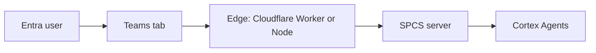

# Agents Embed authentication

How Snowflake Agents Embed proves who the end user is when Cortex agent chat runs inside Microsoft Teams.

Teams always uses an edge (a Cloudflare Worker, or the self-hosted Node edge) in front of the SPCS server.

This page is the security-facing overview. Operator install steps start in [install-guide.md](install-guide.md), then [install-teams.md](install-teams.md).

## Two questions every request answers

1. **May this person use Agents Embed in Teams?** Teams SSO (an Entra token).
2. **Which Snowflake user does Cortex run as?** Either the signed-in person (OAuth, On-Behalf-Of) or one shared service identity (PAT).

Teams login alone never answers (2). PAT mode keeps a gate so the shared credential is not an open proxy, but every Cortex call, role, and thread still belongs to that one Snowflake user. For per-user RBAC and audit in Snowflake, use the `production` mode.

Two different PATs appear in this product. Do not treat them as interchangeable:

| PAT | Where it lives | What it authenticates |
| --- | --- | --- |
| Service PAT (`SNOWFLAKE_PAT` in the container) | SPCS container | Cortex / Snowflake API calls in PAT mode |
| Ingress PAT (`SPCS_PAT` on the edge) | Teams edge | Edge → SPCS hop. Not the Cortex identity when a user token is present |

Browsers never hold a Snowflake PAT or Snowflake OAuth token. The Teams tab holds only an opaque, encrypted edge session (`X-Edge-Session`, a JWE); the edge's `/api/*` proxy decrypts it and injects the user's short-lived Snowflake token server-side, overwriting any browser-supplied `X-User-Access-Token`. `/token/exchange` no longer returns the Snowflake token (except in `local-pat` dev). Keep per-user network policies restricted anyway.

## At a glance

| Modes | Shipped / typical production | Snowflake identity in that mode | Edge |
| --- | --- | --- | --- |
| `production`, `local-oauth`, `local-pat` | `production` | Mapped Entra user (OBO) | Hosts the tab, exchanges tokens, and proxies `/api/*` |

`local-pat` / `local-oauth` are development modes, not customer production.

---

## Microsoft Teams

The tab and the Azure Bot messaging endpoint are served from the edge (`packages/teams-edge`). The SPCS server talks to Cortex. The browser never calls SPCS; the edge does.

### Production (Entra SSO → On-Behalf-Of)

1. The user is signed into Teams. The tab asks Teams for an Entra token (`getAuthToken`).
2. The edge exchanges that token On-Behalf-Of for a Snowflake token (scope `session:role-any` on the Snowflake resource app).
3. The edge authenticates to SPCS with the ingress PAT and forwards the user's Snowflake token for Cortex.

Snowflake maps the Entra token through `CORTEX_TEAMS_OAUTH` (`TYPE = EXTERNAL_OAUTH`, Azure). The mapping claim is `upn` → `LOGIN_NAME`. The Entra user must already exist as a Snowflake user. Agents Embed does not create Snowflake users.

**Role.** Set `SNOWFLAKE_OAUTH_ROLE` in `apps/teams/.env` to request `session:role:<ROLE>`, with `EXTERNAL_OAUTH_ANY_ROLE_MODE = 'DISABLE'` on the integration (preferred). If it is blank, the token requests `session:role-any` and Snowflake may activate any role that user is granted.

**Network mode.** `NETWORK_MODE` changes the path, not the identities above. `public` (default) uses the public SPCS ingress. `hybrid` keeps that ingress but sends the container's Snowflake calls to the internal `SNOWFLAKE_HOST`, allowed by a `COMPUTE_POOL` network rule on `CORTEX_TEAMS_OAUTH`. `privatelink` (preview, not yet validated end to end) has the Worker reach the private ingress through a Workers VPC tunnel, restricts the ingress-PAT user to your private-endpoint IDs, and verifies the Bot Connector JWT at the edge as well as in the container. See [Private connectivity](install-teams.md#7-private-connectivity-optional).

**Bot.** The production bot does not fall back to the shared PAT. Per-user Snowflake identity on the bot channel is not implemented; users who need their own identity should use the tab.

### Local PAT (development only)

No Entra check. The developer supplies a PAT. Cortex runs as that PAT. Do not ship this mode to customers.

---

## Token lifetime

These numbers are the **Entra-issued Snowflake access token**, not the Teams login session.

| Mode | Access token | Refresh / remint | User-visible sign-in again |
| --- | --- | --- | --- |
| Teams production | Entra `expires_in`, typically 60–90 minutes | Tab re-runs Teams SSO + OBO 60 seconds early | Not while Teams will still issue an Entra token |

PAT modes have no per-user token to expire. The service PAT lasts until you rotate it. The edge session is a non-revocable 1-hour bearer; revoke by rotating `EDGE_SESSION_SECRET`.

## Configuring lifetimes

There is no setup-wizard field for these timeouts. Configure Entra access-token lifetime with a [Configurable token lifetime](https://learn.microsoft.com/en-us/entra/identity-platform/configurable-token-lifetimes) policy on the Snowflake resource app / OBO client. `CORTEX_TEAMS_OAUTH` has no access-token validity parameter.

---

## What to tell an auditor

- Cortex never runs with a credential the browser minted for Snowflake. The browser holds only an encrypted edge session.
- The edge keeps the SPCS ingress PAT. That PAT opens the front door to the SPCS service; it is not the user Cortex impersonates when OAuth is on.
- PAT mode is a shared service identity plus an edge gate. It is suitable for demos and tightly controlled pilots, not for per-user Snowflake governance.
- User mapping is directory-driven: the Entra UPN must match a real Snowflake login. Agents Embed does not provision those users.
- Rotate service and ingress PATs as you would any programmatic credential. Rotate Entra client secrets with `apps/teams/scripts/rotate-entra-secret.sh`, not by pasting them into chat.

For install, CORS origins, and secrets, start at [install-guide.md](install-guide.md) and continue in [install-teams.md](install-teams.md).
