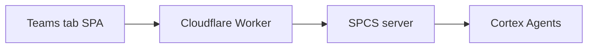
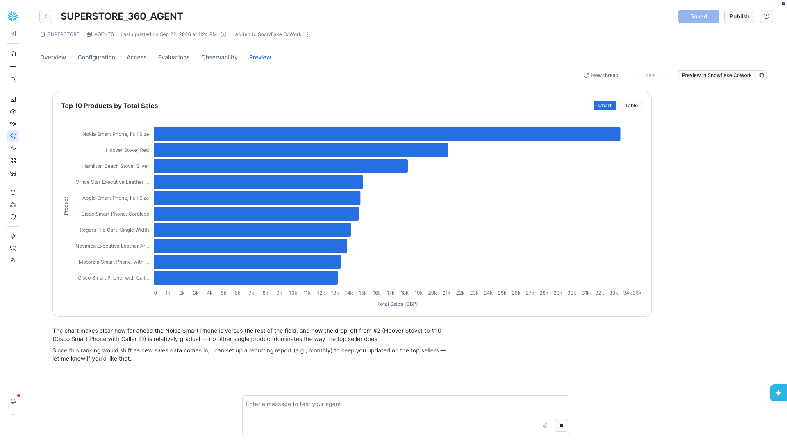

# Install guide

Operator guide for standing up Snowflake Agents Embed: Cortex agent chat embedded in Microsoft Teams, shipped as **Snowflake Agents for Teams (Unofficial)**.

**Complete this master guide first**, then follow [install-teams.md](install-teams.md).

This is the from-this-repo path (`snow app`, Wrangler, `az`). Teams has two installs:

- **Path A, standalone SPCS (the default).** Skip [§ 5](#5-native-app-path-only) and start at [install-teams.md § 2](install-teams.md#2-install-standalone-spcs).
- **Path B, Native App.** Use [§ 5](#5-native-app-path-only), then [install-teams.md Appendix B](install-teams.md#appendix-b-native-app-install-path-b). If the Native App is already published as a listing, skip the provider image push in § 5 and start from the Snowsight install.

To replace an existing Path B install, tear down first ([§ 6](#6-tear-down-semantics) plus the leftover `DROP` list in the Teams guide), then start again at [§ 5](#5-native-app-path-only). To replace a Path A install, use the leftover `DROP` list in the Teams guide, then start again there.

Ingress URL, Worker origin, and bot messaging endpoint look interchangeable and are not. The Teams guide lists the values that apply. Auth modes and token lifetime: [authentication-patterns.md](authentication-patterns.md).



## Contents

1. [What this is](#1-what-this-is)
2. [Which path](#2-which-path)
3. [Shared prerequisites](#3-shared-prerequisites)
4. [Shared conventions](#4-shared-conventions)
5. [Native App path only](#5-native-app-path-only)
6. [Tear down semantics](#6-tear-down-semantics)

---

## 1. What this is

Snowflake Agents Embed embeds Cortex agent chat in Microsoft Teams as a tab and a bot. A Hono service on Snowpark Container Services (SPCS) talks to Cortex. A Cloudflare Worker (or the self-hosted Node edge) serves the tab, exchanges tokens, and proxies `/api/*` to SPCS.

**Path B** is the Native App (`AGENTS_TEAMS_APP`, Streamlit / `CONFIG.*`) and uses [§ 5](#5-native-app-path-only). **Path A** is standalone: [`bootstrap-dev-spcs.sql`](../apps/teams/scripts/bootstrap-dev-spcs.sql), then [`create-bot.sh`](../apps/teams/scripts/create-bot.sh), [`deploy-spcs.sh`](../apps/teams/scripts/deploy-spcs.sh), and [`deploy-tab.sh`](../apps/teams/scripts/deploy-tab.sh). Path A does **not** install the application object. `deploy-spcs.sh` rolls the standalone `AGENTS_TEAMS_APP_DB.PUBLIC.AGENTS_TEAMS` service, not `AGENTS_TEAMS_APP.CONFIG.AGENTS_TEAMS`.

A Native App install does not use `apps/teams/scripts/bootstrap-dev-spcs.sql`. That script targets a standalone database. `apps/teams/scripts/deploy-spcs.sh` builds an image **and** rolls the standalone service; it is not the Native App install path. On Path A, `bootstrap-dev-spcs.sql` + `deploy-spcs.sh` **is** the install path.

If this account already has leftover standalone objects (the `AGENTS_TEAMS` service, `COWORK_COMPUTE_POOL`, account-level `COWORK_*_EAI`, `CORTEX_TEAMS_OAUTH`), tear them down before installing the Native App, or grant the application `USAGE` on an existing `COWORK_*_EAI` when Create Service asks for it. Leftover `DROP` lists are in the Teams guide.

Browsers never hold the Snowflake PAT, and the Teams tab holds only an opaque encrypted edge session (the user's Snowflake OAuth token stays in the edge). Still restrict each user's network policy to the egress ranges that call Snowflake (never an allow-all policy). The Teams edge attaches `SPCS_PAT` server-side. Teams also has `NETWORK_MODE=hybrid` and `privatelink` (preview, not yet validated); see [install-teams.md § 7](install-teams.md#7-private-connectivity-optional). Details: [authentication-patterns.md](authentication-patterns.md).

---

## 2. Which path

| Path | Guide | Service | Edge | Host UI |
| --- | --- | --- | --- | --- |
| A (default) | [install-teams.md § 2](install-teams.md#2-install-standalone-spcs) | Standalone `AGENTS_TEAMS` | Worker that serves `TAB_BASE_HOST` (SPA + `/token/exchange` + `/token/link` + `/api/*` proxy). Name from `EDGE_WORKER_NAME`, else legacy `PAGES_PROJECT`, else the `*.workers.dev` first label, else `agents-embed-teams`. Or the self-hosted Node edge | Teams tab + bot, sideloaded from `packages/teams-manifest` |
| B | [install-teams.md Appendix B](install-teams.md#appendix-b-native-app-install-path-b) | Native App `AGENTS_TEAMS_APP` | Same Worker | Same |

---

## 3. Shared prerequisites

### Tools

| Tool | Notes |
| --- | --- |
| Node 22+ | `npm install` from the repo root |
| Docker with buildx | Images must be `linux/amd64`. An arm64 image starts on SPCS and dies with `exec format error` (climbing `restartCount`, no useful logs) |
| Snowflake CLI (`snow`) | `brew install snowflake-cli` or see [Snowflake CLI](https://docs.snowflake.com/en/developer-guide/snowflake-cli/index). Authenticated to the account that will own the application package (or the standalone service). Pass the connection **after** the subcommand (`snow sql -c demo`, `snow app teardown -c demo`) or set `SNOWFLAKE_DEFAULT_CONNECTION_NAME`. [`scripts/native-app-release.sh`](../scripts/native-app-release.sh) uses the default connection only |

Wrangler and `az` are listed in the Teams guide.

Scripts under `apps/teams/scripts/` are not executable. Invoke them with `bash apps/teams/scripts/<script>.sh`. [`scripts/native-app-release.sh`](../scripts/native-app-release.sh) is committed executable, so `./scripts/native-app-release.sh teams v1` works.

### Accounts

- **Snowflake** with Cortex Agents enabled, plus a Programmatic Access Token scoped to a least-privilege role (not `ACCOUNTADMIN`). The PAT's **user-level** network policy must allow SPCS egress and, for the Cloudflare hop, Cloudflare egress. `privatelink` restricts the ingress-PAT user to your private-endpoint IDs instead.
- **Microsoft 365 / Entra tenant** and a **Cloudflare account** for the edge Worker (unless you self-host the Node edge). Details are in the Teams guide.

### Repo

```bash
npm install
# Copy the template, then fill in real values. Never commit a .env file.
cp apps/teams/.env.example apps/teams/.env
```

Every variable is documented in [`apps/teams/.env.example`](../apps/teams/.env.example). Do not copy a second list here. Write `KEY=value` with no spaces around `=`. Keep a single `DEFAULT_AGENT_FQN`.

Minimum to get through a first install:

- Snowflake: `SNOWFLAKE_ACCOUNT`, `SNOWFLAKE_USER`, `SNOWFLAKE_PAT`

A leftover repo-root `.env` is no longer read; use `apps/teams/.env`.

### Cortex agent

You need at least one persisted agent (`DATABASE.SCHEMA.AGENT_NAME`). Any existing agent is enough.



> Snowsight → AI & ML → Agents (or the agent's object page). Copy the fully-qualified name you will use as `DEFAULT_AGENT_FQN`.

---

## 4. Shared conventions

Setup scripts write `SNOWFLAKE_ACCOUNT` as the hyphenated org-account (`<your-account>`). The underscore form ENOTFOUNDs; the regional locator resolves inside SPCS but routes over a private `10.x` address (`390422`). The egress network rule allowlists all three hostname forms. `CREATE OR REPLACE NETWORK RULE` mints a new object id, so setup also `ALTER`s the EAI to rebind that rule.

On Path B, manifest v2 still leaves that EAI inert until a consumer with `MANAGE APPLICATION SPECIFICATIONS` approves the pending `EXTERNAL_ACCESS` app specification. Without approval the hyphenated Cortex host ENOTFOUNDs even though the service lists the EAI. Recreating the service (not `CREATE IF NOT EXISTS`) is required after approval or a rule/EAI change. The Teams guide has the `SHOW PENDING SPECIFICATIONS` / `ALTER APPLICATION … APPROVE` SQL. Path A creates an account-level EAI in bootstrap SQL instead; there is no app specification to approve.

A consumer role cannot `ALTER` a secret owned by the application. On Path B the Streamlit wizard and `CALL CONFIG.SET_SECRET(...)` are the write path. On Path A, `ALTER SECRET` is the write path (`apps/teams/scripts/fill-dev-secrets.sh` generates the SQL from `.env`).

The Native App image must exist at the path `manifest.yml` declares **including the tag**. Omitting `:latest` fails `snow app version create` with `397012: Image ... not found`. Path B uses `na_image_repo`; Path A uses `IMAGE_REPO`.

Common Native App failures (full tables are in the Teams guide):

| Symptom | Likely cause |
| --- | --- |
| Service never READY / climbing `restartCount` | arm64 image. Rebuild `--platform linux/amd64` |
| `397012: Image … not found` | `:latest` is missing from `na_image_repo`. Push to the manifest path, not `IMAGE_REPO` |
| Create Service: application must have `USAGE` on `AGENTS_*_EAI` | An account-level integration of that name already exists (including a leftover `COWORK_*_EAI`). `GRANT USAGE ON INTEGRATION … TO APPLICATION …` and retry |
| Server logs `ENOTFOUND` for `*.snowflakecomputing.com` | The `EXTERNAL_ACCESS` app specification is pending. Approve it, then recreate the service |
| `093118`: `CREATE INTEGRATION` cannot be granted | That privilege is not on the manifest. Create the security integration as `ACCOUNTADMIN`, then `GRANT MODIFY` |
| `Unknown function SYSTEM$GET_SECRET_STRING` | The installed app version still reads secrets that way. Upgrade, then `SET_SECRET` |
| `snow: No such option: -c` | Put `-c` after the subcommand (`snow sql -c demo`), or set `SNOWFLAKE_DEFAULT_CONNECTION_NAME` |

---

## 5. Native App path only

This section is Path B only. Standalone installs (Path A) skip it and continue at [install-teams.md § 2](install-teams.md#2-install-standalone-spcs) after [§ 3](#3-shared-prerequisites) and [§ 4](#4-shared-conventions).

Two routes. Use **Provider (this repo)** when you are building the application package yourself. Use **Consumer (listing)** when the package is already published.

### Provider path (this repo)

1. **Create the provider image repository** (once per account) in `AGENTS_TEAMS_APP_DB.PUBLIC.NA_IMAGE_REPO`. Use the `repository_url` for `NA_IMAGE_REPO` (not `IMAGE_REPO`) as the Docker registry prefix.
2. **Build and push** `linux/amd64` `:latest` to the path `manifest.yml` declares.
3. **Register a version and create the application object.** [`scripts/native-app-release.sh`](../scripts/native-app-release.sh) is `snow app deploy` → `snow app version create --force` → `snow app run`. It uses the CLI default connection (`SNOWFLAKE_DEFAULT_CONNECTION_NAME` if you need to pin one). Passing `v1` again overwrites that version.

   ```bash
   ./scripts/native-app-release.sh teams v1
   ```

   The script is `--no-interactive`: it does not grant account privileges. `snow app run` may print reference-callback warnings; the procedures exist in `setup.sql` and the install can continue.
4. **Grant account privileges**, then application roles (`APP_ADMIN` to the installer, `APP_PUBLIC` to ordinary users). `APP_ADMIN` is required to set secrets and create/roll the SPCS service.

Concrete database names, Docker tags, grant SQL, and screenshots are in [install-teams.md Appendix B](install-teams.md#appendix-b-native-app-install-path-b).

### Publish the listing (provider, for another account)

Publish the **application package** (`AGENTS_TEAMS_APP_PACKAGE`), not the provider's installed application object. Same-account listing install is not a valid test. Names and SQL: [install-teams.md](install-teams.md#publish-the-listing-provider-for-another-account).

1. From `apps/teams/native-app`, point the default release directive at the version: `snow app publish --version v1 --patch 0 --no-interactive`.
2. If the consumer is in another organization: `ALTER APPLICATION PACKAGE … SET DISTRIBUTION = EXTERNAL` and wait for the security scan to pass.
3. Marketplace → Provider Studio → Create Listing → Only specified consumers → attach the package → add `ORGNAME.ACCOUNTNAME` → Publish. Or `CREATE EXTERNAL LISTING … APPLICATION PACKAGE …` as ACCOUNTADMIN.

### Consumer path (published listing)

In the consumer account: Catalog → Apps → Recently shared with you → Get. Accept the same privilege grants, name the app to match the Teams guide SQL, then run the application-role SQL there against a **consumer-side** PAT user. Continue at [install-teams.md Appendix B](install-teams.md#appendix-b-native-app-install-path-b) (Streamlit). Path A never uses a listing.

---

## 6. Tear down semantics

This section is Native App teardown (`snow app teardown`). Path A has no application package; drop its standalone objects from the leftover list in the Teams guide. Do not run `snow app teardown` for Path A.

Run from the Native App project directory. `--cascade` drops app-owned compute pools and integrations; `--force` drops a package that already has versions. The application **and** the application package are removed (installed versions are gone). Provider image-repo databases are not dropped.

```bash
cd apps/teams/native-app
snow app teardown --cascade --force --no-interactive
```

`--force` does not detach a Marketplace listing. If `DROP APPLICATION PACKAGE` fails after the application is gone, unpublish and drop the listing first (`ALTER LISTING … UNPUBLISH` / `DROP LISTING`), then `DROP APPLICATION PACKAGE`. A leftover package does not block Path A.

Then drop leftovers the CLI does not own — the Teams guide lists them. Keep the provider `AGENTS_TEAMS_APP_DB` and `NA_IMAGE_REPO` so the next [§ 5](#5-native-app-path-only) push has a registry. Keep Cortex agents and `AGENTS_*_USER` roles. Prior installs may still have `COWORK_*` leftovers.

Reinstall from [§ 5](#5-native-app-path-only), then the Teams guide.
