# Teams install guide

Complete the [master install guide](install-guide.md) first.

Operator path for Snowflake Agents for Teams (Unofficial): SPCS server, the edge Cloudflare Worker (the Worker that owns `TAB_BASE_HOST`), Teams tab + bot. This guide installs the standalone SPCS service (**Path A**; the Native App is Path B). Packaging the Native App for distribution, or installing a published listing? Use [Appendix B](#appendix-b-native-app-install-path-b) instead.

The Teams tab and the edge Worker share one origin, so the Single Page Application (SPA) stays on relative `/api/*` and the Worker attaches `SPCS_PAT` and `SPCS_BASE` server-side. See [`packages/tab/.env.production`](../packages/tab/.env.production) and [`packages/teams-edge/src/core/api-proxy.ts`](../packages/teams-edge/src/core/api-proxy.ts). Auth modes and token lifetime: [authentication-patterns.md](authentication-patterns.md).

Already on a `*.pages.dev` host from an earlier install? It keeps working; move to a Worker with [§ 6](#6-pages-to-worker-cutover). Need Snowflake to stay off the public internet? The default install is `NETWORK_MODE=public`; [§ 7](#7-private-connectivity-optional) adds `hybrid` and `privatelink`.

## Contents

1. [Extra prerequisites](#1-extra-prerequisites)
2. [Install (standalone SPCS)](#2-install-standalone-spcs)
3. [Teams app](#3-teams-app)
4. [Verify and common failures](#4-verify-and-common-failures)
5. [Tear down](#5-tear-down)
6. [Pages to Worker cutover](#6-pages-to-worker-cutover) (existing `*.pages.dev` installs)
7. [Private connectivity (optional)](#7-private-connectivity-optional) (`hybrid` and `privatelink` network modes)

Appendix (Native App only): [Appendix B. Native App install (Path B)](#appendix-b-native-app-install-path-b)

---

## 1. Extra prerequisites

| Tool               | Notes                                                                                                                                                                        |
| ------------------ | ---------------------------------------------------------------------------------------------------------------------------------------------------------------------------- |
| Wrangler           | `npx wrangler login` once. Invoke Wrangler from [`packages/teams-edge`](../packages/teams-edge). Root-level `npx wrangler` is not the supported entry                   |
| Azure CLI (`az`) | Used by `create-bot.sh`, `set-bot-endpoint.sh` and `rotate-entra-secret.sh`. Always`az login --tenant "$AZURE_TENANT_ID"` from `apps/teams/.env` — do not use another tenant’s subscription |

- **Cloudflare** account for the edge Worker. If `TAB_BASE_HOST` will be a `*.workers.dev` host, register the account's workers.dev subdomain once (dashboard: Workers & Pages); a custom domain needs a zone on the same account ([B.4](#b4-cloudflare-worker)).
- **Microsoft tenant** in `apps/teams/.env` `AZURE_TENANT_ID`. Every Azure CLI step (bot creation, bot endpoint, Entra) uses that value.
- The PAT’s **user-level** network policy must allow SPCS egress and Cloudflare egress (`public` and `hybrid`; `privatelink` uses private-endpoint IDs instead, [§ 7](#7-private-connectivity-optional)).

Minimum `apps/teams/.env` for Teams / Cloudflare Worker:

- `AZURE_TENANT_ID`, `BOT_APP_ID`, `BOT_APP_SECRET`, `OBO_CLIENT_ID`, `OBO_CLIENT_SECRET`, `SNOWFLAKE_SCOPE`, `TEAMS_APP_ID`
- `TAB_BASE_HOST` / `TAB_BASE_URL`: the edge origin already on the Entra app: the Worker's custom domain (recommended) or `<worker>.<subdomain>.workers.dev`. `zip.sh`, `deploy-tab.sh`, `set-edge-secrets.sh`, and `set-bot-endpoint.sh` all read it.
- `EDGE_WORKER_NAME` (optional): the Worker to deploy to. Blank falls back to a legacy `PAGES_PROJECT`, then the first label of a `*.workers.dev` `TAB_BASE_HOST`, then `agents-embed-teams`.
- `SNOWFLAKE_ENTRA_APP_ID` (Snowflake OAuth resource app), `DEFAULT_AGENT_FQN`, `APPS_API_HOST`
- `SNOWFLAKE_USER` / `SNOWFLAKE_PAT`: the service user (`AGENTS_TEAMS_SVC`) and its PAT. That PAT becomes the Worker secret `SPCS_PAT`.
- `SPCS_INGRESS_HOST` / `SPCS_BASE`: fill these in after the service is READY (`SHOW ENDPOINTS`). `set-edge-secrets.sh` and `zip.sh` need them. In `privatelink`, `SPCS_BASE` is required and is the `privatelink_ingress_url` ([§ 7](#7-private-connectivity-optional)).
- Teams Snowflake secret (`APPS_API_HOST`): written with `ALTER SECRET` on `AGENTS_TEAMS_APP_DB.CONFIG.APPS_API_HOST` (install step 3).

`APPS_API_HOST` is `apps-api.c1.<region>.<cloud>.app.snowflake.com` (for example `apps-api.c1.eu-west-2.aws.app.snowflake.com`). There's no SQL function that returns it directly — run `SELECT CURRENT_REGION();` (e.g. `AWS_EU_WEST_2`), lowercase the part before the first `_` as `<cloud>` and the rest with `_` → `-` as `<region>`, then substitute into the template above. `c1` is a deployment "cell" and is correct for the vast majority of accounts; if the security integration is configured but the bot can't resolve/call it, confirm the real value in Snowsight's browser DevTools → Network tab (any Native Apps/Marketplace page) by finding the host of the `apps-api...` requests Snowsight itself makes. `SNOWFLAKE_SCOPE` must be lowercase `api://<id>/session:role-any`.

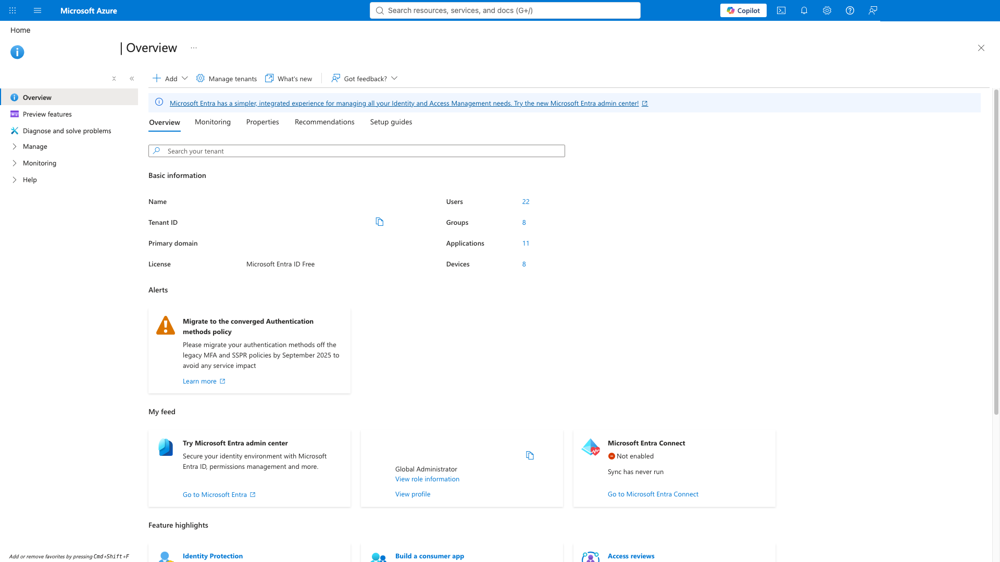

> Microsoft Entra ID → Overview. Capture Tenant ID.

---

## 2. Install (standalone SPCS)

These scripts roll the standalone service `AGENTS_TEAMS_APP_DB.PUBLIC.AGENTS_TEAMS`. Already installed as a Native App in this account? Remove it first ([B.6](#b6-tear-down-path-b)): its app-owned `AGENTS_TEAMS_EAI` blocks the bootstrap ([I9](#i9-bootstrap-003001--modify-on-agents_teams_eai), [I10](#i10-bootstrap-093154-copy-current-grants)).

**1. Bootstrap** account objects with [`apps/teams/scripts/bootstrap-dev-spcs.sql`](../apps/teams/scripts/bootstrap-dev-spcs.sql) (ACCOUNTADMIN section): database, `IMAGE_REPO`, compute pool, Entra+Cortex EAI, empty secrets, placeholder `CORTEX_TEAMS_OAUTH`, role `AGENTS_TEAMS_USER`, service user `AGENTS_TEAMS_SVC`.

```bash
snow sql -f apps/teams/scripts/bootstrap-dev-spcs.sql
```

**2. Entra apps.** Create the bot, tab SSO/OBO and Snowflake resource app registrations in `AZURE_TENANT_ID` with Snowsight wizard tabs 1-6, or by hand in Entra, and put their IDs and secrets in `apps/teams/.env` (`BOT_APP_ID`, `BOT_APP_SECRET`, `OBO_CLIENT_ID`, `OBO_CLIENT_SECRET`, `SNOWFLAKE_ENTRA_APP_ID`). Set `SNOWFLAKE_SCOPE` to `api://<SNOWFLAKE_ENTRA_APP_ID>/session:role-any` (lowercase `session`; never the OBO or bot app id). Use `az login --tenant "$AZURE_TENANT_ID"` for any Azure CLI step. The Azure Bot resource itself is created in [§ 3](#3-teams-app) with `create-bot.sh`.

**3. Fill secrets and configure OAuth** from `apps/teams/.env` (no `CONFIG.SET_SECRET`):

[`apps/teams/scripts/fill-dev-secrets.sh`](../apps/teams/scripts/fill-dev-secrets.sh) applies `apps/teams/.env` into Snowflake (`snow sql --silent` on a mktemp file that is deleted afterwards). Use `--keep` / `-o` only if you need to review the SQL; that file holds secrets, so delete it after applying. `SNOWFLAKE_SCOPE` is `api://<SNOWFLAKE_ENTRA_APP_ID>/session:role-any`, or `.../session:role:<SNOWFLAKE_OAUTH_ROLE>` with `ANY_ROLE_MODE = 'DISABLE'` when `SNOWFLAKE_OAUTH_ROLE` is set in `apps/teams/.env`. `ALLOWED_ORIGINS` is `https://<TAB_BASE_HOST>`. `AGENT_ALLOW_LIST` comes from `apps/teams/.env`, or `[]` if unset.

```bash
bash apps/teams/scripts/fill-dev-secrets.sh
snow sql --silent --enable-templating none -f temp/alter-teams-secrets.sql
```

The generated file is this SQL with the placeholders filled:

```sql
ALTER SECRET AGENTS_TEAMS_APP_DB.CONFIG.BOT_APP_ID SET SECRET_STRING = '<BOT_APP_ID>';
ALTER SECRET AGENTS_TEAMS_APP_DB.CONFIG.BOT_APP_SECRET SET SECRET_STRING = '<BOT_APP_SECRET>';
ALTER SECRET AGENTS_TEAMS_APP_DB.CONFIG.OBO_CLIENT_ID SET SECRET_STRING = '<OBO_CLIENT_ID>';
ALTER SECRET AGENTS_TEAMS_APP_DB.CONFIG.OBO_CLIENT_SECRET SET SECRET_STRING = '<OBO_CLIENT_SECRET>';
ALTER SECRET AGENTS_TEAMS_APP_DB.CONFIG.DEFAULT_AGENT_FQN SET SECRET_STRING = '<DEFAULT_AGENT_FQN>';
ALTER SECRET AGENTS_TEAMS_APP_DB.CONFIG.TEAMS_APP_ID SET SECRET_STRING = '<TEAMS_APP_ID>';
ALTER SECRET AGENTS_TEAMS_APP_DB.CONFIG.AGENT_ALLOW_LIST SET SECRET_STRING = '[]';
ALTER SECRET AGENTS_TEAMS_APP_DB.CONFIG.AZURE_TENANT_ID SET SECRET_STRING = '<AZURE_TENANT_ID>';
ALTER SECRET AGENTS_TEAMS_APP_DB.CONFIG.SNOWFLAKE_SCOPE SET SECRET_STRING = 'api://<SNOWFLAKE_ENTRA_APP_ID>/session:role-any';
ALTER SECRET AGENTS_TEAMS_APP_DB.CONFIG.APPS_API_HOST SET SECRET_STRING = 'apps-api.c1.<region>.<cloud>.app.snowflake.com';
ALTER SECRET AGENTS_TEAMS_APP_DB.CONFIG.ALLOWED_ORIGINS SET SECRET_STRING = 'https://<TAB_BASE_HOST>';

ALTER SECURITY INTEGRATION CORTEX_TEAMS_OAUTH SET
  EXTERNAL_OAUTH_ISSUER = 'https://login.microsoftonline.com/<AZURE_TENANT_ID>/v2.0'
  EXTERNAL_OAUTH_JWS_KEYS_URL = 'https://login.microsoftonline.com/<AZURE_TENANT_ID>/discovery/v2.0/keys'
  EXTERNAL_OAUTH_AUDIENCE_LIST = ('api://<SNOWFLAKE_ENTRA_APP_ID>', '<SNOWFLAKE_ENTRA_APP_ID>')
  EXTERNAL_OAUTH_TOKEN_USER_MAPPING_CLAIM = ('upn')
  EXTERNAL_OAUTH_ANY_ROLE_MODE = 'ENABLE';
```

Mint a PAT on `AGENTS_TEAMS_SVC` if you do not already have one (printed once). That value is the Worker secret `SPCS_PAT` and `apps/teams/.env` `SNOWFLAKE_PAT`.

**4. Build and push** `linux/amd64` `:latest` to **`IMAGE_REPO`** (not `NA_IMAGE_REPO`):

Docker Desktop must be running first, or the build fails with `failed to connect to the docker API at unix:///Users/<you>/.docker/run/docker.sock`. Start it and wait until `docker info` succeeds:

```bash
open -a Docker          # macOS; on Windows/Linux start Docker Desktop from the app menu
docker info >/dev/null  # re-run until it exits 0 (the daemon can take ~30s to start)
```

If it still cannot connect, check `docker context ls` — the active context should be the Docker Desktop one.

[`apps/teams/scripts/push-dev-image.sh`](../apps/teams/scripts/push-dev-image.sh) runs `SHOW IMAGE REPOSITORIES IN SCHEMA AGENTS_TEAMS_APP_DB.PUBLIC`, takes the `repository_url` for `IMAGE_REPO`, then login / build / tag / push. Do not paste `<IMAGE_REPO>` into the shell — zsh treats `<…>` as a redirect. This script does **not** roll a service; that is step 6 (`deploy-spcs.sh`) after the service exists.

```bash
bash apps/teams/scripts/push-dev-image.sh
```

To run the steps by hand instead, first get your `IMAGE_REPO` value — the `repository_url` of the `IMAGE_REPO` row:

```bash
snow sql -q "SHOW IMAGE REPOSITORIES IN SCHEMA AGENTS_TEAMS_APP_DB.PUBLIC"
```

Copy the `repository_url` column from the row whose `name` is `IMAGE_REPO` (not `NA_IMAGE_REPO`). It looks like:

```
<org>-<account>.registry.snowflakecomputing.com/agents_teams_app_db/public/image_repo
```

Use it exactly as shown: no `https://`, no trailing slash, and do not add `/agents-teams-app` (the commands below append that). Then substitute it for `<IMAGE_REPO>` — paste the real value, not the angle-bracket placeholder:

```bash
snow spcs image-registry login

docker build --platform linux/amd64 -f apps/teams/Dockerfile -t agents-teams-app:latest .
docker tag agents-teams-app:latest <IMAGE_REPO>/agents-teams-app:latest
docker push <IMAGE_REPO>/agents-teams-app:latest
```

**5. Create the service** as **SYSADMIN** (not ACCOUNTADMIN). The GRANT statements below only work after this exists. In [`apps/teams/scripts/create-dev-service.sql`](../apps/teams/scripts/create-dev-service.sql) replace `REPLACE_WITH_TAB_BASE_HOST` with `TAB_BASE_HOST` (no scheme), then:

```bash
snow sql -f apps/teams/scripts/create-dev-service.sql
```

Installing in `hybrid` or `privatelink`? Apply the network SQL and edit the spec first ([§ 7.3](#73-path-a-standalone-spcs)), or every user call fails with `390422`.

That file also grants `ALL_ENDPOINTS_USAGE` and runs `SHOW ENDPOINTS`. zsh treats `!` as history expansion — if you paste the GRANTs yourself, use single quotes, not `snow sql -q "…!ALL_ENDPOINTS_USAGE"`.

Copy `ingress_url` into `apps/teams/.env` `SPCS_INGRESS_HOST` (no scheme) and `SPCS_BASE` (`https://…`) before [§ 3](#3-teams-app) `zip.sh`. In `privatelink`, `SPCS_BASE` is `https://` plus `privatelink_ingress_url` instead. Leaving the `.env.example` placeholder here makes every `/api/*` call 500 later ([I17](#i17-every-api-call-is-500-cloudflare-1101)).

**6.** [`apps/teams/scripts/deploy-spcs.sh`](../apps/teams/scripts/deploy-spcs.sh) — use the [`teams-deploy-spcs`](../.claude/skills/teams-deploy-spcs/SKILL.md) skill. Builds, pushes, and rolls **standalone** `AGENTS_TEAMS_APP_DB.PUBLIC.AGENTS_TEAMS`. The service must already exist (step 5).

```bash
bash apps/teams/scripts/deploy-spcs.sh
```

**6a. Add the `upn` optional claim to the Snowflake resource app.** The resource app issues v2 tokens, which carry no `upn` unless requested. Without it Snowflake rejects the token (`Invalid OAuth access token`) and the tab shows `agent_forbidden` ([T9](#t9-you-do-not-have-access-to-that-resource)). Check, then fix if needed (this edits tenant config):

```bash
az ad app show --id "$SNOWFLAKE_ENTRA_APP_ID" \
  --query "{v:api.requestedAccessTokenVersion, c:optionalClaims.accessToken[].name}"   # expect 2 and ["upn"]

az ad app update --id "$SNOWFLAKE_ENTRA_APP_ID" \
  --optional-claims '{"accessToken":[{"name":"upn","essential":false}]}'
```

Only new tokens carry the claim; reload the tab afterwards.

**7. Give each Teams user a Snowflake identity and the agent's grants.** The per-user token is checked against `CORTEX_TEAMS_OAUTH`, which maps the Entra `upn` claim (only; `email` and `preferred_username` are user-editable and not accepted) to a Snowflake `login_name`. No matching user means `agent_forbidden` ([T9](#t9-you-do-not-have-access-to-that-resource)). A user without the agent's grants gets a chat that works but tools that are "not available" ([T10](#t10-the-agent-says-a-tool-is-unavailable)). Run this once per Entra user, as `ACCOUNTADMIN`:

```sql
SELECT CURRENT_ACCOUNT_NAME();   -- must be the account that hosts the SPCS ingress

CREATE USER IF NOT EXISTS <snowflake_user>
  LOGIN_NAME = '<entra-upn>'                 -- exactly the Entra UPN
  DEFAULT_ROLE = AGENTS_TEAMS_USER
  DEFAULT_WAREHOUSE = <warehouse>;           -- Cortex Agents need a default warehouse with USAGE
GRANT ROLE AGENTS_TEAMS_USER TO USER <snowflake_user>;

-- Reach the agent, and use every tool it declares.
GRANT USAGE ON DATABASE <db> TO ROLE AGENTS_TEAMS_USER;
GRANT USAGE ON SCHEMA <db>.<schema> TO ROLE AGENTS_TEAMS_USER;
GRANT USAGE ON AGENT <db>.<schema>.<agent> TO ROLE AGENTS_TEAMS_USER;
```

Cortex Agents resolve permissions from the user's **default** role, so the role above must be `DEFAULT_ROLE`. The tool grants depend on the agent: semantic view and the tables it reads, Cortex Search services, functions, and the warehouse. Grant the Teams role each object the agent uses.

**8.** Edge secrets, then the tab. [`apps/teams/scripts/set-edge-secrets.sh`](../apps/teams/scripts/set-edge-secrets.sh) puts `AZURE_TENANT_ID`, `OBO_*`, `SNOWFLAKE_SCOPE` (`api://<SNOWFLAKE_ENTRA_APP_ID>/session:role-any`), `ENTRA_AUDIENCE_URI` (`api://<TAB_BASE_HOST>/<OBO_CLIENT_ID>`), `SPCS_BASE`, `SPCS_PAT`, `EDGE_SESSION_SECRET`, `BOT_LINK_SECRET` and `BOT_APP_ID` on the Worker in one `wrangler secret bulk`. It does not deploy. [`deploy-tab.sh`](../apps/teams/scripts/deploy-tab.sh) builds the tab and runs `wrangler deploy` from `packages/teams-edge`; it does **not** put secrets, so run it after every secret change. The first `wrangler deploy` creates the Worker. (`set-pages-secrets.sh` still works: it is a shim that runs `set-edge-secrets.sh`.) Missing `AZURE_TENANT_ID` / `OBO_*` / `SNOWFLAKE_SCOPE` is `POST /token/exchange` 500 `Edge misconfigured`. A Teams SSO token whose `aud` is the App ID URI (not the GUID) is `401 ERR_JWT_CLAIM_VALIDATION_FAILED` until `ENTRA_AUDIENCE_URI` is set. Continue at [§ 3](#3-teams-app).

**Security settings:**

- `EDGE_SESSION_SECRET` — HMAC key for the tab edge session; `set-edge-secrets.sh` generates it (saving it to `apps/teams/.env`) and stores it. Without it `/token/exchange` returns 500 and `/api/*` returns 401.
- `BOT_LINK_SECRET` / `BOT_APP_ID` + KV namespace `BOT_LINKS` — per-user identity for the bot in chat (`AUTH_MODE=production`). On the first message the bot replies with a sign-in card; the user opens the tab once (Teams SSO), and the edge stores their encrypted Entra refresh token in KV (90-day TTL, rotated on use) and injects a fresh Snowflake token on each bot turn. `set-edge-secrets.sh` generates `BOT_LINK_SECRET` and pushes `BOT_APP_ID`. The namespace id lives in `apps/teams/.env` as `BOT_LINKS_KV_ID`, not in the repo: [`packages/teams-edge/wrangler.jsonc`](../packages/teams-edge/wrangler.jsonc) holds only a `REPLACE_WITH_KV_NAMESPACE_ID` placeholder, and `deploy-tab.sh` renders a gitignored `wrangler.local.jsonc` from it (both `kv_namespaces` entries, since Wrangler envs do not inherit bindings) and deploys that. Without the key the script refuses to deploy; `deploy-tab.sh --create` finds an existing `BOT_LINKS` namespace or creates one and writes the id to `.env`. If `BOT_LINKS_KV_ID` is not on the logged-in account the deploy stops. By hand: `cd packages/teams-edge && npx wrangler kv namespace create BOT_LINKS`, then put the id in `.env`. If the deploy token cannot read KV (Workers KV Storage: Read), the ownership check warns and skips. The OBO app must be able to issue `offline_access` (else `/token/link` returns 502 `no_refresh_token`). Rotating `BOT_LINK_SECRET` signs every bot user out; users can also send `sign out`. If any of the three is unset the bot path keeps its old behavior (shared PAT in `local-pat` only).
- `SHARE_SIGNING_SECRET` — the bot only unfurls `?s=` share links that carry a valid `&sig=` HMAC. URL builders must sign server-side; unsigned links produce no card.
- `ENTRA_ALLOWED_CLIENT_IDS` / `ENTRA_REQUIRED_SCOPE` — Entra `azp`/`appid` allow-list (defaults to the two Teams clients) and required `scp` (default `access_as_user`).
- `BOT_DEBUG_LOG_QUERIES=1` — debug only; otherwise user queries and agent FQNs are never logged.
- The service PAT must be minted with `ROLE_RESTRICTION`, and a recreated service changes the ingress host, so re-run `set-edge-secrets.sh`, `deploy-tab.sh` and the manifest step.
- **Known feature gap:** bot-channel per-user Snowflake identity (Bot Framework SSO) is not implemented. In `production` the bot fails closed with a single error message; use the tab for chat.
- **Snowflake token stays at the edge (F3):** `/token/exchange` returns only `{ edgeSession, expiresIn }`. The edge session is an encrypted JWE (key derived from `EDGE_SESSION_SECRET`) that carries the Snowflake token; the `/api/*` proxy decrypts it per request and sets `X-User-Access-Token`. The browser never sees the Snowflake token, so XSS or extension access cannot lift it. Rotating `EDGE_SESSION_SECRET` (or redeploying this change) invalidates existing sessions; users just re-sign-in.
- **Fixed role instead of role-any (F2):** set `SNOWFLAKE_OAUTH_ROLE=<ROLE>` in `apps/teams/.env` before running `fill-dev-secrets.sh` / `set-edge-secrets.sh`. The scope becomes `api://<SNOWFLAKE_ENTRA_APP_ID>/session:role:<ROLE>` (the Entra Snowflake app must expose it) and the integration gets `EXTERNAL_OAUTH_ANY_ROLE_MODE = 'DISABLE'`. On an installed native app, update the `SNOWFLAKE_SCOPE` secret and the Worker secret first (`set-edge-secrets.sh`, then `deploy-tab.sh`), then `CALL AGENTS_TEAMS_APP.CONFIG.SET_ANY_ROLE_MODE('DISABLE')`. Left blank, the install default stays role-any, mitigated by `upn`-only mapping, `BLOCKED_ROLES_LIST` and restricted per-user network policies.

```bash
bash apps/teams/scripts/set-edge-secrets.sh
bash apps/teams/scripts/deploy-tab.sh            # privatelink: deploy-tab.sh --privatelink (§ 7)
```

---

## 3. Teams app

1. **Azure Bot messaging endpoint** (needs an Azure Bot Service in `AZURE_TENANT_ID`; create it with `bash apps/teams/scripts/create-bot.sh --apply` if none exists. The personal tab works without it, but adding the app to a channel or chat fails with [`BulkMembershipRequest`](#i20-adding-the-app-to-a-channel-badrequest--bulkmembershiprequest) without a bot): Settings → Configuration → Messaging endpoint:

   `https://<TAB_BASE_HOST>/api/bot/messages`

   Never the SPCS ingress. The edge Worker authenticates to SPCS; the bot cannot. In `privatelink` the same public edge host stays the messaging endpoint: the Worker verifies the Bot Connector JWT itself before relaying to the private ingress.

   [`apps/teams/scripts/set-bot-endpoint.sh`](../apps/teams/scripts/set-bot-endpoint.sh) injects `TAB_BASE_HOST` from `apps/teams/.env` and finds the Bot Service in `apps/teams/.env` `AZURE_TENANT_ID` (`az login --tenant "$AZURE_TENANT_ID"`). It does not use another tenant’s subscription. Override with `RESOURCE_GROUP` / `BOT_NAME` if that tenant has more than one bot. If none exists, create one first:

   ```bash
   bash apps/teams/scripts/create-bot.sh            # dry run: prints the az commands
   bash apps/teams/scripts/create-bot.sh --apply    # resource group, bot (F0), Teams channel
   ```

   It reads `BOT_APP_ID`, `AZURE_TENANT_ID` and `TAB_BASE_HOST` from `.env`, derives the bot's app type (single or multi tenant) from the Entra app's sign-in audience, and never changes an existing bot: if the endpoint differs it points you at `set-bot-endpoint.sh`.

   ```bash
   bash apps/teams/scripts/set-bot-endpoint.sh
   ```

   It is this command with the placeholders filled:

   ```bash
   az resource update -g <resource-group> -n <bot-name> \
     --resource-type Microsoft.BotService/botServices \
     --set properties.endpoint="https://<TAB_BASE_HOST>/api/bot/messages"
   ```
2. **Zip the manifest:**

   ```bash
   bash packages/teams-manifest/zip.sh
   ```

   Sideload: Teams → Apps → Manage your apps → Upload an app → `packages/teams-manifest/agents-teams-app.zip`. Or publish via Teams Admin Center. Teams rejects `name.short` longer than 30 characters (`UnableToParseTeamsAppManifest`); the template’s short name is `Snowflake Agent (Unofficial)`.

   No Azure Bot yet? Run `bash packages/teams-manifest/zip.sh --tab-only` and upload `agents-teams-app-tab-only.zip` instead. It drops the bot, message extension and channel tab, so it works as a personal app only. Create the bot with `create-bot.sh` and upload the full zip (bumping the manifest version) to use channels and chat.

   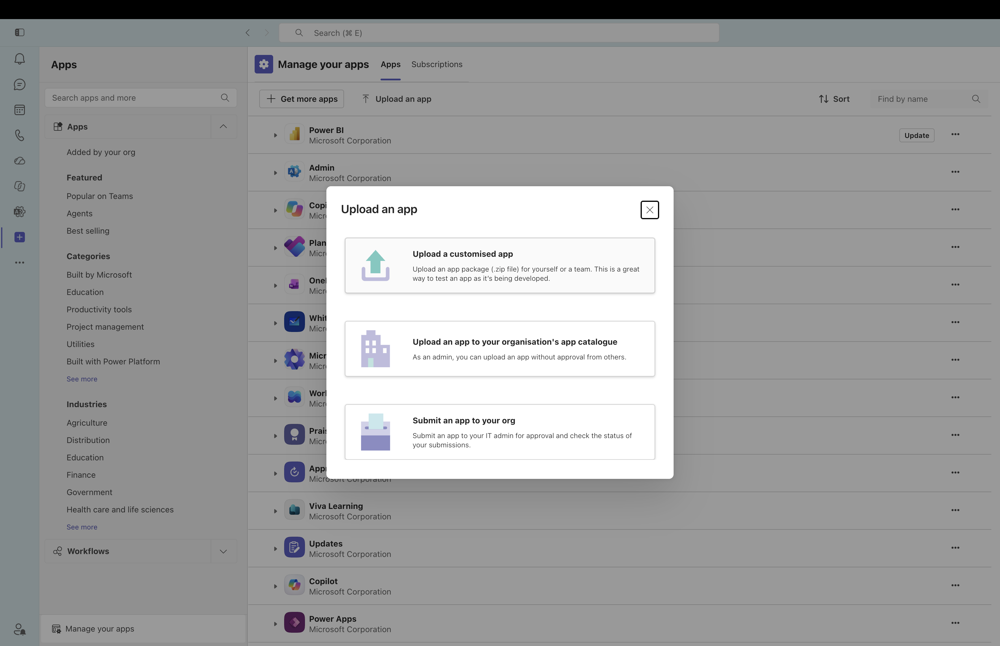

   Choose **Upload a customised app** and select the zip. Teams then shows the app details page; select **Add**.

   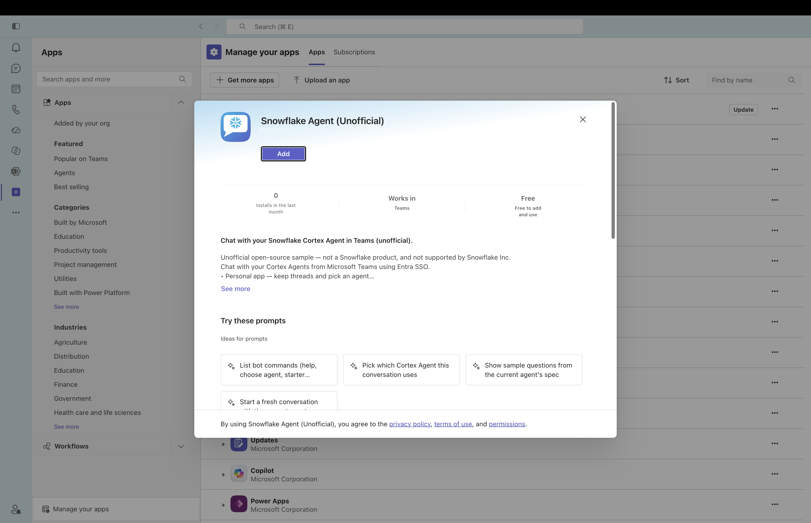

   `zip.sh` runs `generate.mjs`, which writes a gitignored `manifest.json` from `apps/teams/.env` (`TEAMS_APP_ID`, `BOT_APP_ID`, `TAB_BASE_HOST`, `SPCS_INGRESS_HOST`). Update `SPCS_INGRESS_HOST` first (`SHOW ENDPOINTS IN SERVICE AGENTS_TEAMS_APP_DB.PUBLIC.AGENTS_TEAMS`). A leftover hostname from a previous install will not match the new ingress. With `NETWORK_MODE=privatelink` in `apps/teams/.env`, `generate.mjs` leaves `SPCS_INGRESS_HOST` out of `validDomains` (Teams never loads the private ingress) and does not need it.
3. Open the **personal tab**. Teams SSO → Entra JWT → edge `/token/exchange` (OBO) → Snowflake-audience token → same-origin `/api/*`. Hard-refresh Teams (Cmd+Shift+R) after a sideload.

---

## 4. Verify and common failures

Open the personal tab, complete SSO, confirm the agent list loads, ask a question, confirm the answer **streams** (thinking steps / tokens arriving over time), not a single dump after 20s.

Edge probe without a session (expects `401 {"error":"Unauthorized"}`):

```bash
curl -sS -w '\n%{http_code}\n' -H "Origin: https://<TAB_BASE_HOST>" \
  https://<TAB_BASE_HOST>/api/threads
```

This probe stops at the edge. With no `X-Edge-Session` the Worker answers `401` itself and never calls SPCS. A `401` proves that the Worker is deployed on that host, that `SPCS_BASE`, `SPCS_PAT` and `EDGE_SESSION_SECRET` are set, and that the `Origin` is allowed. It does not prove that `SPCS_BASE` is the right URL or that the ingress accepts the PAT. Those show up only on calls that reach the ingress: the tab's own `/api/*` requests (browser network panel), or a direct PAT request to the ingress from a host the PAT user's network policy allows. Match either result in [T6](#t6-api-fails-at-the-edge-or-the-ingress).

### How the edge gates requests

- POSTs need an `Origin` on the allow-list. GET/HEAD without `Origin` are accepted only with `Sec-Fetch-Site: same-origin` (browsers omit `Origin` on same-origin reads).
- Every `/api/*` call except `/token/exchange` needs a valid `X-Edge-Session`; the proxy then attaches `SPCS_PAT`.
- `/token/exchange` needs a real Entra token in `entraToken` (Teams SSO), and is limited to 30/min per IP and 10/min per identity (429 with `Retry-After`).

So the probe above gets the edge's own `401`, and scripts that omit `Origin` or `entraToken` fail with `Forbidden origin`; see [T11](#t11-forbidden-origin-on-api) and [T12](#t12-429-too-many-requests-on-tokenexchange).

### How to read this section

Errors are grouped by when you hit them, and numbered in the order you usually see them:

- [4.1 During install: script and deploy errors](#41-during-install-script-and-deploy-errors) (**I1 to I20**): a script, deploy or SQL step fails before you can open the tab.
- [4.2 After install: errors in the tab](#42-after-install-errors-in-the-tab) (**T1 to T12**): the tab loads, but sign-in, the agent list or a chat fails.
- [4.3 Diagnostics (not errors)](#43-diagnostics-not-errors): how to see the real error when the cause is not obvious
- [7.7 Private connectivity failures](#77-private-connectivity-failures) (**PL1 to PL6**): only in `hybrid` and `privatelink`

Every entry has the same shape: a heading with the error text, then **Symptom**, an optional screenshot, **Cause**, **Fix**, and **Verify** where a check exists.

Four rules save time:

- **Fix in order.** On a fresh install each error hides the next.
- **Re-run the same script.** Most install errors are a wrong or missing value in `apps/teams/.env`, and the scripts are idempotent, so after fixing the value, run the script again.
- **Confirm the account before changing anything.** `SELECT CURRENT_ACCOUNT_NAME();` must be the account that hosts the SPCS ingress. Run the SQL fixes below in that account only.
- **There are two separate network-policy hops.** Cloudflare → SPCS ingress is governed by the *PAT user's* policy ([T7](#t7-cloudflare-ip-is-not-allowed-to-access-snowflake)). SPCS → Cortex is governed by the policy on the *`CORTEX_TEAMS_OAUTH` integration* ([T8](#t8-account-network-policy-blocks-the-spcs-to-cortex-call)). In `hybrid` and `privatelink` the `COMPUTE_POOL` rule replaces T8's NAT range, and in `privatelink` an endpoint-ID rule replaces T7's Cloudflare ranges ([§ 7](#7-private-connectivity-optional)). Do not edit the managed `ACCOUNT_VPN_POLICY_SE`.

> **Redact before you screenshot.** Never capture bearer tokens, PATs, client secrets, or HAR/header dumps. Blur tenant, org and account identifiers.

### 4.1 During install: script and deploy errors

These happen while you run the [install](#2-install-standalone-spcs) and [Teams app](#3-teams-app) steps, before you reach the tab. Entries run in roughly the order of the install. Installed as a Native App? Its extra errors and differences are in [B.5](#b5-native-app-failures).

#### I1. Tenant setup with `az`: "Cannot find user or service principal"

**Symptom.** A tenant-setup step fails: `az role assignment create` reports `Cannot find user or service principal in graph database for 'TEAMS_USERNAME=user@yourtenant.onmicrosoft.com'`.

<!-- TODO screenshot: terminal showing the az "Cannot find user or service principal" error with the doubled 'TEAMS_USERNAME=' prefix. Redact tenant and user. -->

**Cause.** The line in `apps/teams/.env` is `TEAMS_USERNAME=TEAMS_USERNAME=user@domain` (invalid value). The parser splits on the first `=`, so the value becomes `TEAMS_USERNAME=user@domain`.

**Fix.** Make it a single `TEAMS_USERNAME=user@domain` and re-run the step.

#### I2. `fill-dev-secrets.sh`: "APPS_API_HOST is not set"

**Symptom.** `APPS_API_HOST is not set — see apps/teams/.env.example`.

<!-- TODO screenshot: terminal showing "APPS_API_HOST is not set" from fill-dev-secrets.sh. -->

**Cause.** The key is blank or commented out in `apps/teams/.env`. `fill-dev-secrets.sh` requires it.

**Fix.** Set `APPS_API_HOST=apps-api.c1.<region>.<cloud>.app.snowflake.com` for your account's region, then re-run `bash apps/teams/scripts/fill-dev-secrets.sh`. It writes `temp/alter-teams-secrets.sql`; review it and run it in the account that hosts the service.

#### I3. Docker daemon not running

**Symptom.** `push-dev-image.sh` fails with `failed to connect to the docker API at unix:///Users/<you>/.docker/run/docker.sock`.

<!-- TODO screenshot: terminal showing the docker.sock connection error. -->

**Cause.** Docker Desktop is not running.

**Fix.** `open -a Docker`, wait for the whale icon to settle, confirm with `docker info >/dev/null && echo ok`, then re-run. If `docker context ls` shows a different active context, switch with `docker context use desktop-linux`.

#### I4. `<IMAGE_REPO>` is a placeholder, not a value

**Symptom.** You are unsure what to enter for `<IMAGE_REPO>` in the `docker tag` / `docker push` commands.

<!-- TODO screenshot: output of SHOW IMAGE REPOSITORIES with the repository_url of the IMAGE_REPO row highlighted. Redact org and account. -->

**Cause.** `<IMAGE_REPO>` stands for your registry URL. zsh also treats an unquoted `<...>` as a redirect, so pasting the placeholder as written fails.

**Fix.** Run `snow sql -q "SHOW IMAGE REPOSITORIES IN SCHEMA AGENTS_TEAMS_APP_DB.PUBLIC"` and copy `repository_url` from the `IMAGE_REPO` row. It looks like `<org>-<account>.registry.snowflakecomputing.com/agents_teams_app_db/public/image_repo`: no `https://`, no trailing slash, no `/agents-teams-app`. Substitute the real value and drop the angle brackets.

#### I5. `snow: No such option: -c`

**Symptom.** `snow -c demo sql ...` fails with `No such option: -c`.

**Cause.** `-c` (connection) is an option of the subcommand, not of `snow` itself.

**Fix.** Put `-c` after the subcommand (`snow sql -c demo -q "..."`), or set `SNOWFLAKE_DEFAULT_CONNECTION_NAME`.

#### I6. zsh: `event not found: ALL_ENDPOINTS_USAGE`

**Symptom.** Pasting a grant such as `AGENTS_TEAMS!ALL_ENDPOINTS_USAGE` in zsh fails with `event not found: ALL_ENDPOINTS_USAGE`.

**Cause.** zsh history expansion treats `!` inside double quotes as an event reference.

**Fix.** Quote the SQL in single quotes, or pass it in a `<<'EOF'` heredoc. Not double quotes.

#### I7. `397012: Image … not found`

**Symptom.** Creating the service fails with `397012: Image … not found`.

**Cause.** `:latest` is missing from the image repository the service reads from.

**Fix.** The service reads `IMAGE_REPO`. Push to `/agents_teams_app_db/public/image_repo/agents-teams-app:latest`. (Native App installs read `na_image_repo` instead: see [B5](#b5-native-app-variants-of-the-main-chapter-entries).)

#### I8. Service never READY, `restartCount` keeps climbing

**Symptom.** `DESC SERVICE` / `SHOW SERVICE CONTAINERS` never reaches READY and `restartCount` increases. Container logs show `exec format error`.

**Cause.** The image was built for arm64 (Apple Silicon default). SPCS runs amd64.

**Fix.** Rebuild with `--platform linux/amd64`, retag, and push `:latest` to `IMAGE_REPO` ([I7](#i7-397012-image--not-found)), then roll the service with `deploy-spcs.sh`. (Native App: see [B5](#b5-native-app-variants-of-the-main-chapter-entries).)

#### I9. Bootstrap `003001` / `MODIFY` on `AGENTS_TEAMS_EAI`

**Symptom.** Bootstrap fails with `003001` on `MODIFY` for `AGENTS_TEAMS_EAI`.

**Cause.** A leftover EAI from a Native App install ([B.6](#b6-tear-down-path-b)) or from another role.

**Fix.** Re-run bootstrap. It takes ownership (`REVOKE CURRENT GRANTS`) and then runs `ALTER`. If it fails with `093154`, see [I10](#i10-bootstrap-093154-copy-current-grants).

#### I10. Bootstrap `093154` `COPY CURRENT GRANTS`

**Symptom.** Bootstrap fails with `093154` on `COPY CURRENT GRANTS`.

**Cause.** App-owned objects reject `COPY`.

**Fix.** Bootstrap uses `REVOKE CURRENT GRANTS`; re-run it. If that still fails, tear down the Native App ([B.6](#b6-tear-down-path-b)) and re-run. Do not `DROP` the leftover while the app owns it.

#### I11. `002003` Service `AGENTS_TEAMS` does not exist

**Symptom.** A grant fails with `002003`: service `AGENTS_TEAMS` does not exist.

**Cause.** The grants ran before `CREATE SERVICE`.

**Fix.** Push `:latest` to `IMAGE_REPO` ([I7](#i7-397012-image--not-found)), then `snow sql -f apps/teams/scripts/create-dev-service.sql`.

#### I12. Service `FAILED`: `Missing required environment variable: ALLOWED_ORIGINS`

**Symptom.** The service is `FAILED` and its logs show `Missing required environment variable: ALLOWED_ORIGINS`.

**Cause.** `ALLOWED_ORIGINS` was never written. Production `TEAMS_AUTH_MODE` cannot boot without it.

**Fix.** `ALTER SECRET … ALLOWED_ORIGINS`, then roll with `deploy-spcs.sh`. (Native App: see [B5](#b5-native-app-variants-of-the-main-chapter-entries).)

#### I13. `Cannot find module 'miniflare'` / Wrangler fails at repo root

**Symptom.** `npx wrangler` fails with `Cannot find module 'miniflare'`.

**Cause.** Wrangler was run from the repo root, where it is not installed.

**Fix.** `cd packages/teams-edge` first, then `npx wrangler …`. The scripts already do this.

#### I14. `wrangler deploy`: workers.dev subdomain or Worker name

**Symptom.** `deploy-tab.sh` fails with one of:

- `You need to register a workers.dev subdomain before publishing to workers.dev`
- `EDGE_WORKER_NAME "…" is not a valid Worker name (lowercase letters, digits, hyphens)`
- `set-edge-secrets.sh` succeeded but the deployed Worker answers `/token/exchange` with 500 `Edge misconfigured`: the secrets went to a different Worker.

**Cause.** The first `wrangler deploy` creates the Worker, so there is no project to create first (unlike Pages). It does need a workers.dev subdomain on the account when it publishes to workers.dev. Both scripts derive the same Worker name (`EDGE_WORKER_NAME`, else `PAGES_PROJECT`, else the first label of a `*.workers.dev` `TAB_BASE_HOST`, else `agents-embed-teams`), so a name passed by hand to one of them, or an `EDGE_WORKER_NAME` changed between the two runs, splits secrets from code.

**Fix.**

1. Register the subdomain once: dashboard → Workers & Pages → the account's workers.dev subdomain. Or use a custom domain ([B.4](#b4-cloudflare-worker)).
2. Set `EDGE_WORKER_NAME` in `apps/teams/.env` to the Worker that owns `TAB_BASE_HOST` (a `*.workers.dev` host is `<worker>.<subdomain>.workers.dev`).
3. Re-run `bash apps/teams/scripts/set-edge-secrets.sh`, then `bash apps/teams/scripts/deploy-tab.sh`.

**Verify.** `cd packages/teams-edge && npx wrangler secret list --name <worker>` lists the ten secrets ([B.4](#b4-cloudflare-worker)).

#### I15. `set-edge-secrets.sh`: "SNOWFLAKE_PAT is not set"

**Symptom.** `✗ SNOWFLAKE_PAT is not set — see apps/teams/.env.example`.

<!-- TODO screenshot: terminal showing the SNOWFLAKE_PAT is not set error. -->

**Cause.** The ingress PAT was never minted or pasted into `apps/teams/.env`. The edge Worker uses it as `SPCS_PAT` to authenticate to the SPCS ingress. The same `✗ <NAME> is not set` message covers every value the script requires (`AZURE_TENANT_ID`, `BOT_APP_ID`, `OBO_*`, `SNOWFLAKE_ENTRA_APP_ID`, `TAB_BASE_HOST`); in `privatelink` it stops instead with `NETWORK_MODE=privatelink needs SPCS_BASE=https://<privatelink_ingress_url>` ([§ 7.6](#76-edge-in-privatelink-workers-vpc)).

**Fix.** Mint a PAT for the service user (the secret is shown **once**):

```sql
ALTER USER AGENTS_TEAMS_SVC ADD PROGRAMMATIC ACCESS TOKEN AGENTS_TEAMS_INGRESS_PAT_<YYYYMMDD>
  ROLE_RESTRICTION = '<role that holds APP_PUBLIC>' DAYS_TO_EXPIRY = 90;
```

Paste the `token_secret` into `SNOWFLAKE_PAT=` in `apps/teams/.env` (no whitespace, no quotes) and re-run the script. Once the new PAT works, drop the superseded one with `ALTER USER AGENTS_TEAMS_SVC REMOVE PROGRAMMATIC ACCESS TOKEN <old_name>`.

#### I16. `deploy-tab.sh` fails with a DNS / network error

**Symptom.** Wrangler fails while uploading (for example `getaddrinfo ENOTFOUND` or a fetch failure to `api.cloudflare.com`).

**Cause.** A transient network error between your machine and Cloudflare.

**Fix.** Re-run `bash apps/teams/scripts/deploy-tab.sh`. If it repeats, check `cd packages/teams-edge && npx wrangler whoami` and your VPN/DNS.

#### I17. Every `/api/*` call is 500 (Cloudflare 1101)

**Symptom.** The tab loads but the banner says "Cortex is temporarily unavailable. Please try again in a moment. Details: Failed to list threads: 500". In the browser network tab `GET /api/threads?page_size=20` is 500, and the body is Cloudflare error 1101 "Worker threw exception".

<!-- TODO screenshot: the Teams tab banner "Cortex is temporarily unavailable ... Failed to list threads: 500". -->

**Cause.** The Worker secret `SPCS_BASE` is a placeholder (it is derived from `SPCS_INGRESS_HOST`, which was still the `.env.example` value). The proxy builds `${SPCS_BASE}/api/...`, `new Request()` throws `Invalid URL`, and Cloudflare reports 1101. A changed secret also reaches only isolates started after it, so deploy after `set-edge-secrets.sh`. To see the exception itself, use [Diagnostics](#43-diagnostics-not-errors).

**Fix.**

1. Get the real ingress host: `snow sql -q "SHOW ENDPOINTS IN SERVICE AGENTS_TEAMS_APP_DB.PUBLIC.AGENTS_TEAMS"` and copy `ingress_url`.
2. Set `SPCS_INGRESS_HOST=<that host, no scheme>` in `apps/teams/.env` (in `privatelink`, set `SPCS_BASE=https://<privatelink_ingress_url>` instead).
3. `bash apps/teams/scripts/set-edge-secrets.sh`, then `bash apps/teams/scripts/deploy-tab.sh`.

**Verify.** Reload the tab. In the browser network panel `GET /api/threads?page_size=20` is 200, and the agent list loads. The edge probe in [§ 4](#4-verify-and-common-failures) cannot show this fix: it returns `401` before the proxy builds the upstream URL, so it passes even with a placeholder `SPCS_BASE`.

#### I18. `set-bot-endpoint.sh`: could not resolve Bot Service

**Symptom.** `set-bot-endpoint.sh` reports it could not resolve the Bot Service in `AZURE_TENANT_ID`.

**Cause.** There is no Azure Bot in that tenant, or more than one.

**Fix.** Run `bash apps/teams/scripts/create-bot.sh --apply` ([§ 3](#3-teams-app) step 1), or set `RESOURCE_GROUP` / `BOT_NAME` to pick the right one.

#### I19. Sideload: `UnableToParseTeamsAppManifest` / `name.short` exceeds 30

**Symptom.** Uploading the app zip in Teams fails with `UnableToParseTeamsAppManifest`.

**Cause.** Teams caps `name.short` at 30 characters. The committed template uses `Snowflake Agent (Unofficial)`.

**Fix.** Rebuild the zip with `bash packages/teams-manifest/zip.sh`. Confirm `SPCS_INGRESS_HOST` matches the current ingress first ([§ 3](#3-teams-app) step 2).

#### I20. Adding the app to a channel: `BadRequest ... BulkMembershipRequest`

**Symptom.** Teams reports `BadRequest: Failed to execute Skype backend request BulkMembershipRequest` when you add the app to a channel, team or chat. Adding it as a personal app may still work.

**Cause.** The manifest declares a `bots` entry whose `botId` has no Azure Bot Service behind it (or its Teams channel is not enabled), so Teams cannot add the bot to the conversation.

**Fix.** `bash apps/teams/scripts/create-bot.sh` shows whether the bot exists and the Teams channel is on; add `--apply` to create what is missing. `smoke-test.sh` has a Bot check. If you only want the tab, build a tab-only package instead of a bot.

### 4.2 After install: errors in the tab

The tab is reachable, but something fails once a user signs in or chats. A fresh install into a new Snowflake account tends to hit T1 to T10 one after another. Each hides the next, so fix them in order.

#### T1. AADSTS500011 and "Nothing is here yet"

**Symptom.** Teams sign-in fails with `AADSTS500011` (resource principal `api://<host>/<id>` not found), or the tab shows Cloudflare "Nothing is here yet".

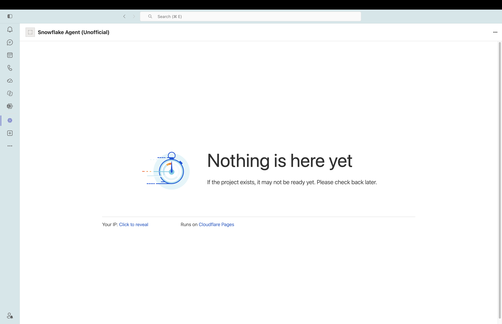

**Cause.** The manifest asks Entra for `api://<TAB_BASE_HOST>/<id>`, but the Entra Application ID URI uses a different host, and/or nothing is deployed at `TAB_BASE_HOST`. "Nothing is here yet" is what a legacy `*.pages.dev` project with no **Production** deployment shows. On a Worker host the equivalent is a Cloudflare 404 or 1042 until the first `deploy-tab.sh`.

**Fix.** Make `TAB_BASE_HOST` / `TAB_BASE_URL` match the registered host (`az ad app show --id <OBO_CLIENT_ID> --query identifierUris`), or add the new host to the registration with `az ad app update --id <OBO_CLIENT_ID> --identifier-uris api://<TAB_BASE_HOST>/<OBO_CLIENT_ID>` (list every URI you want to keep: the flag replaces the set). Then run `set-edge-secrets.sh` and `deploy-tab.sh`, `set-bot-endpoint.sh`, update `ALLOWED_ORIGINS` and roll the service, then `zip.sh` and re-upload the app. Moving off `*.pages.dev` follows the same order; see [§ 6](#6-pages-to-worker-cutover).

#### T2. Personal tab "Couldn't sign you in"

**Symptom.** The personal tab opens but shows "Couldn't sign you in".

**Cause.** The edge origin is not the Entra-authorized host.

**Fix.** Reuse the existing Worker (`EDGE_WORKER_NAME`) and `TAB_BASE_HOST`. Do not point the tab at a new custom domain or `*.workers.dev` host until that host is on the Entra app ([§ 6](#6-pages-to-worker-cutover) step 1). Keep `TAB_BASE_URL` and the manifest on that same origin.

#### T3. Token exchange fails with AADSTS65005

**Symptom.** The tab signs in, then `POST https://<TAB_BASE_HOST>/token/exchange` returns 401 with `{"error":"OBO exchange failed","status":400,"code":"AADSTS65005"}`. The 401 is from the edge; `status: 400` is Entra's token-endpoint response ("requested a scope that doesn't exist on the resource").

**Cause.** `SNOWFLAKE_SCOPE` (the Worker secret **and** the `SNOWFLAKE_SCOPE` Snowflake secret) must name the **Snowflake OAuth resource** app, not the Teams SSO / bot app. They are different Entra registrations:

| App                                                        | Exposes`session:role-any`? |
| ---------------------------------------------------------- | ---------------------------- |
| Teams SSO / bot (`BOT_APP_ID` / `OBO_CLIENT_ID`)       | No,`access_as_user` only   |
| Snowflake OAuth resource (`<snowflake-resource-app-id>`) | Yes                          |

The scope is also case-sensitive: Entra exposes `session:role-any` (lowercase); `SESSION:ROLE-ANY` does not exist.

**Fix.** Confirm the resource app, then set the same value everywhere:

```bash
az ad app show --id <snowflake-resource-app-id> \
  --query "{appId:appId,uris:identifierUris,scopes:api.oauth2PermissionScopes[].value,preAuth:api.preAuthorizedApplications}"
# expect api://<snowflake-resource-app-id>, scope session:role-any, and the Teams app pre-authorized
```

```bash
# SNOWFLAKE_SCOPE=api://<snowflake-resource-app-id>/session:role-any  in apps/teams/.env
bash apps/teams/scripts/set-edge-secrets.sh
bash apps/teams/scripts/deploy-tab.sh      # secret bulk alone leaves warm isolates
```

Then re-apply the Snowflake side (it updates the `SNOWFLAKE_SCOPE` secret and the `CORTEX_TEAMS_OAUTH` audience) and roll the service:

```bash
bash apps/teams/scripts/fill-dev-secrets.sh
snow sql --silent --enable-templating none -f temp/alter-teams-secrets.sql
bash apps/teams/scripts/deploy-spcs.sh
```

(Native App: the `CONFIGURE_OAUTH` / `SET_SECRET` / `ROLL_SERVER_SERVICE` calls are in [B5](#b5-native-app-variants-of-the-main-chapter-entries).)

Pointing `CORTEX_TEAMS_OAUTH` at the bot's app id does not cause 65005; it fails later, when Snowflake rejects the token audience. Once the exchange succeeds, a Snowflake `EXTERNAL_OAUTH_USER_CLAIM_MISSING` means the token has no `upn` claim; add it as an optional claim, see [T9](#t9-you-do-not-have-access-to-that-resource).

**Verify.** Reload the tab. A healthy exchange returns `{ edgeSession, expiresIn }` (never the Snowflake token).

#### T4. Programmatic access token is invalid

**Symptom.** The tab shows "Programmatic access token is invalid." The edge's `/api/*` fails at the ingress and nothing reaches the container.

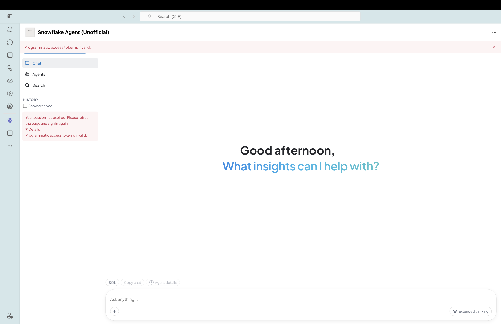

**Cause.** `SPCS_PAT` was minted in a different Snowflake account from the one hosting the SPCS ingress (easy when several `snow` connections exist). Ingress rejects it before the app runs. A whitespace-wrapped PAT is a different failure; see the `FAULT` result in [T6](#t6-api-fails-at-the-edge-or-the-ingress).

**Fix.** In the ingress account, mint a token for the ingress user, put it in `apps/teams/.env` `SNOWFLAKE_PAT` (no whitespace), then push it to the Worker and redeploy:

```sql
SELECT CURRENT_ACCOUNT_NAME();
ALTER USER <pat-user> ADD PROGRAMMATIC ACCESS TOKEN AGENTS_TEAMS_INGRESS_PAT
  ROLE_RESTRICTION = 'AGENTS_TEAMS_USER' DAYS_TO_EXPIRY = 90;   -- value is shown once
```

```bash
bash apps/teams/scripts/set-edge-secrets.sh
bash apps/teams/scripts/deploy-tab.sh
```

**Verify.** Reload the tab. The error moves on: the agent list loads, or you see the Cloudflare IP error ([T7](#t7-cloudflare-ip-is-not-allowed-to-access-snowflake)), which is the next fix. The edge probe cannot show this, because it never sends the PAT to the ingress.

#### T5. `Token expired` at the ingress

**Symptom.** Every `/api/*` call returns 401 `Token expired. …`. It often works for a few minutes after a PAT change, then fails. The JWT's own `exp` still looks far in the future.

**Cause.** The deployed `SPCS_PAT` is a **rotated-out** token. `ROTATE PROGRAMMATIC ACCESS TOKEN` renames the old one and leaves a short grace window, then Snowflake rejects it with `394401`. Decoding the JWT cannot show this; check server-side:

```sql
SHOW USER PROGRAMMATIC ACCESS TOKENS FOR USER "<pat-user>";   -- use the ACTIVE row, not *_ROTATED_*
```

**Fix.** Put the ACTIVE token in `apps/teams/.env` `SNOWFLAKE_PAT` (no whitespace), then `bash apps/teams/scripts/set-edge-secrets.sh` and `bash apps/teams/scripts/deploy-tab.sh`. Every rotation needs both steps or the app breaks again a few minutes later.

#### T6. `/api/*` fails at the edge or the ingress

**Symptom.** The edge probe at the top of [§ 4](#4-verify-and-common-failures) returns something other than `401 {"error":"Unauthorized"}`, or the tab's own `/api/*` requests fail in the browser network panel. The probe stops at the edge, so it can return only the **probe** rows. The **tab** rows come from requests that carry an edge session and reach the ingress; a direct PAT request also reaches the ingress, from any host the PAT user's network policy allows. Match the result:

| Result                                                                                              | Seen on    | Cause                                                                                                                                                                        | Fix                                                                                                                                                                                                                                                                      |
| --------------------------------------------------------------------------------------------------- | ---------- | ---------------------------------------------------------------------------------------------------------------------------------------------------------------------------- | ------------------------------------------------------------------------------------------------------------------------------------------------------------------------------------------------------------------------------------------------------------------------ |
| 403`{"error":"Forbidden origin"}`                                                                 | probe      | The`Origin` is not the Worker host.                                                                                                                                        | See[T11](#t11-forbidden-origin-on-api).                                                                                                                                                                                                                                   |
| 500`Proxy misconfigured: missing SPCS_BASE` (or `SPCS_PAT`, `EDGE_SESSION_SECRET`)            | probe      | That Worker secret is unset.                                                                                                                                                 | `set-edge-secrets.sh`, then `deploy-tab.sh`.                                                                                                                                                                                                                         |
| 500`{"error":"Edge misconfigured"}`                                                               | probe, tab | On every edge route: a privatelink deploy without the`SPCS_VPC` binding. On `/token/exchange` only: its secrets went to a different Worker.                              | See[PL6](#pl6-edge-misconfigured-500-in-privatelink), or [I14](#i14-wrangler-deploy-workersdev-subdomain-or-worker-name).                                                                                                                                                  |
| 404, or Cloudflare error 1042                                                                       | probe      | No Worker is deployed on that host yet, or`TAB_BASE_HOST` belongs to a different Worker.                                                                                   | See[I14](#i14-wrangler-deploy-workersdev-subdomain-or-worker-name), then `deploy-tab.sh`.                                                                                                                                                                               |
| 302 to`sfc-endpoint-login-…/sfc-oauth-begin`                                                     | tab        | The ingress saw no valid credential: the edge did not attach a usable`SPCS_PAT`.                                                                                           | `set-edge-secrets.sh`, then `deploy-tab.sh`.                                                                                                                                                                                                                         |
| 401`Incoming request with IP/Token … is not allowed`                                             | tab        | The PAT user's network policy rejects the edge's address.                                                                                                                    | See[T7](#t7-cloudflare-ip-is-not-allowed-to-access-snowflake) (`public`, `hybrid`) or [PL3](#pl3-the-private-ingress-rejects-the-edge-401-or-403) (`privatelink`).                                                                                                   |
| 403`Insufficient privileges to use <ingress>`                                                     | tab        | The`SPCS_PAT` user lacks endpoint access.                                                                                                                                  | Native App:`GRANT APPLICATION ROLE AGENTS_TEAMS_APP.APP_PUBLIC TO USER "<pat-user>"`. Path A: grant `AGENTS_TEAMS!ALL_ENDPOINTS_USAGE` plus `USAGE` on `AGENTS_TEAMS_APP_DB` / `PUBLIC` (quote the SQL, see [I6](#i6-zsh-event-not-found-all_endpoints_usage)). |
| 500`{"responseType":"FAULT","detail":""}`                                                         | tab        | The ingress rejected`SPCS_PAT` before the container (no service logs). Almost always whitespace in `apps/teams/.env` `SNOWFLAKE_PAT` (JWT signature wrapped on paste). | Strip the spaces, run`set-edge-secrets.sh`, then `deploy-tab.sh`.                                                                                                                                                                                                    |
| 500, Cloudflare 1101                                                                                | tab        | Placeholder`SPCS_BASE`.                                                                                                                                                    | See[I17](#i17-every-api-call-is-500-cloudflare-1101).                                                                                                                                                                                                                     |
| 522 right after`deploy-spcs.sh`                                                                   | tab        | The new ingress is not routable yet (origin timeout).                                                                                                                        | Wait about a minute and retry. The ingress called directly should return`302` first.                                                                                                                                                                                   |
| 404`Could not find the service associated with endpoint <old-id>…` right after `deploy-tab.sh` | tab        | A warm isolate still has the previous`SPCS_BASE` (for example, the ingress of an earlier install).                                                                         | Retry after about 20s. If it persists, check that`apps/teams/.env` `SPCS_BASE` is the new ingress, then re-run `set-edge-secrets.sh` and `deploy-tab.sh`.                                                                                                        |

Calling the **ingress** directly with no PAT also returns `302`. That is expected; the edge must attach the PAT, and the ingress is never the bot endpoint.

**Verify.** The edge probe returns `401 {"error":"Unauthorized"}`. In the tab, `GET /api/agents` and `GET /api/threads` are 200 and the agent list loads.

#### T7. Cloudflare IP is not allowed to access Snowflake

**Symptom.** The Teams tab shows "Incoming request with IP/Token is not allowed to access Snowflake". `/api/*` is 401 with `Incoming request with IP/Token <public-ip> is not allowed`, and the IP is a Cloudflare edge range (`104.16/13`, `172.64/13`, `162.158/15`, …), not the SPCS NAT and not `10.x`.

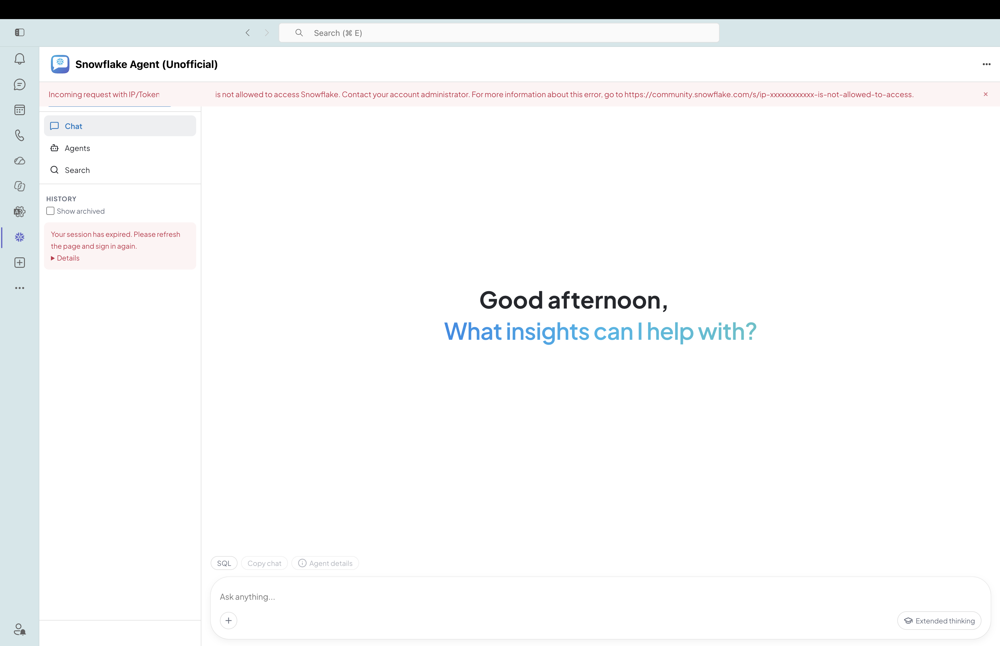

**Cause.** The edge Worker reaches the ingress with `SPCS_PAT`, so Snowflake checks the **PAT user's** network policy against a Cloudflare edge IP. The account policy has no Cloudflare ranges. The managed account policy is not the lever: do not edit `ACCOUNT_VPN_POLICY_SE` and do not add Cloudflare ranges to the account policy.

**Fix.** Run the script. It prints the SQL by default and runs it with `--apply`; it leaves a user that already has a different user-level policy alone unless `--replace`, and never touches account-level policies:

```bash
bash apps/teams/scripts/set-svc-network-policy.sh [-c <snow connection>]            # dry run
bash apps/teams/scripts/set-svc-network-policy.sh [-c <snow connection>] --apply
```

Or do it by hand. Use the current IPv4 list from [https://www.cloudflare.com/ips-v4](https://www.cloudflare.com/ips-v4) (do not use `0.0.0.0/0`; the policy must stay restricted):

```sql
CREATE NETWORK POLICY IF NOT EXISTS AGENTS_TEAMS_INGRESS_POLICY
  ALLOWED_IP_LIST = ('173.245.48.0/20', '103.21.244.0/22' /* …paste the rest of ips-v4 */);
ALTER USER <pat-user> SET NETWORK_POLICY = AGENTS_TEAMS_INGRESS_POLICY;
```

Also confirm that the Worker's `SPCS_PAT` is that user's **ACTIVE** token ([T5](#t5-token-expired-at-the-ingress)) and redeploy.

This policy is for `public` and `hybrid`. In `privatelink` the edge reaches the private ingress, so the PAT user gets `AGENTS_TEAMS_PL_INGRESS_POLICY` (private-endpoint IDs, no Cloudflare ranges) instead ([§ 7.4](#74-network-sql-accountadmin)). A Cloudflare IP in this error in `privatelink` means the edge is still deployed without `--privatelink`.

**Verify.** Reload the tab: the IP error is gone and the agent list loads. The edge probe cannot show this, because it never reaches the ingress. A direct PAT request from a laptop is blocked by this same policy, as intended.

#### T8. Account network policy blocks the SPCS to Cortex call

**Symptom.** The tab banner reads "Your Snowflake account's network policy is blocking this connection". The upstream error is `390422` on `/api/agent/run` or `/api/threads`.

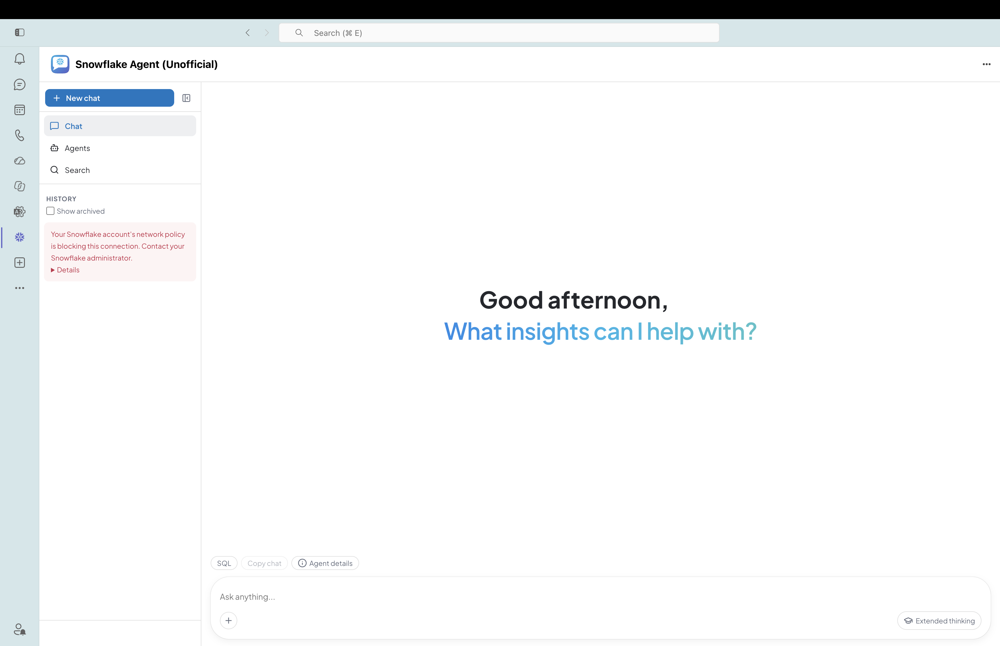

**Cause.** The chat reaches the service, but the service's call to Cortex comes from the compute pool's public NAT range, which the account policy does not allow. The range differs by region, so do not copy one from another account. This is the SPCS → Cortex hop, not the Cloudflare → ingress hop ([T7](#t7-cloudflare-ip-is-not-allowed-to-access-snowflake)).

**Fix.** Read the blocked IP, then attach a scoped policy to the OAuth integration:

```sql
SELECT event_timestamp, client_ip, error_message
FROM SNOWFLAKE.ACCOUNT_USAGE.LOGIN_HISTORY      -- can lag; or use TABLE(SNOWFLAKE.INFORMATION_SCHEMA.LOGIN_HISTORY())
WHERE is_success = 'NO'
ORDER BY event_timestamp DESC LIMIT 5;

USE ROLE ACCOUNTADMIN;
CREATE NETWORK POLICY IF NOT EXISTS AGENTS_TEAMS_SPCS_POLICY
  ALLOWED_IP_LIST = ('<observed-nat-prefix>/24');     -- the /24 of the blocked client_ip
ALTER SECURITY INTEGRATION CORTEX_TEAMS_OAUTH SET NETWORK_POLICY = AGENTS_TEAMS_SPCS_POLICY;
```

Allow the `/24`, not the single IP, because the NAT address floats within it. Never allowlist a private `10.x` address.

If `LOGIN_HISTORY` shows a private `10.x` as the blocked `client_ip`, the call took the internal route instead of the public NAT. In `public` mode that means the Cortex URL was built from the injected `SNOWFLAKE_HOST`; `SNOWFLAKE_HOST_MODE=account` (the default) builds it from `SNOWFLAKE_ACCOUNT` (public NAT), so upgrade the app and roll the service rather than editing any policy.

In `hybrid` and `privatelink` the internal route is intentional (`SNOWFLAKE_HOST_MODE=internal`). A NAT `/24` cannot match it; the fix is the `COMPUTE_POOL` network rule on `CORTEX_TEAMS_OAUTH`, which replaces this policy. See [PL1](#pl1-390422-after-switching-to-hybrid-or-privatelink).

#### T9. You do not have access to that resource

**Symptom.** The tab banner reads "You do not have access to that resource". `POST /api/threads` returns 401 `agent_forbidden` (upstream `390303` or `null`).

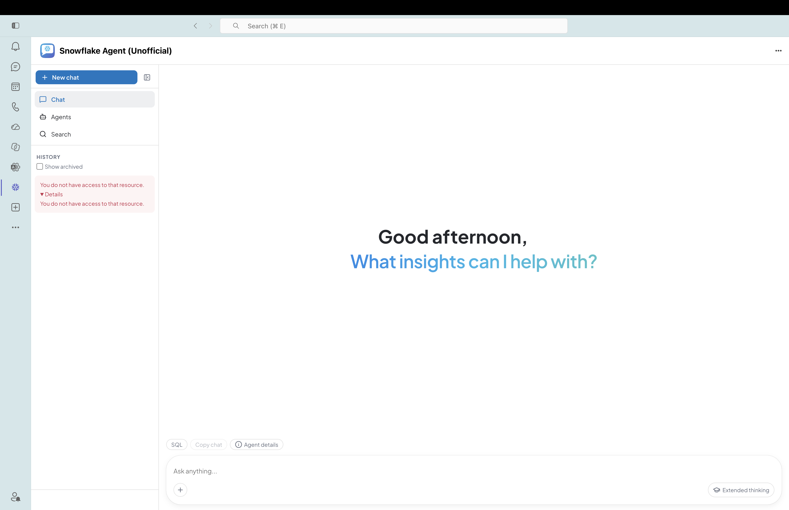

**Cause.** The tab shows `agent_forbidden` for **any** upstream 401/403 (only Snowflake `390422` becomes a network-policy error), so the banner alone does not tell you why. Read the container log first ([Reading the SPCS container log](#reading-the-spcs-container-log)). `CORTEX_TEAMS_OAUTH` could not map the token to a user, for one of two independent reasons:

1. **No Snowflake user for the Entra identity.** No user has a `login_name` equal to the token's `upn`.
2. **Token has no `upn` claim.** The log shows `Upstream 401: Invalid OAuth access token`. Entra v2 access tokens omit `upn` unless it is added as an optional claim ([install step 6a](#2-install-standalone-spcs)).

**Fix.** For cause 1, create the user ([install step 7](#2-install-standalone-spcs) grants), using the Entra UPN as `login_name`. Ask the user for the UPN; do not guess it.

```sql
SHOW USERS LIKE '<snowflake_user>';
CREATE USER IF NOT EXISTS <snowflake_user> LOGIN_NAME = '<entra-upn>'
  DEFAULT_ROLE = AGENTS_TEAMS_USER DEFAULT_WAREHOUSE = <warehouse>;
GRANT ROLE AGENTS_TEAMS_USER TO USER <snowflake_user>;
GRANT USAGE ON DATABASE <db> TO ROLE AGENTS_TEAMS_USER;
GRANT USAGE ON SCHEMA <db>.<schema> TO ROLE AGENTS_TEAMS_USER;
GRANT USAGE ON AGENT <db>.<schema>.<agent> TO ROLE AGENTS_TEAMS_USER;
```

For cause 2, add `upn` as an optional claim on the Snowflake resource app in Entra (Token configuration → Add optional claim → Access → `upn`, and allow the Graph permission prompt), or with the CLI command in [install step 6a](#2-install-standalone-spcs). Only new tokens carry it, so reload the tab. Do **not** widen `EXTERNAL_OAUTH_TOKEN_USER_MAPPING_CLAIM` to `email` or `preferred_username`: those are attacker-influenceable and enable account takeover (security review F2). Keep it at `('upn')`.

Reload the tab (no sideload required). If chat then works but a tool is "unavailable", see [T10](#t10-the-agent-says-a-tool-is-unavailable).

#### T10. The agent says a tool is unavailable

**Symptom.** The agent streams a reply, then says a tool (for the test agent, "Superstore Analyst") is not available. There is no error banner, so an HTTP-status check passes.

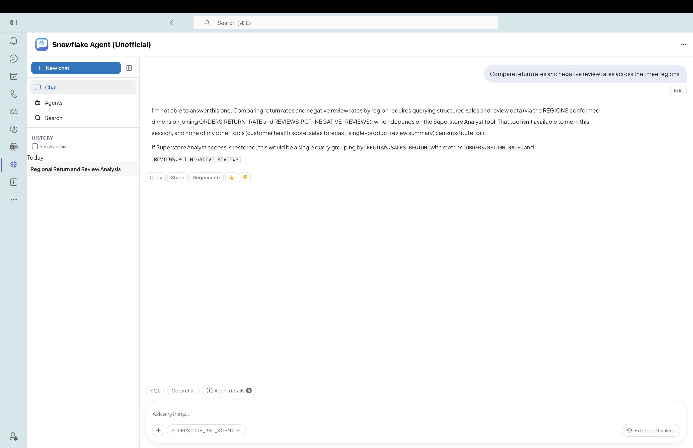

**Cause.** Sign-in and the agent now work, but the user's **default role** lacks a grant the agent's tools need (semantic view and its tables, search service, functions, warehouse, `SNOWFLAKE.CORTEX_USER`), or the user has no default warehouse. Cortex silently drops tools the caller cannot use, so the agent answers that the tool is unavailable instead of failing.

**Fix.** Grant `AGENTS_TEAMS_USER` everything the agent uses (semantic view and its tables, search service, functions, warehouse, `SNOWFLAKE.CORTEX_USER`), then:

```sql
ALTER USER <snowflake_user> SET DEFAULT_ROLE = AGENTS_TEAMS_USER, DEFAULT_WAREHOUSE = <warehouse>;
SHOW GRANTS TO ROLE AGENTS_TEAMS_USER;
```

**Verify.** Start a **new** chat and re-ask; an old thread keeps the earlier answer.

#### T11. `Forbidden origin` on `/api/*`

**Symptom.** Same-origin GETs (threads, agent list) return `{"error":"Forbidden origin"}` with 403 while POSTs work.

**Cause.** Browsers omit `Origin` on same-origin GET/HEAD. The edge accepts that only when `Sec-Fetch-Site: same-origin`; POSTs always need an allowed `Origin`. An edge deploy older than that allowance rejects the GETs, and a new deploy can take about 15 seconds to reach every location.

**Fix.** `bash apps/teams/scripts/deploy-tab.sh`, wait, retry. A cross-site GET without `Origin` must still be refused.

#### T12. `429 Too many requests` on `/token/exchange`

**Symptom.** Sign-in fails and `POST /token/exchange` returns 429 with a `Retry-After` header.

**Cause.** The limits are 30 requests/min per IP and 10/min per identity. The usual trigger is a loop: an upstream 401/403 (often [T9](#t9-you-do-not-have-access-to-that-resource)) makes the tab re-mint its edge session, and concurrent requests each re-mint. The tab now shares one in-flight exchange, so a remaining loop means a real 401/403 to fix.

**Fix.** Wait for `Retry-After`, fix the underlying 401/403, reload the tab.

### 4.3 Diagnostics (not errors)

#### Reading the SPCS container log

The container log holds the real upstream error that the UI redacts (`Upstream 401: Invalid OAuth access token`). As SYSADMIN (the service owner):

```bash
snow sql --role SYSADMIN -q "SELECT SYSTEM\$GET_SERVICE_LOGS('AGENTS_TEAMS_APP_DB.PUBLIC.AGENTS_TEAMS',0,'agents-teams-app',400)" \
  | grep -E "Upstream|error|forbidden"
```

#### Profiling a HAR without leaking tokens

A HAR export contains live bearer tokens and edge sessions. Extract metadata only: method, path, status, timing, response-body error strings, and whether a header is present (never its value). Do not paste the HAR or raw headers anywhere, and delete it when done. Repeated `/token/exchange` calls followed by 429 point to [T12](#t12-429-too-many-requests-on-tokenexchange); 403 `Forbidden origin` on GETs points to [T11](#t11-forbidden-origin-on-api).

#### Seeing the actual edge Worker error

Use this when `/api/*` is 500 and the cause is not obvious (as in [I17](#i17-every-api-call-is-500-cloudflare-1101) or [PL6](#pl6-edge-misconfigured-500-in-privatelink)).

<!-- TODO screenshot: `wrangler tail` output showing the "Invalid URL" exception. Redact tokens and hostnames. -->

```bash
cd packages/teams-edge
npx wrangler tail <worker-name>             # EDGE_WORKER_NAME; no --env, even in privatelink
npx wrangler secret list --name <worker-name>
```

Then reproduce the failing request in the tab. Do not pass `--env privatelink` to `tail` or `secret` commands: for those, Wrangler targets `<worker-name>-privatelink`, a Worker that does not exist. Only `deploy-tab.sh` passes `--env`, and it pins `--name` as well. In the dashboard the same view is **Workers & Pages** → the Worker → **Logs**, and secrets are under **Settings** → **Variables and Secrets**.

macOS notes: there is no `timeout` command, so stop `tail` with Ctrl-C. In zsh always replace `<...>` placeholders (unquoted angle brackets are redirects).

#### Quick fixes

One-line fixes and behaviours that are not failures.

| Symptom                                         | Fix                                                                                                                                                                                |
| ----------------------------------------------- | ---------------------------------------------------------------------------------------------------------------------------------------------------------------------------------- |
| Edge secret rotated, old behaviour persists     | Isolates stay warm. Redeploy after`set-edge-secrets.sh`: `bash apps/teams/scripts/deploy-tab.sh`.                                                                              |
| No dictation (mic) button in the Teams composer | By design, not a failure. Chrome blocks the Web Speech API inside cross-origin iframes, which every Teams tab is, so dictation is disabled on Teams. |

---

## 5. Tear down

Installed as a Native App? Use [B.6](#b6-tear-down-path-b) instead; do **not** run `snow app teardown` for this install.

Do **not** run `snow app teardown`. Drop the standalone objects:

```sql
DROP SERVICE IF EXISTS AGENTS_TEAMS_APP_DB.PUBLIC.AGENTS_TEAMS;
DROP SERVICE IF EXISTS AGENTS_TEAMS_APP_DB.PUBLIC.AGENTS_TEAMS_STAGING;
DROP COMPUTE POOL IF EXISTS AGENTS_TEAMS_APP_POOL;
DROP SECURITY INTEGRATION IF EXISTS CORTEX_TEAMS_OAUTH;
DROP EXTERNAL ACCESS INTEGRATION IF EXISTS AGENTS_TEAMS_EAI;
```

Keep `AGENTS_TEAMS_APP_DB` and `IMAGE_REPO` so the next [push](#2-install-standalone-spcs) has a registry. Keep Cortex agents, `AGENTS_TEAMS_USER`, and `AGENTS_TEAMS_SVC`. Reinstall from [§ 2](#2-install-standalone-spcs).

`AGENTS_TEAMS_SPCS_POLICY` and `AGENTS_TEAMS_INGRESS_POLICY` are **not** created by `bootstrap-dev-spcs.sql`. `set-svc-network-policy.sh` creates the latter, and you create either by hand when [T7 or T8](#t7-cloudflare-ip-is-not-allowed-to-access-snowflake) (see also [T8](#t8-account-network-policy-blocks-the-spcs-to-cortex-call)) appears. If you did, and you want a clean slate, detach then drop them (drop the integration or user first, otherwise Snowflake refuses because the policy is still in use):

```sql
ALTER SECURITY INTEGRATION IF EXISTS CORTEX_TEAMS_OAUTH UNSET NETWORK_POLICY;
ALTER USER IF EXISTS <pat-user> UNSET NETWORK_POLICY;
DROP NETWORK POLICY IF EXISTS AGENTS_TEAMS_SPCS_POLICY;
DROP NETWORK POLICY IF EXISTS AGENTS_TEAMS_INGRESS_POLICY;
```

If you keep the install, re-attach after a reinstall that recreates the integration: `ALTER SECURITY INTEGRATION CORTEX_TEAMS_OAUTH SET NETWORK_POLICY = AGENTS_TEAMS_SPCS_POLICY;`. Per-user Snowflake users created in [install step 7](#2-install-standalone-spcs) are not dropped by teardown. If you ran the `hybrid` or `privatelink` network SQL, also drop its objects ([§ 7.8](#78-tear-down-private-connectivity)).

To remove the edge as well (it holds the service PAT as a secret):

```bash
cd packages/teams-edge
npx wrangler delete --name <worker-name>      # EDGE_WORKER_NAME; no --env
npx wrangler kv namespace delete --namespace-id <BOT_LINKS id>   # optional: signs every bot user out
```

Then revoke the PAT itself: `ALTER USER <pat-user> REMOVE PROGRAMMATIC ACCESS TOKEN AGENTS_TEAMS_INGRESS_PAT;`. A legacy `*.pages.dev` project is deleted from **Workers & Pages** in the dashboard.

---

## 6. Pages to Worker cutover

This section applies to installs whose `TAB_BASE_HOST` is a `*.pages.dev` host from before the edge moved to a Worker. The Pages project keeps serving until you retire it, but `deploy-tab.sh` now deploys only the Worker, so edge fixes reach users only after the cutover. A Pages Function also cannot use a Workers VPC binding, so `privatelink` ([§ 7](#7-private-connectivity-optional)) needs the Worker.

Four things are pinned to the edge host: the Entra Application ID URI, the Teams manifest (`webApplicationInfo.resource`, `validDomains`, the tab `contentUrl`), the Azure Bot messaging endpoint, and the service's `ALLOWED_ORIGINS`. Change them in this order. The old host keeps working until step 7, so users are not cut off midway.

1. **Add the new host to Entra; keep the old one.** `--identifier-uris` replaces the whole set, so list both:

   ```bash
   az ad app show --id <OBO_CLIENT_ID> --query identifierUris
   az ad app update --id <OBO_CLIENT_ID> \
     --identifier-uris "api://<old-host>.pages.dev/<OBO_CLIENT_ID>" "api://<new-host>/<OBO_CLIENT_ID>"
   ```
2. **Deploy the Worker on the new host.** In `apps/teams/.env` set `TAB_BASE_HOST` / `TAB_BASE_URL` to the new host and `EDGE_WORKER_NAME` to the Worker name (it takes precedence over a legacy `PAGES_PROJECT`). Then run the secrets script and the deploy, and attach the custom domain ([B.4](#b4-cloudflare-worker)):

   ```bash
   bash apps/teams/scripts/set-edge-secrets.sh
   bash apps/teams/scripts/deploy-tab.sh
   ```

   Check that `https://<new-host>/` serves the tab and that the edge probe ([§ 4](#4-verify-and-common-failures)) on the new host returns `401` ([T6](#t6-api-fails-at-the-edge-or-the-ingress)). `BOT_LINKS` keeps the same KV id, and `set-edge-secrets.sh` reuses `EDGE_SESSION_SECRET` and `BOT_LINK_SECRET` from `apps/teams/.env`. Existing bot links therefore keep working on the new host. Tab users sign in again silently on first load, because the browser keeps the edge session per origin.
3. **Rebuild the manifest** for the new host. `generate.mjs` writes `validDomains`, `webApplicationInfo` and the tab URLs from `TAB_BASE_HOST`. If the app is published in the org catalog, first raise `version` in [`manifest.template.json`](../packages/teams-manifest/manifest.template.json), because Teams Admin Center does not accept an update with the same version:

   ```bash
   bash packages/teams-manifest/zip.sh
   ```
4. **Re-upload the app** (sideload, or Teams Admin Center → the app → **Update**).
5. **Move the bot**: `bash apps/teams/scripts/set-bot-endpoint.sh` points the messaging endpoint at `https://<new-host>/api/bot/messages`.
6. **Update the service origin.**

   - Native App: `CALL AGENTS_TEAMS_APP.CONFIG.ROLL_SERVER_SERVICE('https://<new-host>');`. A roll keeps the service, so the ingress host does not change.
   - Path A: set the secret, then roll. It takes a comma-separated list, so you can keep the old origin during the soak:

     ```sql
     ALTER SECRET AGENTS_TEAMS_APP_DB.CONFIG.ALLOWED_ORIGINS
       SET SECRET_STRING = 'https://<new-host>,https://<old-host>.pages.dev';
     ```

     Then run `bash apps/teams/scripts/deploy-spcs.sh`.
7. **Retire Pages after a soak** (a week of normal use is enough). Then:

   - Remove the old URI from Entra (step 1 with only the new URI).
   - Drop the old origin from `ALLOWED_ORIGINS` and roll.
   - Delete the Pages project from **Workers & Pages** in the dashboard. It still holds a copy of `SPCS_PAT`.

---

## 7. Private connectivity (optional)

> **Validation status.**
>
> - **Works (AWS, Azure and GCP):** the `privatelink` edge path. Bot Connector → Worker (`env.privatelink`) → Workers VPC → `cloudflared` → private ingress → container.
> - **Does not work as designed:**
>   - `SNOWFLAKE_HOST_MODE=internal` with the `COMPUTE_POOL` rule: every forwarded user token failed with `395090`. `account` host mode worked ([PL8](#pl8-395090-with-snowflake_host_modeinternal)).
>   - The PAT user's `AWSVPCEID` network policy did not stop the PAT working from the internet ([PL9](#pl9-the-pat-still-works-from-the-internet)). The Azure `AZURELINKID` and GCP `GCPPSCID` equivalents were created and attached but not tested as a PAT control.
>   - `ENFORCE_PRIVATELINK_ACCESS_ONLY` did not block public key-pair or PAT logins on AWS ([§ 7.4](#74-network-sql-accountadmin)). It was deliberately not run on Azure: there is no confirmed admin recovery path there.
> - **Untested:** the Native App path and the self-hosted Node edge.
>
> Do not treat the network policies in this section as the control that keeps the service off the internet until Snowflake confirms the behaviour above. Try the rest on a non-production Business Critical account first, and report what you see, including any error codes.

The default install (`NETWORK_MODE=public`) uses public endpoints for every hop. Two opt-in modes keep Snowflake off the public internet:

- `hybrid`: Snowflake logins are restricted to private connectivity and the compute pool. The public SPCS ingress stays, so the edge is unchanged.
- `privatelink`: the edge reaches the service only through its private ingress.

Both modes are designed for AWS PrivateLink, Azure Private Link and Google Cloud Private Service Connect. `privatelink` is validated on all three (see the status above).

### 7.1 Modes

| Mode                 | Edge → SPCS ingress                                                                                                                | Container → Snowflake                                                                                                                                                               | Policies ([§ 7.4](#74-network-sql-accountadmin))                                                                                                                                                                                                |
| -------------------- | ----------------------------------------------------------------------------------------------------------------------------------- | ------------------------------------------------------------------------------------------------------------------------------------------------------------------------------------ | ----------------------------------------------------------------------------------------------------------------------------------------------------------------------------------------------------------------------------------------------- |
| `public` (default) | Worker, global`fetch` to the public `ingress_url`                                                                               | `SNOWFLAKE_HOST_MODE=account`: the org-account host over the public NAT                                                                                                            | [T7](#t7-cloudflare-ip-is-not-allowed-to-access-snowflake) on the PAT user (Cloudflare IPs), [T8](#t8-account-network-policy-blocks-the-spcs-to-cortex-call) on `CORTEX_TEAMS_OAUTH` (NAT `/24`) if needed                                    |
| `hybrid`           | Same as public                                                                                                                      | `SNOWFLAKE_HOST_MODE=account` (as in public). `internal` only accepts the SPCS service token, so user tokens get `395090` ([PL8](#pl8-395090-with-snowflake_host_modeinternal)) | Designed:`COMPUTE_POOL` rule on `CORTEX_TEAMS_OAUTH`. With `account` mode keep the T8 NAT policy; T7 kept                                                                                                                                 |
| `privatelink`      | Worker`env.privatelink` through the `SPCS_VPC` Workers VPC binding (cloudflared in your network) to `privatelink_ingress_url` | Same as hybrid:`account` today, so this hop still leaves SPCS over its public NAT                                                                                                  | PAT user limited to your private endpoint IDs (does not currently refuse internet use,[PL9](#pl9-the-pat-still-works-from-the-internet)); T7 policy still the working control; optional `ENFORCE_PRIVATELINK_ACCESS_ONLY` (no observed effect) |

The Teams client, Entra and the Bot Connector are always public. In every mode:

- The personal tab and the bot's messaging endpoint stay on the public edge host (`TAB_BASE_HOST`).
- In `privatelink` the Worker verifies the Bot Connector JWT itself before it relays to the private ingress. The container verifies it again.
- Only the edge's SPCS calls go through the VPC. Entra, JWKS and OBO calls stay on the Worker's normal egress.
- The browser never holds the service PAT or a Snowflake token.

### 7.2 Prerequisites

- **Business Critical** edition (or higher), with private connectivity to the account already in place: AWS PrivateLink, Azure Private Link or GCP Private Service Connect, plus the private DNS for the account URL.
- **A confirmed private login and an admin recovery path**: an ACCOUNTADMIN who can sign in through `privatelink-account-url` from inside the network, and who can do so from where they normally work. This is needed before enforcement ([§ 7.4](#74-network-sql-accountadmin)). A laptop cannot resolve the private hostnames, so if the admin key is only on the laptop, tunnel through a host in the VPC. Tested recipe with AWS Systems Manager (no inbound ports, no sudo; if `brew install --cask session-manager-plugin` needs sudo, use AWS's standalone plugin bundle instead):

  ```bash
  aws ssm start-session --target <instance-id> \
    --document-name AWS-StartPortForwardingSessionToRemoteHost \
    --parameters host=<privatelink-account-url>,portNumber=443,localPortNumber=8443
  # in another shell: TLS is verified against the real hostname, no hosts-file edit
  curl --resolve <privatelink-account-url>:8443:127.0.0.1 \
    -X POST https://<privatelink-account-url>:8443/session/v1/login-request   # 200
  ```

  For a full login, use the Python connector with `host=<privatelink-account-url>`, `port=8443`, and `socket.getaddrinfo` mapped to `127.0.0.1` inside the process. `SELECT CURRENT_IP_ADDRESS()` then returns a VPC address, which proves the login came over private connectivity.

  On Azure this recovery path was **not tested**. `az vm run-command invoke` runs a command on a VM that has no public IP, which is enough to confirm DNS and a `200` from `/session/v1/login-request` from inside the VNet, but it does not give the laptop a tunnel. Use Azure Bastion native-client tunnelling or a VM that holds an ACCOUNTADMIN key before you consider enforcement.

  On GCP this was also **not tested** as a laptop tunnel. IAP SSH needs `roles/iap.tunnelResourceAccessor` (without it: error `4033 'not authorized'`). In-VPC checks that worked without SSH: a startup script (instance metadata) that prints DNS and `login-request` results, read back with `gcloud compute instances get-serial-port-output`. The serial buffer persists across reboots, so give each probe a distinct line prefix and filter for the newest format.
- **Azure Private Link setup** (when the account has no private endpoint yet). Order that worked:

  1. On a new subscription, register the providers first: `az provider register -n Microsoft.Network` and `-n Microsoft.Compute` (wait for `Registered`).
  2. Create the VNet and subnets (`pe`, `vm`), then turn off the private endpoint network policy on the `pe` subnet with `az network vnet subnet update --private-endpoint-network-policies Disabled`. `az network vnet create` rejects that flag.
  3. Read `privatelink-pls-id` from `SELECT SYSTEM$GET_PRIVATELINK_CONFIG();` and create a manual-approval private endpoint to it (`az network private-endpoint create --manual-request true`).
  4. Authorize the endpoint in Snowflake with the **private endpoint's resource ID**, not the subscription ID, and a short-lived Azure token (do not print it):

     ```sql
     SELECT SYSTEM$AUTHORIZE_PRIVATELINK('<private endpoint resource id>', '<az account get-access-token access token>');
     SELECT SYSTEM$GET_PRIVATELINK_AUTHORIZED_ENDPOINTS();   -- type "Azure Endpoint Connection Id", a linkIdentifier
     ```
  5. Create the private DNS zones and records ([§ 7.5](#75-private-dns)).

  Azure Policy can block this on a shared or sandbox subscription (`ResourceGroupQuotaExceeded`, `NetworkActionDeny` on VNet, NSG, route table or public IP actions). Use a subscription where you can create network resources; do not look for ways around a policy deny.
- **GCP Private Service Connect setup** (when the account has no PSC endpoint yet). Order that worked (tested in `europe-west2`):

  1. Enable the Compute Engine and Cloud DNS APIs. Create a custom-mode VPC and a subnet with Private Google Access.
  2. Create a Cloud Router and Cloud NAT. The tunnel VM has no external IP and needs outbound access to GitHub (to install `cloudflared`) and Cloudflare on port 7844.
  3. Reserve an internal address (`gcloud compute addresses create ... --subnet ...`).
  4. Read `privatelink-gcp-service-attachment` from `SELECT SYSTEM$GET_PRIVATELINK_CONFIG();` and create a forwarding rule to it (`gcloud compute forwarding-rules create ... --target-service-attachment <attachment> --address <reserved address> --network ... --subnet ...`). It stays `PENDING` until the next step.
  5. Authorize the **GCP project** (not the endpoint) in Snowflake with the project ID and a short-lived gcloud token. Put the token in a mode-600 temp file and delete it afterwards; do not print it:

     ```sql
     SELECT SYSTEM$AUTHORIZE_PRIVATELINK('<gcp project id>', '<gcloud auth print-access-token>');
     SELECT SYSTEM$GET_PRIVATELINK_AUTHORIZED_ENDPOINTS();   -- type "Gcp Project Id", connectionLimit 10
     ```

     The forwarding rule moves to `ACCEPTED`.
  6. Read the numeric connection ID for the `GCPPSCID` network rule ([§ 7.4](#74-network-sql-accountadmin)): `gcloud compute forwarding-rules describe <rule> --region <region> --format="value(pscConnectionId)"`.
  7. Create the private DNS zones and records ([§ 7.5](#75-private-dns)).

  Org policy and IAM denies (for example a missing `iap.tunnelResourceAccessor` or Secret Manager `setIamPolicy`, see [PL14](#pl14-gcp-secret-manager-iam-denied-for-the-tunnel-vm)) are reported to the project owner, not worked around.
- **For `privatelink` only:**

  - `SELECT SYSTEM$GET_PRIVATELINK_CONFIG();` must return `app-service-privatelink-url` (SPCS private ingress) and `spcs-auth-privatelink-url`. Without them the account has no private SPCS ingress, so use `hybrid`.
  - A host in your network that runs `cloudflared`, uses the private DNS from [§ 7.5](#75-private-dns), and can reach Cloudflare on port 7844 ([PL5](#pl5-cloudflared-cannot-connect-udp-7844)).
  - The `SPCS_VPC` binding needs Workers VPC (beta) on the Cloudflare account.
- **No `executeAsCaller`** in the service spec. The `COMPUTE_POOL` rule does not cover caller's-rights tokens, so `deploy-spcs.sh` refuses `hybrid` and `privatelink` if the spec sets it.

Native App: pick the mode on wizard tab 8 ([Tab 8: Network](#b3-streamlit)). It runs the same detection and generates the same SQL as below. Then **Create Service** or **Roll service** on tab 9 applies `service_spec_private.yml`. The Native App path is the least tested: a Native App may reject the spec's `capabilities` block. If **Create Service** fails on it, stay on `public` and report the error.

### 7.3 Path A (standalone SPCS)

> **Use `account` host mode for per-user sign-in.** The internal host (`SNOWFLAKE_HOST_MODE=internal`) accepts only the SPCS-issued service token. Forwarded External OAuth (Entra) user tokens, PATs and key-pair JWTs are rejected there with upstream `401` code `395090` ("Please use OAuth"), whatever the spec or network rules say ([PL8](#pl8-395090-with-snowflake_host_modeinternal)). `account` mode reaches Snowflake over the SPCS public egress NAT, so keep the T8 policy on the integration. `internal` is service-identity-only and opt-in.
>
> **`deploy-spcs.sh` defaults to `account`.** For every `NETWORK_MODE` it writes `SNOWFLAKE_HOST_MODE=account` and `enableCustomCredentials=false`. Set `SPCS_HOST_MODE=internal` in `apps/teams/.env` to opt in to `internal`; the script then warns about `395090`.
>
> **Native App path.** `CONFIG.SET_NETWORK_MODE` still maps `hybrid` and `privatelink` to `service_spec_private.yml` (`internal`) and the wizard still generates the pool policy. That path has the same `395090` problem and is a known follow-up.

1. For `privatelink`, set `NETWORK_MODE=privatelink` in `apps/teams/.env` when you deploy the edge ([§ 7.6](#76-edge-in-privatelink-workers-vpc)). `deploy-spcs.sh` is safe with it set: it keeps `account` host mode.
2. As ACCOUNTADMIN, apply the network SQL ([§ 7.4](#74-network-sql-accountadmin)). Skip the pool rule part; it is only needed for `internal` mode.
3. Service:
   - **New install**: in [`create-dev-service.sql`](../apps/teams/scripts/create-dev-service.sql) keep `SNOWFLAKE_HOST_MODE: account` and leave the `capabilities` block commented ([install step 5](#2-install-standalone-spcs)). `internal` (set it and uncomment the block) works only for the SPCS service identity; user tokens get `395090`.
   - **Existing service**: confirm the live spec still says `account` after any roll.
4. `bash apps/teams/scripts/deploy-spcs.sh`. With `NETWORK_MODE=hybrid` it prints `network mode: hybrid (SNOWFLAKE_HOST_MODE=account, enableCustomCredentials=false)`. If `docker push` says `unauthorized`, the script built an uppercase registry host: set a lowercase `SNOWFLAKE_REGISTRY_HOST` in `apps/teams/.env`.
5. Leave the `SNOWFLAKE_ACCOUNT_NAME` secret in the org-account form that `bootstrap-dev-spcs.sql` writes. Never use the `.privatelink` host: it does not resolve inside SPCS, and the server warns at boot if it sees one.
6. `hybrid` is done here. Verify chat, streaming and the bot ([§ 4](#4-verify-and-common-failures)).
7. `privatelink` continues:
   - `SHOW ENDPOINTS IN SERVICE AGENTS_TEAMS_APP_DB.PUBLIC.AGENTS_TEAMS;`. `privatelink_ingress_url` shows "Endpoints provisioning in progress..." for about a minute after the service is `READY`; poll until it appears. Then copy `privatelink_ingress_url` into `apps/teams/.env` as `SPCS_BASE=https://<privatelink_ingress_url>`. Copy it verbatim; do not rebuild it from the wildcard.
   - Add the private DNS records ([§ 7.5](#75-private-dns)).
   - Deploy the edge through the Workers VPC ([§ 7.6](#76-edge-in-privatelink-workers-vpc)).
   - `SPCS_INGRESS_HOST` may stay empty: `generate.mjs` leaves it out of `validDomains`.

To go back to `public`, see [§ 7.8](#78-tear-down-private-connectivity).

### 7.4 Network SQL (ACCOUNTADMIN)

The wizard's Network tab (8c) generates this from the detected cloud and your endpoint IDs. On Path A, copy it and fill in the placeholders. Every statement is idempotent, so re-run the whole block after a change such as a new endpoint ID. The objects live in their own database (`AGENTS_TEAMS_NETWORK.RULES`), so the Native App's `--cascade` teardown never drops a policy that is still attached.

**hybrid and privatelink: container → Snowflake.**

```sql
USE ROLE ACCOUNTADMIN;
CREATE DATABASE IF NOT EXISTS AGENTS_TEAMS_NETWORK;
CREATE SCHEMA IF NOT EXISTS AGENTS_TEAMS_NETWORK.RULES;

-- Container -> Snowflake (internal host mode only, experimental, see 7.3): allow user tokens
-- the service forwards from AGENTS_TEAMS_APP_POOL. In account host mode this rule is unused.
CREATE NETWORK RULE IF NOT EXISTS AGENTS_TEAMS_NETWORK.RULES.AGENTS_TEAMS_POOL_RULE
  TYPE = COMPUTE_POOL MODE = INGRESS VALUE_LIST = ('AGENTS_TEAMS_APP_POOL');
ALTER NETWORK RULE AGENTS_TEAMS_NETWORK.RULES.AGENTS_TEAMS_POOL_RULE SET VALUE_LIST = ('AGENTS_TEAMS_APP_POOL');
CREATE NETWORK POLICY IF NOT EXISTS AGENTS_TEAMS_POOL_POLICY
  ALLOWED_NETWORK_RULE_LIST = (AGENTS_TEAMS_NETWORK.RULES.AGENTS_TEAMS_POOL_RULE);
ALTER NETWORK POLICY AGENTS_TEAMS_POOL_POLICY SET ALLOWED_NETWORK_RULE_LIST = (AGENTS_TEAMS_NETWORK.RULES.AGENTS_TEAMS_POOL_RULE);
ALTER SECURITY INTEGRATION CORTEX_TEAMS_OAUTH SET NETWORK_POLICY = AGENTS_TEAMS_POOL_POLICY;
```

Setting this policy replaces the [T8](#t8-account-network-policy-blocks-the-spcs-to-cortex-call) NAT policy on the integration, so only do it when you run `internal` mode. In `account` mode keep the T8 policy. Keep `AGENTS_TEAMS_SPCS_POLICY` if you have one, so switching back is one `ALTER`.

**privatelink only: edge → private ingress.** Use the rule `TYPE` for your cloud:

| Cloud | `TYPE`        | Endpoint ID                                  | Where to find it                                                                                                                                                                                      |
| ----- | --------------- | -------------------------------------------- | ----------------------------------------------------------------------------------------------------------------------------------------------------------------------------------------------------- |
| AWS   | `AWSVPCEID`   | `vpce-0123456789abcdef0`                   | VPC console → Endpoints (the endpoint the edge's network uses)                                                                                                                                       |
| Azure | `AZURELINKID` | a number (for example`637547164`)          | `SELECT SYSTEM$GET_PRIVATELINK_AUTHORIZED_ENDPOINTS();`: the row of type "Azure Endpoint Connection Id", its `linkIdentifier` field. Created and attached in testing; not tested as a PAT control |
| GCP   | `GCPPSCID`    | a number (for example`115114074418315274`) | `gcloud compute forwarding-rules describe <rule> --region=<region> --format="value(pscConnectionId)"`. Accepted and attached in testing; not tested as a PAT control                                |

```sql
-- Edge -> SPCS ingress: intended to limit the service PAT to your private endpoint.
-- Observed not to refuse internet use (see below). Keep the Cloudflare IP policy (T7) too.
CREATE NETWORK RULE IF NOT EXISTS AGENTS_TEAMS_NETWORK.RULES.AGENTS_TEAMS_PL_INGRESS_RULE
  TYPE = AWSVPCEID MODE = INGRESS VALUE_LIST = ('<endpoint-id>');   -- AZURELINKID / GCPPSCID on Azure / GCP
ALTER NETWORK RULE AGENTS_TEAMS_NETWORK.RULES.AGENTS_TEAMS_PL_INGRESS_RULE SET VALUE_LIST = ('<endpoint-id>');
CREATE NETWORK POLICY IF NOT EXISTS AGENTS_TEAMS_PL_INGRESS_POLICY
  ALLOWED_NETWORK_RULE_LIST = (AGENTS_TEAMS_NETWORK.RULES.AGENTS_TEAMS_PL_INGRESS_RULE);
ALTER NETWORK POLICY AGENTS_TEAMS_PL_INGRESS_POLICY SET ALLOWED_NETWORK_RULE_LIST = (AGENTS_TEAMS_NETWORK.RULES.AGENTS_TEAMS_PL_INGRESS_RULE);
ALTER USER AGENTS_TEAMS_SVC SET NETWORK_POLICY = AGENTS_TEAMS_PL_INGRESS_POLICY;
```

`AGENTS_TEAMS_SVC` is the user that owns the edge's `SPCS_PAT`; use yours if it differs. The PAT keeps its `ROLE_RESTRICTION`. The endpoint-ID policy is meant to limit where the PAT can be used from, not what it can do. **It did not do that in testing.** With the policy attached (confirmed with `SHOW PARAMETERS LIKE 'NETWORK_POLICY' IN USER AGENTS_TEAMS_SVC`) and the rule correct, the PAT still worked from a laptop on the internet against both the public SPCS ingress and the SQL API. `LOGIN_HISTORY_BY_USER` showed every PAT login as a success with `client_ip` `0.0.0.0`, so no rejection was ever recorded ([PL9](#pl9-the-pat-still-works-from-the-internet)). Treat this policy as defence in depth you cannot yet rely on, and ask Snowflake why it is not enforced before you document it as a control. Protect the PAT instead: `ROLE_RESTRICTION`, short expiry, and the edge session check. Send a direct PAT request to the ingress from inside the network; a success from the internet is the observed behaviour, not a deployment fault.

**User-level policies.** A user's own network policy overrides the integration's policy. Those users get `390422` from the app while everyone else works. This lists them (the view lags by up to about 2 hours):

```sql
SELECT ref_entity_name AS user_name, policy_name
  FROM SNOWFLAKE.ACCOUNT_USAGE.POLICY_REFERENCES
  WHERE policy_kind = 'NETWORK_POLICY' AND ref_entity_domain = 'USER'
    AND ref_entity_name <> 'AGENTS_TEAMS_SVC';
```

For each listed policy, add the pool rule to its allowed list without dropping the user's existing rules:

```sql
ALTER NETWORK POLICY <policy_name> ADD ALLOWED_NETWORK_RULE_LIST = (AGENTS_TEAMS_NETWORK.RULES.AGENTS_TEAMS_POOL_RULE);
```

`ADD` is a preview clause that Snowflake documents for AWS accounts only (not exercised on Azure). On Azure and GCP, read the current list with `DESC NETWORK POLICY <policy_name>;`, then `SET ALLOWED_NETWORK_RULE_LIST = (...)` to that list plus the pool rule.

**Enforcement (optional, privatelink only).** `SYSTEM$ENFORCE_PRIVATELINK_ACCESS_ONLY()` blocks every public login to the account, not just this app's.

> **Warning:** sign in once through the private account URL before you enforce, and confirm you can reach it from where you will run the revert ([§ 7.2](#72-prerequisites)). Enforcing without a working private login locks the account out until Snowflake Support recovers it. Do not enforce without an explicit decision by the account owner.

```sql
-- SELECT SYSTEM$ENFORCE_PRIVATELINK_ACCESS_ONLY();
-- Revert: SELECT SYSTEM$DISABLE_PRIVATELINK_ACCESS_ONLY();
```

Observed on the test account (enforce, then revert):

- The call returned "Successfully enforced Private Link Only Access", but public key-pair logins (`snow sql` over the public host) and public PAT SQL API calls kept working, immediately and after about 70 seconds. It did not behave as a block on public logins for these auth methods.
- The public SPCS ingress with the PAT went from `200` to `500` with an empty body. That is a fault, not a clean refusal.
- A signed-in tab call returned `404 {"code":"thread_not_found"}` while enforcement was on. The container logged no upstream 404, and the same `threads` call with the service PAT returned `200 []` on both hosts. The cause is undetermined ([PL10](#pl10-thread_not_found-404-after-enforcing)).
- `SELECT SYSTEM$DISABLE_PRIVATELINK_ACCESS_ONLY();` restored normal behaviour.

Raise these with Snowflake before you depend on enforcement. Do not enforce in `hybrid`: there the edge still uses the public ingress.

### 7.5 Private DNS

The hosts that need private DNS come from `SELECT SYSTEM$GET_PRIVATELINK_CONFIG();` (the wizard parses it on tab 8a and lists the rows on 8b). Create the records in the zone that the `cloudflared` host and admin workstations resolve through:

| Cloud | Record                                                                                      |
| ----- | ------------------------------------------------------------------------------------------- |
| AWS   | CNAME to the VPC endpoint DNS name, in a Route 53 private hosted zone                       |
| Azure | A record to the private endpoint IP, in an Azure Private DNS zone (A, not CNAME). See below |
| GCP   | A record to the Private Service Connect endpoint IP, in a Cloud DNS private zone            |

| Host                                                                | Needed for                                                                                             |
| ------------------------------------------------------------------- | ------------------------------------------------------------------------------------------------------ |
| the service's`privatelink_ingress_url`                            | privatelink: the edge's`SPCS_BASE`. Add it as an exact record even when the wildcard below covers it |
| `app-service-privatelink-url` (wildcard `*.…`)                 | privatelink: SPCS private ingress                                                                      |
| `app-service-privatelink-url-next`                                | privatelink: SPCS private ingress, newer host form                                                     |
| `spcs-auth-privatelink-url`                                       | privatelink: SPCS ingress authentication                                                               |
| `privatelink-account-url`, `regionless-privatelink-account-url` | admin and user logins over private connectivity                                                        |
| `privatelink-ocsp-url`                                            | certificate revocation (OCSP) checks                                                                   |
| `spcs-registry-privatelink-url`                                   | optional: image push over private connectivity                                                         |

The `privatelink.snowflake.app` zone may already hold a wildcard alias (`*.<region-id>`) that points at a different endpoint. An exact record overrides a wildcard, so always add the exact CNAME for your ingress host, and check the zone for a clashing wildcard first.

Some accounts get the newer `-next` host form for their ingress. Copy `privatelink_ingress_url` from `SHOW ENDPOINTS` verbatim; do not rebuild it from the wildcard. The wildcard's form can differ from the certificate the ingress serves.

**GCP.** Create three Cloud DNS private zones attached to the VPC that holds the `cloudflared` host: `privatelink.snowflakecomputing.com`, `privatelink.snowflake.com` and `privatelink.snowflake.app`. Name each zone for what it holds: zone names cannot be changed, and a wrong name stays until the zone is deleted. Add an A record for every host above in the matching zone, pointing at the reserved PSC address. Tested result from a VM in the VPC: the account, regionless, OCSP and `spcs-auth` hosts and the ingress host all resolved to the PSC address, `POST /session/v1/login-request` with body `{}` returned `200`, and the OCSP host answered `200` on port 80. The existing `*.<region-id>` wildcard A record covered the ingress, but add the exact record anyway.

**Azure.** Create three private DNS zones and link each to the VNet that holds the `cloudflared` host: `privatelink.snowflakecomputing.com`, `privatelink.snowflake.com` and `privatelink.snowflake.app`. Put an A record for every host above in the matching zone, pointing at the private endpoint's IP (`az network private-endpoint show` → network interface → private IP). Tested result from a VM in the VNet: the account, regionless, OCSP and `spcs-auth` hosts and the ingress host all resolved to the private endpoint IP, and `POST /session/v1/login-request` with body `{}` on the private account URL returned `200` (an empty body returns `400`, which is still Snowflake answering). The OCSP host answers on port 80; port 443 shows a certificate name mismatch, which is expected. If the `*.<region-id>` wildcard A record already covers the ingress, still add the exact record.

Check from the `cloudflared` host, with the service PAT in `$SNOWFLAKE_PAT`. The SPCS ingress needs `Authorization: Snowflake Token="<PAT>"`; a `Bearer` header gets a `302` to the login page on every path and looks like a DNS or policy fault. The SQL and Cortex APIs are the opposite: `Authorization: Bearer <PAT>` with `X-Snowflake-Authorization-Token-Type: PROGRAMMATIC_ACCESS_TOKEN`.

```bash
dig +short <privatelink_ingress_url>      # a private address, never a public one
printf 'Authorization: Snowflake Token="%s"\n' "$SNOWFLAKE_PAT" | \
  curl -s -o /dev/null -w '%{http_code}\n' https://<privatelink_ingress_url>/healthz -H @-      # 200
```

### 7.6 Edge in privatelink: Workers VPC

The same Worker serves the tab. Its `env.privatelink` sends only SPCS calls through a Workers VPC service, which rides a Cloudflare Tunnel from a `cloudflared` host in your network. Nothing in your network accepts inbound connections.

1. **Tunnel.** Create a tunnel (Cloudflare dashboard: Zero Trust → Networks → Tunnels, or `cloudflared tunnel create <name>`). Run `cloudflared` on a host that uses the private DNS from [§ 7.5](#75-private-dns). Note the tunnel ID.

   - **Azure host.** Use a small Linux VM in the VNet with no public IP and no inbound NSG rules. It still reaches Cloudflare outbound (port 7844 over QUIC and HTTP/2 both passed in testing). Install and run `cloudflared` as a systemd unit with `az vm run-command`. Pass the tunnel token only as a protected parameter, never in custom data or on the command line:

     ```bash
     az vm run-command create -g <rg> --vm-name <vm> --run-command-name cloudflared-install \
       --script @install-cloudflared.sh --protected-parameters TUNNEL_TOKEN="$TUNNEL_TOKEN"
     ```

     The script reads `$TUNNEL_TOKEN` from its environment. Use `--run-command-name` (not `-n`) and plain `NAME=value`, not JSON. `az vm run-command invoke` has no protected parameters, so use it only for token-free checks. In zsh an unquoted variable holding several arguments is not word-split, so build arrays or quote each argument. The AWS equivalent is an SSM SecureString read at boot.
   - **GCP host.** Use a small Debian 12 VM (`e2-small`) in the VPC with no external IP, a network tag, and its own service account. Cloud NAT gives it outbound access to GitHub and Cloudflare port 7844. A startup script installs `cloudflared` and runs it as a systemd unit.

     `wrangler tunnel create` prints no token. Fetch it from the API with the Wrangler OAuth token (`npx wrangler auth token`) into a mode-600 file, and never print it: `GET https://api.cloudflare.com/client/v4/accounts/<account-id>/cfd_tunnel/<tunnel-id>/token`.

     Deliver the token to the VM through Secret Manager: create the secret, grant `roles/secretmanager.secretAccessor` on that secret to the VM's service account, and have the startup script read it. If your account cannot set the policy (`secretmanager.secrets.setIamPolicy` denied, [PL14](#pl14-gcp-secret-manager-iam-denied-for-the-tunnel-vm)), ask an admin to grant it. The fallback used in testing, with the owner's agreement: put the token in an instance metadata key (`tunnel-token`), have the startup script write it to `/etc/cloudflared-token` (mode 600) and start the unit, then **remove the metadata key straight away** (`gcloud compute instances remove-metadata ... --keys tunnel-token`) and delete the secret. While the key is set, anyone with `compute.instances.get` on the project can read the token.

     Check from the serial console ([§ 7.2](#72-prerequisites)): `cloudflared` is `active`, the ingress host resolves to the PSC address, and an unauthenticated `GET /healthz` returns `302` (the login redirect), which proves the route and TLS without using the PAT.
2. **VPC service.** It points the tunnel at the private ingress host:

   ```bash
   cd packages/teams-edge
   npx wrangler vpc service create agents-teams-spcs --type http \
     --tunnel-id <tunnel-id> --hostname <privatelink_ingress_url>
   ```

   - Pass `--resolver-ips` (your VPC resolver) if the `cloudflared` host's default DNS cannot see the private zone.
   - Leave certificate verification at its default. Never pass `--cert-verification-mode disabled`: it would let any host on the path impersonate the ingress to the PAT.
3. **Binding.** Put the service ID it prints into `apps/teams/.env` as `SPCS_VPC_SERVICE_ID`. `deploy-tab.sh --privatelink` refuses to run without it and renders it into `env.privatelink.vpc_services[0].service_id` of the gitignored `wrangler.local.jsonc`.
4. **Secrets.** `NETWORK_MODE=privatelink` and `SPCS_BASE=https://<privatelink_ingress_url>` in `apps/teams/.env`, then:

   ```bash
   bash apps/teams/scripts/set-edge-secrets.sh
   bash apps/teams/scripts/deploy-tab.sh --privatelink
   ```

   - `set-edge-secrets.sh` refuses an empty `SPCS_BASE` in this mode, and warns if it does not look like a private ingress.
   - `deploy-tab.sh` deploys `--env privatelink` under the same Worker name. Never pass `--env privatelink` to `wrangler tail` or `secret` commands ([Seeing the actual edge Worker error](#seeing-the-actual-edge-worker-error)).
5. **Policy.** Apply the privatelink part of [§ 7.4](#74-network-sql-accountadmin) to the PAT user, if you have not already (defence in depth; see the caveat there).
6. **Verify.** This path was validated end to end on AWS PrivateLink (Bot Connector → Worker → `cloudflared` host → private ingress → container, tab chat and a real Teams bot message) and on Azure Private Link and GCP Private Service Connect (same path; edge probes, tab chat and the bot e2e script suite 1).

   - After the first `wrangler deploy` of a new Worker name, `workers.dev` returns Cloudflare error `1042` (a 404) for about 20 seconds while the route propagates. Retry before debugging.
   - The edge probe ([§ 4](#4-verify-and-common-failures)) through `https://<TAB_BASE_HOST>` returns `401`. The edge answers it without calling SPCS, so it proves only that the Worker started with its binding ([PL6](#pl6-edge-misconfigured-500-in-privatelink)).
   - The tab lists agents and a chat streams. This is the first request that crosses the tunnel.
   - A bot message gets a reply.
   - a direct PAT request to `https://<privatelink_ingress_url>` succeeds from inside the network. From the internet it also succeeded in testing ([PL9](#pl9-the-pat-still-works-from-the-internet)), so do not use a laptop result as evidence either way.

Workers VPC is in beta, so pin the Wrangler version in `packages/teams-edge` and re-run the verify steps after each upgrade. For networks that cannot run a tunnel to Cloudflare, use the self-hosted Node edge in [§ 7.6a](#76a-edge-in-privatelink-self-hosted-node-edge).

### 7.6a Edge in privatelink: self-hosted Node edge

The same edge core runs as a Node container inside your network, with no Cloudflare account. It serves the tab, proxies `/api/*` to the `privatelink_ingress_url` and handles `/token/*`. Teams and the Bot Connector must still reach it over public HTTPS, so put a TLS-terminating load balancer or reverse proxy in front. The edge to SPCS hop stays private.

1. **Build.** From the repo root: `docker build -f apps/teams/edge.Dockerfile -t agents-teams-edge .` The image runs as `node` and bakes in the tab build, so `VITE_SPCS_BASE` must stay empty.
2. **Environment file** (keep it `0600`, never commit it; start from `apps/teams/.env.node-edge.example`). `loadNodeConfig` refuses to start without the first six:

   | Variable                                                                                                   | Value                                                                                                                                                                                                                |
   | ---------------------------------------------------------------------------------------------------------- | -------------------------------------------------------------------------------------------------------------------------------------------------------------------------------------------------------------------- |
   | `PUBLIC_ORIGIN`                                                                                          | The browser-facing origin,`https://<TAB_BASE_HOST>`. The edge builds every request URL from it, so the same-origin check never trusts `Host` or `X-Forwarded-Host`. `http` is allowed only for `localhost` |
   | `SPCS_BASE`                                                                                              | `https://<privatelink_ingress_url>`, verbatim from `SHOW ENDPOINTS`                                                                                                                                              |
   | `SPCS_PAT`                                                                                               | The service PAT (same user and`ROLE_RESTRICTION` as the Worker edge)                                                                                                                                               |
   | `EDGE_SESSION_SECRET`, `BOT_LINK_SECRET`                                                               | Random 32+ bytes.`set-edge-secrets.sh` generates them for the Worker; reuse the same values when moving an existing install so sessions and bot links survive                                                      |
   | `BOT_APP_ID`                                                                                             | Required: the Node edge always verifies the Bot Connector JWT                                                                                                                                                        |
   | `AZURE_TENANT_ID`, `OBO_CLIENT_ID`, `OBO_CLIENT_SECRET`, `SNOWFLAKE_SCOPE`, `ENTRA_AUDIENCE_URI` | As for the Worker edge                                                                                                                                                                                               |
   | `TRUSTED_PROXY_HOPS`                                                                                     | How many proxies in front append to`X-Forwarded-For` (default `0`: use the socket address). The edge takes the Nth entry from the right, so the client cannot spoof it                                           |
   | `PORT`, `HOST`, `DATA_DIR`, `TAB_DIST_ROOT`                                                        | Defaults`8080`, `0.0.0.0`, `/data`, `/app/dist`                                                                                                                                                              |
3. **Run, one replica.**

   ```bash
   docker run -d --name teams-edge --restart unless-stopped \
     --read-only --cap-drop ALL --security-opt no-new-privileges --tmpfs /tmp \
     -v teams-edge-data:/data --env-file edge.env -p 8080:8080 agents-teams-edge
   ```

   - Put `/data` on an encrypted volume (KMS-encrypted EBS, an Azure managed disk with encryption, or a CMEK persistent disk). The bot-link values are already sealed with `BOT_LINK_SECRET`, but the disk should not be readable either.
   - The store is SQLite with an exclusive lock, so a second replica on the same volume fails at startup ([PL7](#pl7-the-node-edge-will-not-start-or-the-link-store-is-locked)). For high availability use the Worker edge.
4. **DNS and TLS.** The container host must use the private DNS from [§ 7.5](#75-private-dns). Point `TAB_BASE_HOST` at the load balancer, then follow the host cutover in [§ 6](#6-pages-to-worker-cutover) (Entra identifier URI, manifest, bot endpoint, `ROLL_SERVER_SERVICE` for CORS), skipping the Cloudflare steps.
5. **Policy.** Apply the privatelink part of [§ 7.4](#74-network-sql-accountadmin). If the container's egress comes through a private endpoint, its endpoint ID goes in the PAT user's rule.
6. **Verify.**

   - `curl https://<TAB_BASE_HOST>/healthz` returns `ok`, and `/config` returns the tab shell, not a 404.
   - The edge probe ([§ 4](#4-verify-and-common-failures)) returns `401`. As with the Worker, the edge answers it without calling SPCS.
   - A tab chat streams and a bot message gets a reply. These are the first requests that cross the private hop.
   - `docker exec teams-edge stat -c '%a' /data /data/bot-links.sqlite` prints `700` and `600`.

### 7.7 Private connectivity failures

#### PL1. `390422` after switching to hybrid or privatelink

**Symptom.** After the roll, the tab shows "Your Snowflake account's network policy is blocking this connection" ([T8](#t8-account-network-policy-blocks-the-spcs-to-cortex-call) banner). The container log has `390422`. It happens for every user, or only for some.

**Cause.**

- **Every user:** the container now calls the internal host, but `CORTEX_TEAMS_OAUTH` has no `COMPUTE_POOL` rule. Either the policy is missing, or it is still the T8 NAT `/24`, which cannot match internal traffic.
- **Some users:** those users have their own network policy, which overrides the integration's.
- A `public` spec that still carries `enableCustomCredentials: false` with `SNOWFLAKE_HOST_MODE=internal` fails the same way.

**Fix.**

- `DESC SECURITY INTEGRATION CORTEX_TEAMS_OAUTH;` should show `NETWORK_POLICY` = `AGENTS_TEAMS_POOL_POLICY`. If not, apply [§ 7.4](#74-network-sql-accountadmin).
- For individual users, run the `POLICY_REFERENCES` query and add the pool rule to each listed policy.
- On Path A, confirm the live spec (`DESCRIBE SERVICE`) has `SNOWFLAKE_HOST_MODE: internal` and `enableCustomCredentials: true` together. If the error is `395090` instead of `390422`, see [PL8](#pl8-395090-with-snowflake_host_modeinternal): `internal` mode itself is the problem.

**Verify.** Start a new chat; `/api/agent/run` streams.

#### PL2. `NXDOMAIN` for a privatelink host

**Symptom.** Either of these:

- The container log shows `ENOTFOUND` / `NXDOMAIN` for a `*.privatelink.snowflakecomputing.com` host.
- `cloudflared` or `dig` on the tunnel host cannot resolve `privatelink_ingress_url`.

**Cause.**

- **Inside SPCS:** `SNOWFLAKE_ACCOUNT` (the `SNOWFLAKE_ACCOUNT_NAME` secret) was set to the private account URL. That host does not resolve inside SPCS. In internal mode the container uses the injected `SNOWFLAKE_HOST` instead.
- **On the tunnel host:** the private zone is missing the record, or that host does not use the zone.

**Fix.**

- **SPCS:** put the org-account form back (`<org>-<account>`, as `bootstrap-dev-spcs.sql` writes it), then roll.
- **Tunnel host:** add the exact `privatelink_ingress_url` record ([§ 7.5](#75-private-dns)) and associate the zone with the host's VPC or VNet. Alternatively, pass `--resolver-ips` on the VPC service.

**Verify.** `dig +short <privatelink_ingress_url>` returns a private address.

#### PL3. The private ingress rejects the edge (401 or 403)

**Symptom.** In `privatelink`, the tab's `/api/*` requests fail at the ingress with either of these:

- `401` "Incoming request with IP/Token … is not allowed": the network policy check.
- `403 Insufficient privileges to use <ingress>`: the endpoint grant check.

The edge probe in [§ 4](#4-verify-and-common-failures) still returns `401 {"error":"Unauthorized"}`, because it never reaches the ingress.

**Cause.** For the `401`, one of three:

- The PAT user's policy does not list the endpoint the tunnel host actually uses. A second VPC endpoint or another region has a different ID. (In testing the policy was never enforced, so this cause may not fire on your account; see [PL9](#pl9-the-pat-still-works-from-the-internet).)
- Using `Authorization: Bearer` against the ingress when testing by hand. The ingress needs `Snowflake Token="<PAT>"` and answers `Bearer` with a `302` to login.
- The user still has the Cloudflare IP policy (T7), which a private-endpoint request cannot match.
- The Worker still runs the public env, or `SPCS_BASE` is still the public ingress. The request then arrives from a Cloudflare IP, which the endpoint-ID policy rejects.

For the `403`, the PAT user lacks `ALL_ENDPOINTS_USAGE` / `APP_PUBLIC` ([T6](#t6-api-fails-at-the-edge-or-the-ingress)).

**Fix.**

- `SHOW PARAMETERS LIKE 'NETWORK_POLICY' IN USER <pat-user>;` should name `AGENTS_TEAMS_PL_INGRESS_POLICY`. Check its rule's `VALUE_LIST` against the endpoint ID on the tunnel host's network, then re-run [§ 7.4](#74-network-sql-accountadmin) with the right IDs.
- Check that `apps/teams/.env` `SPCS_BASE` is `https://<privatelink_ingress_url>`, then run `set-edge-secrets.sh` and `deploy-tab.sh --privatelink`.
- For the `403`, apply the grant in [T6](#t6-api-fails-at-the-edge-or-the-ingress).

**Verify.**

- Reload the tab: the agent list loads.
- From the tunnel host, a direct PAT request to `https://<privatelink_ingress_url>` succeeds.

#### PL4. Northstar host: audience or certificate mismatch

**Symptom.** Either of these:

- The edge (or `curl` from the tunnel host) fails TLS with a certificate name mismatch on the private ingress.
- The ingress rejects the PAT with an audience error, although the same PAT works on the public ingress.

**Cause.**

- **Certificate:** the host was rebuilt from `app-service-privatelink-url`, and the wildcard's form does not match the certificate's name.
- **Audience:** on the newer `-next` ingress, the token audience can differ from the host form you called.

**Fix.**

- Use `privatelink_ingress_url` from `SHOW ENDPOINTS` verbatim in `SPCS_BASE`, the VPC service `--hostname`, and the DNS record.
- If the audience error persists with the verbatim host, it is the open Snowflake issue. Stay on `hybrid` until it is fixed.
- Do not work around either error by disabling certificate verification.

**Verify.** `curl https://<privatelink_ingress_url>/healthz` from the tunnel host completes TLS without `-k`.

#### PL5. cloudflared cannot connect (UDP 7844)

**Symptom.** Either of these:

- `cloudflared` logs repeated `failed to dial to edge with quic` or `Unable to establish connection`.
- The dashboard shows the tunnel as down; edge calls to SPCS time out or return `502`.

**Cause.** The host's egress blocks Cloudflare's tunnel port. `cloudflared` uses QUIC on UDP 7844 and falls back to HTTP/2 on TCP 7844.

**Fix.**

- Allow outbound UDP and TCP 7844 from the `cloudflared` host to Cloudflare.
- If UDP cannot be opened, run `cloudflared tunnel run --protocol http2 <tunnel>` so it uses TCP only.
- No inbound rule is needed.

**Verify.** The tunnel shows **Healthy** and the [§ 7.6](#76-edge-in-privatelink-workers-vpc) verify steps pass.

#### PL6. `Edge misconfigured` 500 in privatelink

**Symptom.** The tab loads, but every `/api/*` and `/token/*` call returns `500 {"error":"Edge misconfigured"}`. `wrangler tail` shows `Edge misconfigured: SPCS_UPSTREAM=vpc but the SPCS_VPC binding is missing`, or `Unknown SPCS_UPSTREAM`.

**Cause.** The privatelink env deployed without its VPC binding. Usually the deploy bypassed `deploy-tab.sh` (a bare `wrangler deploy` uses the template with placeholder ids), or `SPCS_VPC_SERVICE_ID` was wrong. By design the Worker fails closed: it proxies nothing rather than send the PAT over the public internet. A `500 {"error":"Proxy misconfigured"}` on `/api/bot/messages` is the related check: in privatelink the Worker must verify bot requests, so it needs the `BOT_APP_ID` secret.

**Fix.**

- Restore `env.privatelink.vpc_services` with the real service ID ([§ 7.6](#76-edge-in-privatelink-workers-vpc) step 3), and redeploy with `deploy-tab.sh --privatelink`.
- For the bot, re-run `set-edge-secrets.sh` with `BOT_APP_ID` set.

**Verify.** `wrangler tail <worker-name>` shows no `Edge misconfigured` lines and the edge probe ([§ 4](#4-verify-and-common-failures)) returns `401`. The probe proves the binding is present, not that the tunnel works; a tab chat proves that ([§ 7.6](#76-edge-in-privatelink-workers-vpc)).

#### PL7. The Node edge will not start, or the link store is locked

**Symptom.** The container exits at boot. The log says one of: `Bot-link database … is locked by another process`, `Data directory … has mode 7xx` or `must not be group or world accessible`, `is owned by uid …`, `Refusing to run the bot-link store as root`, or `Missing required environment: …`.

**Cause.** The store protects the sealed bot links, so it refuses to start rather than repair a weak setup.

- *Locked.* A second replica, or an old container still running, holds the SQLite lock on the same volume.
- *Mode or owner.* The volume was created by another user or with a loose mode.
- *Root.* The container was started with `--user 0`.
- *Missing environment.* A required variable is unset ([§ 7.6a](#76a-edge-in-privatelink-self-hosted-node-edge) step 2).

**Fix.**

- Run exactly one replica: `docker ps` for a stale container, then stop it. Do not delete the `-wal` or `-shm` files.
- Fix the volume, as the volume's owner: `chown node:node` and `chmod 700` on the directory, `chmod 600` on `bot-links.sqlite`. Never loosen the checks.
- Remove `--user`, so the image's `node` user runs.

**Verify.** `docker logs teams-edge` ends with `teams-edge listening on …`, and `/healthz` returns `ok`.

#### PL8. `395090` with `SNOWFLAKE_HOST_MODE=internal`

**Symptom.** In `hybrid` or `privatelink`, every call from the container to Snowflake fails with upstream `401` code `395090`: "Error connecting to Snowflake via Snowpark Container Services. Please use OAuth". The tab shows `agent_forbidden`. There is no `390422`.

**Cause.** Snowflake design, not a misconfiguration. Inside SPCS the injected `SNOWFLAKE_HOST` resolves to the SPCS-internal endpoint, which marks the request as coming from SPCS and accepts only the SPCS-issued token from `/snowflake/session/token`. Any other credential (forwarded External OAuth, PAT, key-pair JWT) gets `395090`, and the "Please use OAuth" text is misleading. The container sends `Authorization: Bearer <Entra token>` with `X-Snowflake-Authorization-Token-Type: OAUTH`, so no header change fixes it, and `enableCustomCredentials` is documented only for the Python connector and ODBC. Caller's rights does not help: it identifies the user who authenticated to the ingress, which here is the Worker's service PAT. It reproduced on two accounts; changing only `SNOWFLAKE_HOST_MODE` to `account` fixed it, and tab chat and a real Teams bot message then worked. The server now reports this as code `host_mode_rejects_user_token` and warns at boot when `internal` is combined with `production` or `local-oauth`. The 395090 path is reasoned from Snowflake's internal tickets and our two reproductions; the direct SPCS-token-200 versus Entra-token-395090 comparison was not run.

**Open question for Snowflake.** Is there a supported private egress path from SPCS to the account (for example the account's own PrivateLink host) that accepts non-SPCS credentials? Until there is, per-user identity means the container's Snowflake calls leave over SPCS public egress.

**Fix.** Set `SNOWFLAKE_HOST_MODE: account` in the live spec (`ALTER SERVICE ... FROM SPECIFICATION`, or edit `create-dev-service.sql` before a new create), keep the T8 policy on the integration, and remove `SPCS_HOST_MODE=internal` from `apps/teams/.env` if set ([§ 7.3](#73-path-a-standalone-spcs)).

**Verify.** A new chat streams, and the container log has no `395090`.

#### PL9. The PAT still works from the internet

**Symptom.** From a laptop, a direct PAT request to the public ingress succeeds, and the SQL API accepts the PAT, although `AGENTS_TEAMS_PL_INGRESS_POLICY` is attached to the PAT user.

**Cause.** Not identified. `SHOW PARAMETERS` shows the policy and the `AWSVPCEID` rule is correct, but `LOGIN_HISTORY_BY_USER` records `client_ip` as `0.0.0.0` for these PAT logins and none was rejected. So the user-level endpoint-ID policy did not restrict the PAT on this account.

**Fix.** There is none yet. Do not rely on the policy as the control that keeps the PAT off the internet. Keep `ROLE_RESTRICTION` and a short expiry, keep the T7 policy as well if your edge has stable egress IPs, and ask Snowflake whether `AWSVPCEID` rules apply to PAT logins and to SPCS ingress.

**Verify.** Not testable from the internet side. Check `LOGIN_HISTORY_BY_USER` for rejected logins after you change anything.

#### PL10. `thread_not_found` 404 after enforcing

**Symptom.** After `SYSTEM$ENFORCE_PRIVATELINK_ACCESS_ONLY()`, the tab's `GET /api/threads?page_size=20` returns `404 {"code":"thread_not_found"}`.

**Cause.** Undetermined. `codeForUpstreamStatus` in `packages/cortex-server/src/http/upstream-error.ts` maps any upstream 404 to `thread_not_found`, but the container logged no `Upstream 404`. The same endpoint with the service PAT returned `200 []` while enforcement was on, so the endpoint was reachable. It might be enforcement or the signed-in user's Snowflake user and role.

**Fix.** Run `SELECT SYSTEM$DISABLE_PRIVATELINK_ACCESS_ONLY();` (through the admin recovery path in [§ 7.2](#72-prerequisites) if you need it) and retry. If it still fails, check the user's role and the `SNOWFLAKE_SCOPE`.

**Verify.** The tab lists threads again.

#### PL11. Account network policy blocks the container's egress (`account` host mode)

**Symptom.** The tab shows "Your Snowflake account's network policy is blocking this connection" ([T8](#t8-account-network-policy-blocks-the-spcs-to-cortex-call) banner) and the agent selector is empty, but the PAT user works. Seen on Azure and GCP accounts with an account-wide IP allow-list.

**Cause.** In `account` host mode the container reaches Snowflake over the public internet from an SPCS egress pool, not one address (three addresses in one `/24` appeared on Azure; `35.246.9.223` on GCP `europe-west2`, so allow `35.246.9.0/24` there). The range differs by cloud and region: read it from your own blocked rows. `LOGIN_HISTORY` shows the signed-in user from the SPCS address with `INCOMING_REQUEST_BLOCKED`, while the PAT user, whose own policy applies, succeeds.

**Fix.** Allow the SPCS egress range for the Teams users or for `CORTEX_TEAMS_OAUTH`, not for the whole account. Find the range from the blocked rows, allow the whole `/24`, and keep the user-level or integration-level policy narrow:

```sql
SELECT event_timestamp, user_name, client_ip, error_message
  FROM TABLE(SNOWFLAKE.INFORMATION_SCHEMA.LOGIN_HISTORY(TIME_RANGE_START => DATEADD('hour', -1, CURRENT_TIMESTAMP())))
  WHERE error_message ILIKE '%INCOMING_REQUEST_BLOCKED%';
```

**Verify.** The blocked rows stop and the tab lists agents. The account-wide policy itself is unchanged.

#### PL12. The agent selector is empty although agents exist

**Symptom.** `GET /api/agents` returns `[]`. `SHOW AGENTS` run by hand as the same user lists them.

**Cause.** `runShowAgents` in `packages/cortex-server/src/snowflake/list-agents.ts` returns `[]` for any non-OK response, so a blocked login ([PL11](#pl11-account-network-policy-blocks-the-containers-egress-account-host-mode)), a missing grant or a missing warehouse looks like "no agents". This is a known code gap, not a configuration choice.

**Fix.** Check `LOGIN_HISTORY` and the container log (`agents-teams-app`) before changing any grant. If the PAT user's `SHOW AGENTS` returns `200` with no rows, the role lacks `USAGE ON AGENT`. the sample-agent grants script did not grant it (seen on GCP):

```sql
GRANT USAGE ON AGENT <DB>.<SCHEMA>.<AGENT_NAME> TO ROLE AGENTS_TEAMS_USER;
```

**Verify.** The selector lists the agents once the real cause is fixed.

#### PL13. The default agent needs a warehouse the account does not have

**Symptom.** An agent run fails on a fresh account, and the agent references `CORTEX_WH`.

**Cause.** Cortex agents run on the user's `DEFAULT_ROLE`, which needs a usable warehouse. An agent that references a warehouse such as `CORTEX_WH` fails on a new trial account, which does not have one.

**Fix.** Create the warehouse (or point the agent at one that exists) and grant `USAGE` on it to the Teams role. Set the user's `DEFAULT_WAREHOUSE`.

**Verify.** A chat turn returns a table or text instead of an agent run error.

#### PL14. GCP Secret Manager IAM denied for the tunnel VM

**Symptom.** `gcloud secrets add-iam-policy-binding` fails with `403 secretmanager.secrets.setIamPolicy` denied, so the VM's service account cannot read the tunnel-token secret and `cloudflared` never starts.

**Cause.** Your gcloud identity can create secrets but not set their IAM policy. This is an organisation permission, not a fault in the setup.

**Fix.** Ask a project admin to grant `roles/secretmanager.secretAccessor` on that one secret to the VM's service account. Do not widen IAM at project level yourself. If the account owner agrees to a short-lived fallback, pass the token in an instance metadata key that the startup script copies to a mode-600 file, then remove the key and delete the secret ([§ 7.6](#76-edge-in-privatelink-workers-vpc)).

**Verify.** `cloudflared` is `active` on the VM (serial console), the tunnel shows connections in Cloudflare, and `gcloud compute instances describe <vm> --format="value(metadata.items[].key)"` no longer lists `tunnel-token`.

#### Other things seen on a new or trial account

These are not PrivateLink faults, but a fresh account hits them in the same session:

- Chat fails with "Access denied for trial accounts" until Cortex agents are enabled on the account.
- Title generation logs Cortex `403` code `003001` ("This account is not allowed to access this endpoint") on a trial account. Chat itself works.
- `[bot] hydration failed … will retry next turn`: the bot reads `SNOWFLAKE_INTELLIGENCE.AGENTS.COWORK_BOT_STATE`, and no setup script creates it. It is non-fatal, but per-user bot state is lost on restart.
- `snow sql -f` echoes each statement before the JSON, which breaks JSON parsing. Use `snow sql -q "<sql>" --format json`.
- The service's container is named `agents-teams-app` in `SYSTEM$GET_SERVICE_LOGS`. The valid login view is `SNOWFLAKE.INFORMATION_SCHEMA.LOGIN_HISTORY`.
- A laptop IP outside the account's network policy cannot run `snow` at all (login fails with `250001`). Connect the VPN first, and do the non-Snowflake steps first when that happens mid-teardown.
- `deploy-spcs.sh` builds an uppercase registry host, so `docker push` says `unauthorized`. Set a lowercase `SNOWFLAKE_REGISTRY_HOST`.
- `fill-dev-secrets.sh` aborts while `TEAMS_APP_ID` is blank; generate it first.
- `set-edge-secrets.sh` appends new `EDGE_SESSION_SECRET` and `BOT_LINK_SECRET` lines even when blank placeholders exist, leaving duplicates. Delete the blank ones. If `apps/teams/.env` lacks a trailing newline, a plain `echo >>` glues the new line onto the last one: append with `printf '\n...'`.

### 7.8 Tear down private connectivity

To go back to `public`, keep the service and undo the policies in the order below. Each step changes one hop. Chat fails for that hop between the two halves of a step, so run each step without a break.

If you enforced private-only access, revert it before step 1, because the `public` container calls Snowflake over the public NAT: `SELECT SYSTEM$DISABLE_PRIVATELINK_ACCESS_ONLY();`.

1. **Container.**

   - Switch the mode back. Native App: on wizard tab 8 pick **public**, then **Roll service** on tab 9. Path A: set `NETWORK_MODE=public` and run `deploy-spcs.sh`.
   - Then, as ACCOUNTADMIN, put the integration back on its public policy ([T8](#t8-account-network-policy-blocks-the-spcs-to-cortex-call)), or unset it:

     ```sql
     ALTER SECURITY INTEGRATION CORTEX_TEAMS_OAUTH SET NETWORK_POLICY = AGENTS_TEAMS_SPCS_POLICY;   -- or UNSET NETWORK_POLICY
     ```
2. **Edge** (privatelink only).

   - Put the PAT user back on the Cloudflare IP policy ([T7](#t7-cloudflare-ip-is-not-allowed-to-access-snowflake)): `ALTER USER AGENTS_TEAMS_SVC SET NETWORK_POLICY = AGENTS_TEAMS_INGRESS_POLICY;`.
   - Set `SPCS_BASE` back to the public `ingress_url` (or remove it, so `set-edge-secrets.sh` uses `SPCS_INGRESS_HOST`) and `NETWORK_MODE=public`. Then run `set-edge-secrets.sh` and `deploy-tab.sh --public`.
3. **Drop the private objects.** Remove the pool rule first from any user-level policy you added it to in [§ 7.4](#74-network-sql-accountadmin) (`REMOVE ALLOWED_NETWORK_RULE_LIST`, or `SET` without it). Then:

   ```sql
   DROP NETWORK POLICY IF EXISTS AGENTS_TEAMS_POOL_POLICY;
   DROP NETWORK POLICY IF EXISTS AGENTS_TEAMS_PL_INGRESS_POLICY;
   DROP DATABASE IF EXISTS AGENTS_TEAMS_NETWORK;
   ```

   Snowflake refuses to drop a policy that is still attached to a user or integration, so an error here means a step above was skipped.
4. **Cloudflare and DNS.**

   - Node edge: stop and remove the container, then the `/data` volume once no bot links are needed.
   - Workers VPC: delete the VPC service with `npx wrangler vpc service delete <service-id>` from `packages/teams-edge`.
   - Delete the tunnel, and stop `cloudflared`.
   - Remove the SPCS records from the private zone. Keep the account URL records if other clients use private connectivity.
5. **A throwaway test install.** The order that worked (AWS steps first, then the Azure variant below):

   - Bot: point the Bot Service messaging endpoint back at the production Worker or Pages URL, and restore `apps/teams/.env` (including `BOT_LINKS_KV_ID`).
   - Entra: remove the test identifier URI. `az ad app update --identifier-uris` replaces the whole set, so pass the URIs you want to keep.
   - Cloudflare: delete the test Worker, the VPC service, then the tunnel.
   - AWS: terminate the `cloudflared` instance, delete its SSM parameter, then remove the Route 53 records for the ingress host.
   - Snowflake: unset the integration and user policies, then drop the service, compute pool, external access integration, `CORTEX_TEAMS_OAUTH`, the service and test users, both network policies, `AGENTS_TEAMS_NETWORK` and `AGENTS_TEAMS_APP_DB`, and the role. `SHOW PARAMETERS ... IN INTEGRATION` is not supported (`002041`); use `DESC SECURITY INTEGRATION`.
   - Teams: remove the sideloaded test app.

   **Azure variant.** Same groups, with these differences:

   - **Revoke before you delete the endpoint.** Run `SELECT SYSTEM$REVOKE_PRIVATELINK('<private endpoint resource id>', '<az access token>');` while the private endpoint still exists. After the endpoint is deleted the call fails with `502012` ("Endpoint Id is not found") for the endpoint ID and `502004` ("Endpoint Id is invalid") for the subscription ID, and the endpoint stays listed by `SYSTEM$GET_PRIVATELINK_AUTHORIZED_ENDPOINTS()` with an empty `linkIdentifier`. The leftover entry is inert; ask Snowflake support if it must be cleared.
   - **Delete the resource group, then the tunnel.** `az group delete --name <rg> --yes` then `az group wait --name <rg> --deleted` removes the VM, endpoint, DNS zones and VNet and stops `cloudflared`. `wrangler tunnel delete` fails with Cloudflare error `1022` ("active connections") while `cloudflared` is still connected, so delete the Worker, the VPC service (`wrangler vpc service delete <id>`), the resource group and only then the tunnel. Pass `--name` to every `wrangler` command, never `--env privatelink`.
   - **Entra and bot.** Delete the throwaway Azure Bot (find its resource group with `az bot show`) and its Entra app by display name. Check the app ID is not the live bot's before deleting.
   - **Local.** Restore `apps/teams/.env` from your backup, remove `SPCS_VPC_SERVICE_ID` from `apps/teams/.env` and delete `packages/teams-edge/wrangler.local.jsonc`, and delete the temporary tunnel-token and key files (`rm -rf` for a temporary key directory).

   **GCP variant (run end to end on 2026-10-11/12).** Same groups, with these differences:

   - **Revoke before you delete the forwarding rule.** Run `SELECT SYSTEM$REVOKE_PRIVATELINK('<gcp project id>', '<gcloud access token>');` while the PSC forwarding rule still exists. This mirrors the Azure failure after endpoint deletion. The revoke succeeded ("Private link access revoked."), but the reverse order was not tried, so keep revoke first. The authorization is per project, so revoking it affects every endpoint from that project.
   - **Delete in this order**, checking each with a `gcloud ... list`: the Worker and Workers VPC service; the VM (this stops `cloudflared`) and its service account; the Cloud DNS records, then the zones; the forwarding rule, the reserved address and the subnet; the Cloud NAT, router and any IAP firewall rule; the VPC. Then delete the tunnel (`1022` while `cloudflared` is connected), and any Secret Manager secret that is left. The delete of the VM, DNS and NAT can exceed a two-minute shell timeout; run it in the background and check each `list`.
   - **Entra and bot.** As for Azure: delete the throwaway Azure Bot (and its resource group if it has one) and its Entra app by display name, after checking the app ID is not the live bot's.
   - **Snowflake.** As above, plus the throwaway user, its policy and the egress rule from [PL11](#pl11-account-network-policy-blocks-the-containers-egress-account-host-mode), and the `GCPPSCID` rule (dropped with `AGENTS_TEAMS_NETWORK`).
   - **Local.** As for Azure, plus any `tunnel_token` file and startup script you wrote.

---

## Appendix B. Native App install (Path B)

Use this appendix only to package and distribute the app (Provider) or to install a published listing (Consumer). Most installs use the standalone flow in [§ 2](#2-install-standalone-spcs). Everything below is specific to the Native App.

Differences from [§ 1](#1-extra-prerequisites): fill `SPCS_INGRESS_HOST` / `SPCS_BASE` after the service is READY from wizard tab 9 (9c, Show Endpoint URL) / `GET_SERVER_STATUS`; the Teams Snowflake secret `APPS_API_HOST` is written by the wizard / `CONFIG.SET_SECRET`; the Azure CLI is needed only if you provision a new Entra tenant or Bot resource by hand.

Uses the [master guide § 5](install-guide.md#5-native-app-path-only) pattern. Do not run `bootstrap-dev-spcs.sql` or `deploy-spcs.sh` on this path.

### B.1 Deploy the Native App

Two paths. Use **Provider (this repo)** when you are building the application package yourself. Use **Consumer (listing)** when the package is already published.

Manifest image: `/agents_teams_app_db/public/na_image_repo/agents-teams-app:latest`

#### Provider path (this repo)

**1. Create the provider image repository** (once per account):

```sql
CREATE DATABASE IF NOT EXISTS AGENTS_TEAMS_APP_DB;
CREATE SCHEMA IF NOT EXISTS AGENTS_TEAMS_APP_DB.PUBLIC;
CREATE IMAGE REPOSITORY IF NOT EXISTS AGENTS_TEAMS_APP_DB.PUBLIC.NA_IMAGE_REPO;

SHOW IMAGE REPOSITORIES IN SCHEMA AGENTS_TEAMS_APP_DB.PUBLIC;
```

Copy the `repository_url` column from the row whose `name` is `NA_IMAGE_REPO` (not `IMAGE_REPO`) — this is `<teams_na_image_repo_url>` in step 2. It looks like `<org>-<account>.registry.snowflakecomputing.com/agents_teams_app_db/public/na_image_repo`: no `https://`, no trailing slash, and do not add `/agents-teams-app` (step 2 appends it). Paste the real value, not the angle-bracket placeholder.

**2. Build and push** `linux/amd64` `:latest`:

Docker Desktop must be running first, or the build fails with `failed to connect to the docker API at unix:///Users/<you>/.docker/run/docker.sock`. Start it and wait until `docker info` succeeds:

```bash
open -a Docker          # macOS; on Windows/Linux start Docker Desktop from the app menu
docker info >/dev/null  # re-run until it exits 0 (the daemon can take ~30s to start)
```

If it still cannot connect, check `docker context ls` — the active context should be the Docker Desktop one.

```bash
snow spcs image-registry login

docker build --platform linux/amd64 -f apps/teams/Dockerfile -t agents-teams-app:latest .
docker tag agents-teams-app:latest <teams_na_image_repo_url>/agents-teams-app:latest
docker push <teams_na_image_repo_url>/agents-teams-app:latest
```

**3. Register a version and create the application object** against [`apps/teams/native-app/`](../apps/teams/native-app/):

```bash
./scripts/native-app-release.sh teams v1
```

**4. Grant account privileges**, then application roles. The Teams app needs `CREATE COMPUTE POOL`, `BIND SERVICE ENDPOINT`, `CREATE EXTERNAL ACCESS INTEGRATION`, `CREATE SECURITY INTEGRATION`, and `SNOWFLAKE.CORTEX_USER`.

```sql
GRANT CREATE COMPUTE POOL ON ACCOUNT TO APPLICATION AGENTS_TEAMS_APP;
GRANT BIND SERVICE ENDPOINT ON ACCOUNT TO APPLICATION AGENTS_TEAMS_APP;
GRANT CREATE EXTERNAL ACCESS INTEGRATION ON ACCOUNT TO APPLICATION AGENTS_TEAMS_APP;
GRANT CREATE SECURITY INTEGRATION ON ACCOUNT TO APPLICATION AGENTS_TEAMS_APP;
GRANT DATABASE ROLE SNOWFLAKE.CORTEX_USER TO APPLICATION AGENTS_TEAMS_APP;

CREATE ROLE IF NOT EXISTS AGENTS_TEAMS_USER;
GRANT APPLICATION ROLE AGENTS_TEAMS_APP.APP_ADMIN TO ROLE ACCOUNTADMIN;
GRANT APPLICATION ROLE AGENTS_TEAMS_APP.APP_PUBLIC TO ROLE AGENTS_TEAMS_USER;

-- Service user that owns the edge Worker's SPCS_PAT (skip CREATE if it already exists).
CREATE USER IF NOT EXISTS AGENTS_TEAMS_SVC
  TYPE = SERVICE
  DEFAULT_ROLE = AGENTS_TEAMS_USER;
GRANT ROLE AGENTS_TEAMS_USER TO USER AGENTS_TEAMS_SVC;
-- The edge SPCS_PAT is a user token. That user must hold APP_PUBLIC or ingress
-- returns 403 Insufficient privileges to use <ingress> instead of the app's 401.
GRANT APPLICATION ROLE AGENTS_TEAMS_APP.APP_PUBLIC TO USER "AGENTS_TEAMS_SVC";

-- Mint the PAT once (printed once) if that user has none. Its value is apps/teams/.env
-- SNOWFLAKE_PAT and the edge Worker's SPCS_PAT.
-- ALTER USER <pat-user> ADD PROGRAMMATIC ACCESS TOKEN AGENTS_TEAMS_INGRESS_PAT
--   ROLE_RESTRICTION = 'AGENTS_TEAMS_USER' DAYS_TO_EXPIRY = 90;
```

`APP_ADMIN` is required to set secrets and create/roll the SPCS service. Ordinary users get `APP_PUBLIC` only. The `snowflake.yml` identifier is `agents_teams_app`; Snowflake creates the object as `AGENTS_TEAMS_APP`. Use the uppercase name in SQL.

`AGENTS_TEAMS_SVC` (created above; the standalone bootstrap creates the same user) is the dedicated service user that owns the PAT you will store as the edge Worker secret `SPCS_PAT` in [Cloudflare Worker](#b4-cloudflare-worker) below. Put that username in `apps/teams/.env` as `SNOWFLAKE_USER` and reuse `SNOWFLAKE_PAT` as the ingress token. Grant `APP_PUBLIC` to that user directly (`TO USER`), not only to role `AGENTS_TEAMS_USER` — otherwise edge → ingress returns 403 `Insufficient privileges to use <ingress>`. This is not `TEAMS_USERNAME` (Entra) and not the Cortex identity.

**5. Give each Teams user a Snowflake identity and the agent's grants.** Same SQL as [install step 7](#2-install-standalone-spcs) (once per Entra user, as `ACCOUNTADMIN`); run it after the application roles above.

#### Publish the listing (provider, for another account)

You publish the **application package** `AGENTS_TEAMS_PACKAGE`, not the installed `AGENTS_TEAMS_APP` object. Same-account listing install is not a valid test. Official steps: [Publish an app to consumers](https://docs.snowflake.com/en/developer-guide/native-apps/ui-provider-publishing-app-package).

**1. Point the default release directive at the version** (from [`apps/teams/native-app/`](../apps/teams/native-app/)):

```bash
cd apps/teams/native-app
snow app publish --version v1 --patch 0 --no-interactive
```

`snow app publish` sets the release directive. It does not create a Marketplace listing. Confirm with `snow app release-directive list`.

**2. External org only.** Skip if the consumer is in the same organization. Otherwise:

```sql
ALTER APPLICATION PACKAGE AGENTS_TEAMS_PACKAGE SET DISTRIBUTION = EXTERNAL;
DESC APPLICATION PACKAGE AGENTS_TEAMS_PACKAGE;
```

Wait until the automated security scan reports PASSED. A pending or failed scan blocks install outside the org.

**3. Create a private listing.** In Snowsight (provider account): Marketplace → Provider Studio → Create Listing → **Only specified consumers** → attach `AGENTS_TEAMS_PACKAGE` → add `ORGNAME.ACCOUNTNAME` (from the consumer: `SELECT CURRENT_ORGANIZATION_NAME(), CURRENT_ACCOUNT_NAME();`) → Publish. A provider profile is not required. If that account is in another region, accept Cross-Cloud Auto-Fulfillment (not available on trial accounts).

Or as ACCOUNTADMIN:

```sql
CREATE EXTERNAL LISTING IF NOT EXISTS AGENTS_TEAMS_LISTING
  APPLICATION PACKAGE AGENTS_TEAMS_PACKAGE
  AS $$
title: "Snowflake Agents for Teams (Unofficial)"
description: "Native App SPCS server for the Teams tab and bot."
listing_terms:
  type: "OFFLINE"
targets:
  accounts: ["ORGNAME.ACCOUNTNAME"]
auto_fulfillment:
  refresh_type: "SUB_DATABASE_WITH_REFERENCE_USAGE"
$$
PUBLISH = FALSE
REVIEW = FALSE;
```

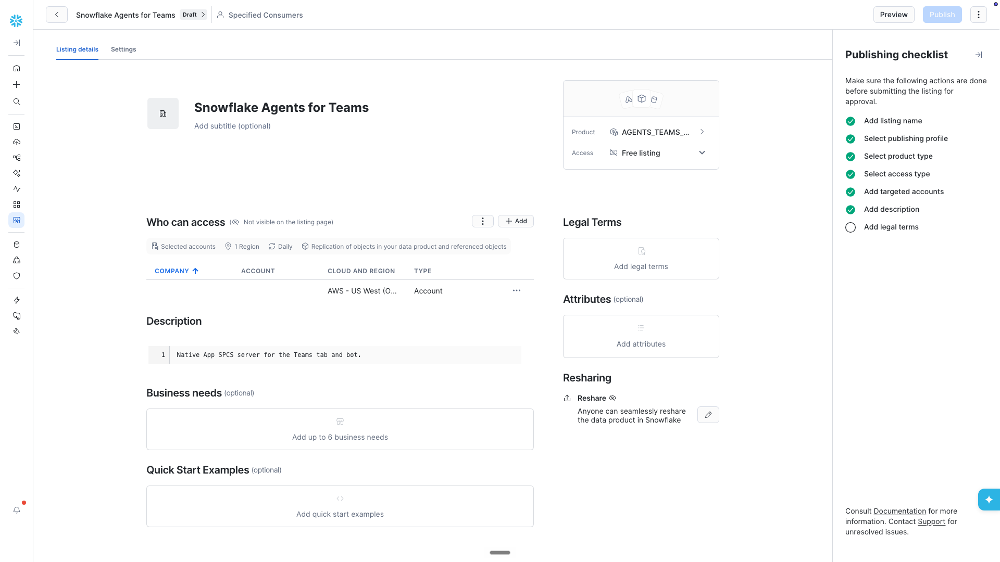

> Marketplace → Provider Studio. Private listing attached to `AGENTS_TEAMS_PACKAGE`, specified consumers.

#### Consumer path (published listing)

In the **consumer** account (a role with `IMPORT SHARE` and `CREATE DATABASE`, usually ACCOUNTADMIN): Apps → Shared with me → Get. Accept the privilege requests (`CREATE COMPUTE POOL`, `BIND SERVICE ENDPOINT`, `CREATE EXTERNAL ACCESS INTEGRATION`, `CREATE SECURITY INTEGRATION`, `SNOWFLAKE.CORTEX_USER`). Name the installed app `AGENTS_TEAMS_APP` so the SQL above matches.

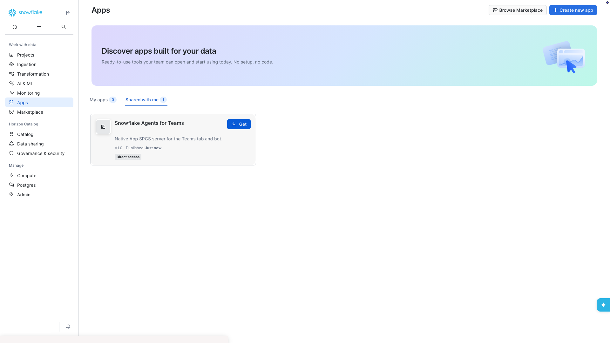

> Consumer account. Apps → Shared with me → Get, accepting the privilege requests before naming the installed app `AGENTS_TEAMS_APP`.

Then run that application-role SQL **in the consumer account**, against **that** account’s PAT user. Create a consumer-side service user; do not reuse the provider’s `AGENTS_TEAMS_SVC`. Continue from [Streamlit](#b3-streamlit).

The provider’s `AGENTS_TEAMS_APP` is unchanged. See the [master guide consumer path](install-guide.md#consumer-path-published-listing).

### B.2 Pending spec and leftover EAI

The setup script creates the egress EAI **and** an `EXTERNAL_ACCESS` app specification (`cortex_and_entra_egress`). Until a role with `MANAGE APPLICATION SPECIFICATIONS` (ACCOUNTADMIN or SECURITYADMIN) approves it, SPCS cannot resolve the Cortex hostname (`ENOTFOUND`) even though `DESC SERVICE` lists the EAI. Approve after every install or host-list change, then recreate the service. Skip if `SHOW PENDING SPECIFICATIONS` returns no rows (already `APPROVED`). Use the `sequence_number` column from that SHOW — do not paste a placeholder:

```sql
SHOW PENDING SPECIFICATIONS IN APPLICATION AGENTS_TEAMS_APP;
-- only if a row is returned:
ALTER APPLICATION AGENTS_TEAMS_APP APPROVE SPECIFICATION cortex_and_entra_egress SEQUENCE_NUMBER = 1;
```

If Create Service reports that the application needs `USAGE` on `AGENTS_TEAMS_EAI` (an account-level integration of the same name already exists), grant it and retry:

```sql
GRANT USAGE ON INTEGRATION AGENTS_TEAMS_EAI TO APPLICATION AGENTS_TEAMS_APP;
```

### B.3 Streamlit

The wizard is `CONFIG.SETUP_WIZARD`, created by [`setup.sql`](../apps/teams/native-app/setup/setup.sql) on install or upgrade. In Snowsight: **Apps → `AGENTS_TEAMS_APP` → SETUP_WIZARD** (pick a warehouse). Confirm with `SHOW STREAMLITS IN APPLICATION AGENTS_TEAMS_APP`. The SQL in this subsection is the equivalent of the wizard buttons; both require `APP_ADMIN`.

Nine tabs. Source: [`apps/teams/native-app/streamlit/setup_wizard.py`](../apps/teams/native-app/streamlit/setup_wizard.py). The in-wizard expanders already include Azure screenshots under `native-app/streamlit/img/entra-setup/`; the slots below keep this guide self-contained.

If the Entra app and Azure Bot already exist, skip tabs 1–6 and paste the existing IDs and secrets from `apps/teams/.env` on tab 7.

**Tab 1: Register** the Entra app (`agents-teams-app`, single tenant, no redirect URI yet).

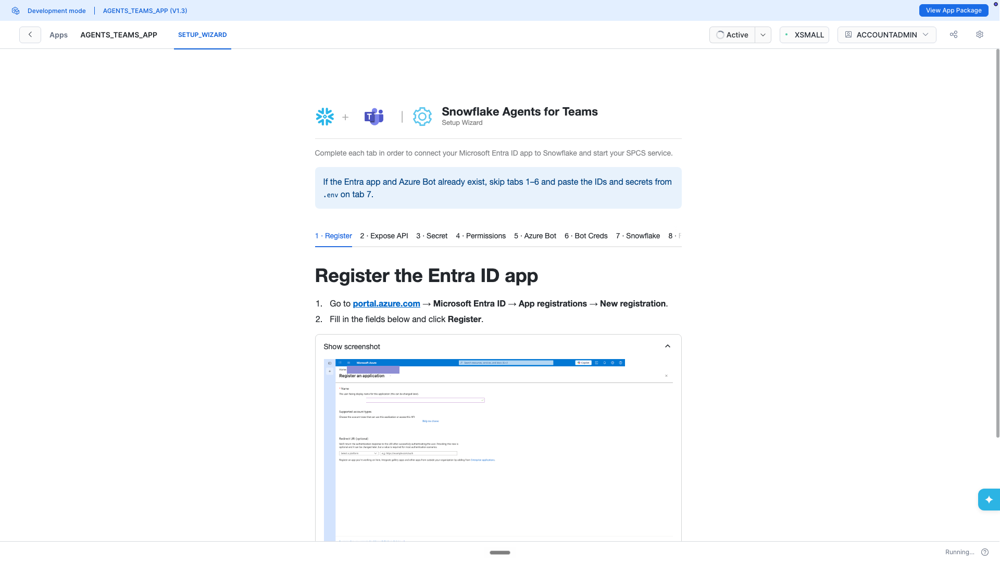

> Catalog → Apps → `AGENTS_TEAMS_APP` → SETUP_WIZARD, tab 1. Skip 1–6 if Entra and the bot already exist.

**Tab 2: Expose an API.** When Azure prompts for the Application ID URI, replace the default `api://<client-id>` with `api://<TAB_BASE_HOST>/<client-id>` (for example `api://teams.example.com/<client-id>`). Teams SSO requires the edge hostname in the URI, and `TAB_BASE_HOST` in `apps/teams/.env` must be that same host, so pick the Worker host first ([Cloudflare Worker](#b4-cloudflare-worker)). A mismatch fails sign-in with `AADSTS500011` ([§ 4](#4-verify-and-common-failures)). Scope name `access_as_user`, admins and users can consent. This is the Teams SSO / OBO app, not the Snowflake OAuth resource app that tab 7 asks for.

**Tab 3: Client secret.** Copy the **Value** immediately; it is shown once. That is **OBO Client Secret**. Application (client) ID from Overview is **OBO Client App ID**.

**Tab 4: API permissions.** Microsoft Graph delegated `User.Read`. Optionally Grant admin consent.

**Tab 5: Azure Bot.** Create an Azure Bot resource (single tenant). You may reuse the app from tabs 1–4 or let Azure create a new App ID.

**Tab 6: Bot App ID and secret.** Settings → Configuration → Microsoft App ID. Manage Password → new client secret. Copy the Value once.

**Tab 7: Snowflake.** Paste tenant ID, bot + OBO credentials, Snowflake App (OAuth resource) client ID (UUID or `api://…`), Apps API host (`apps-api.c1.<region>.<cloud>.app.snowflake.com`), default agent FQN, optional allow-list, Teams App ID (default `<your-teams-app-id>`). Click **Configure Security Integration**. The integration maps the `upn` claim only; add `upn` as an access-token optional claim on the Snowflake resource app (see [T9](#t9-you-do-not-have-access-to-that-resource)) or Cortex returns `agent_forbidden`.

> **This button only `ALTER`s `CORTEX_TEAMS_OAUTH` - it does not create it.** Snowflake Native Apps have no manifest privilege that gets `CREATE SECURITY INTEGRATION` auto-granted to the app (`CREATE INTEGRATION` is rejected outright as an invalid privilege name; declaring `CREATE SECURITY INTEGRATION` under `privileges:` passes manifest validation but is never actually granted at run time — confirmed by testing, not assumed). So on every fresh install, before tab 7's button will work, an `ACCOUNTADMIN` in the consumer's account must run **one** of:
>
> - The manual SQL below (creates the integration directly, then grants the app `MODIFY` on it), or
> - The app's own creation path, which keeps the integration's definition inside the versioned app rather than hand-typed by every installer:
>   ```sql
>   GRANT CREATE INTEGRATION ON ACCOUNT TO APPLICATION <installed-app-name>;
>   CALL <installed-app-name>.CONFIG.CREATE_OAUTH_INTEGRATION();
>   REVOKE CREATE INTEGRATION ON ACCOUNT FROM APPLICATION <installed-app-name>;
>   ```
>
> Symptom if you skip this: tab 7's button (or the equivalent `CALL CONFIG.CONFIGURE_OAUTH(...)`) fails with `Integration 'CORTEX_TEAMS_OAUTH' does not exist or not authorized ... The owning application <installed-app-name> must have at least one privilege granted on INTEGRATION CORTEX_TEAMS_OAUTH` — see the troubleshooting table (`093118`, [§ 4](#4-verify-and-common-failures)).
>
> `<installed-app-name>` is whatever `SHOW APPLICATIONS` shows for this install (for example `SNOWFLAKE_AGENTS_FOR_TEAMS` when installed from a Marketplace listing) — it is **not** always the placeholder `AGENTS_TEAMS_APP` this doc uses elsewhere.

SQL path (same outcome as the streamlit). Create the security integration as `ACCOUNTADMIN`, grant the application `MODIFY`, then configure and set secrets. Replace `AGENTS_TEAMS_APP` below with your actual installed app name (`SHOW APPLICATIONS`):

```sql
CREATE SECURITY INTEGRATION IF NOT EXISTS CORTEX_TEAMS_OAUTH
  TYPE = EXTERNAL_OAUTH
  ENABLED = TRUE
  EXTERNAL_OAUTH_TYPE = AZURE
  EXTERNAL_OAUTH_ISSUER = 'https://login.microsoftonline.com/PLACEHOLDER/v2.0'
  EXTERNAL_OAUTH_JWS_KEYS_URL = 'https://login.microsoftonline.com/PLACEHOLDER/discovery/v2.0/keys'
  EXTERNAL_OAUTH_AUDIENCE_LIST = ('api://PLACEHOLDER', 'PLACEHOLDER')
  EXTERNAL_OAUTH_TOKEN_USER_MAPPING_CLAIM = ('upn')
  EXTERNAL_OAUTH_SNOWFLAKE_USER_MAPPING_ATTRIBUTE = 'login_name'
  EXTERNAL_OAUTH_ANY_ROLE_MODE = 'ENABLE';

GRANT MODIFY ON INTEGRATION CORTEX_TEAMS_OAUTH TO APPLICATION AGENTS_TEAMS_APP;

CALL AGENTS_TEAMS_APP.CONFIG.CONFIGURE_OAUTH(
  '<AZURE_TENANT_ID>',
  'api://<snowflake-app-id>',
  '<snowflake-app-id>'
);

CALL AGENTS_TEAMS_APP.CONFIG.SET_SECRET('BOT_APP_ID', '<BOT_APP_ID>');
CALL AGENTS_TEAMS_APP.CONFIG.SET_SECRET('BOT_APP_SECRET', '<BOT_APP_SECRET>');
CALL AGENTS_TEAMS_APP.CONFIG.SET_SECRET('OBO_CLIENT_ID', '<OBO_CLIENT_ID>');
CALL AGENTS_TEAMS_APP.CONFIG.SET_SECRET('OBO_CLIENT_SECRET', '<OBO_CLIENT_SECRET>');
CALL AGENTS_TEAMS_APP.CONFIG.SET_SECRET('DEFAULT_AGENT_FQN', 'MY_DB.MY_SCHEMA.MY_AGENT');
CALL AGENTS_TEAMS_APP.CONFIG.SET_SECRET('TEAMS_APP_ID', '<your-teams-app-id>');
CALL AGENTS_TEAMS_APP.CONFIG.SET_SECRET('AGENT_ALLOW_LIST', '[]');
CALL AGENTS_TEAMS_APP.CONFIG.SET_SECRET('AZURE_TENANT_ID', '<AZURE_TENANT_ID>');
CALL AGENTS_TEAMS_APP.CONFIG.SET_SECRET('SNOWFLAKE_SCOPE', 'api://<snowflake-resource-app-id>/session:role-any');
CALL AGENTS_TEAMS_APP.CONFIG.SET_SECRET('APPS_API_HOST', 'apps-api.c1.<region>.<cloud>.app.snowflake.com');
```

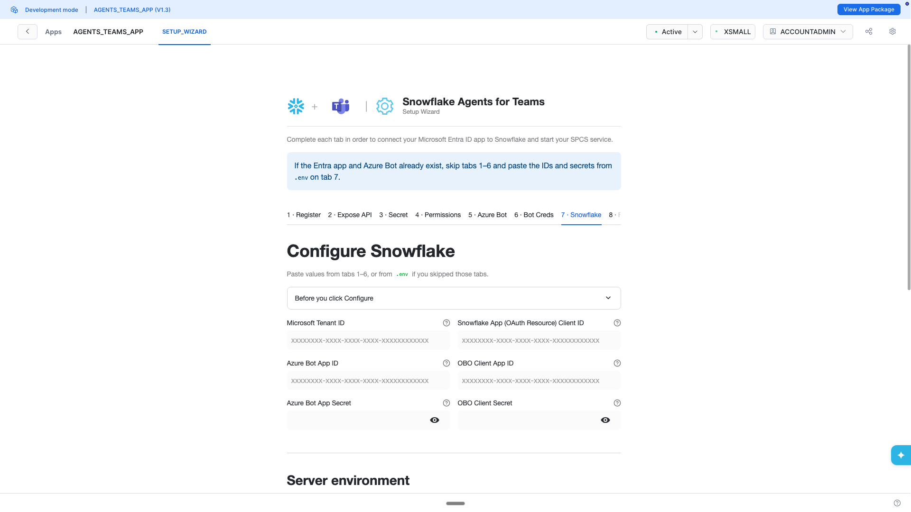

> Tab 7: tenant, bot, OBO, and Snowflake OAuth resource fields.

**Tab 8: Network.** Leave the mode on **public** (the default) unless the account restricts Snowflake to private connectivity; public needs nothing else on this tab. For **hybrid** and **privatelink**, read [§ 7](#7-private-connectivity-optional) first. Pick the mode and click **Save network mode** (`CONFIG.SET_NETWORK_MODE`). The mode only takes effect on the next **Create Service** or **Roll service** on tab 9, and a roll keeps the saved mode. In hybrid and privatelink the tab shows three more steps:

- **8a · Detect**: the cloud (from `CURRENT_REGION()`) and the account's PrivateLink configuration. The app usually cannot run `SYSTEM$GET_PRIVATELINK_CONFIG()` itself; run the query it shows as `ACCOUNTADMIN` and paste the JSON back. **Read private ingress URL** shows `privatelink_ingress_url` once the service is running.
- **8b · Private DNS**: one record per host for your private zone ([§ 7.5](#75-private-dns)).
- **8c · ACCOUNTADMIN SQL**: the compute pool network rule on `CORTEX_TEAMS_OAUTH` and, in privatelink, the endpoint-ID policy on the service PAT user ([§ 7.4](#74-network-sql-accountadmin)). Apply it **before** Create Service or Roll service, or every user call fails with `390422`.

SQL path: `CALL AGENTS_TEAMS_APP.CONFIG.SET_NETWORK_MODE('hybrid');` (`public`, `hybrid` or `privatelink`) and `CALL AGENTS_TEAMS_APP.CONFIG.GET_NETWORK_MODE();`. A value outside those three returns a `refuse:` string and changes nothing.

**Tab 9: Finish**

The edge Worker does **not** need to exist yet to complete this tab. Its hostname is known in advance: a custom domain you choose, or `<worker-name>.<your-subdomain>.workers.dev` (see [Cloudflare Worker](#b4-cloudflare-worker)). Decide it now and use it below. The first `deploy-tab.sh` happens after this tab.

1. **9a · CDN domain**: the edge hostname (`teams.example.com`) or `https://teams.example.com` (no path). Same origin as `TAB_BASE_HOST`. A self-hosted edge uses its own public hostname here.
2. **9b · Create Service**: `CONFIG.CREATE_SERVER_SERVICE` + `CONFIG.GRANT_ENDPOINT_ACCESS`. The procedure accepts the origin string or the bare hostname. It applies `services/service_spec.yml` in public mode and `services/service_spec_private.yml` in hybrid and privatelink. It also writes `CONFIG.ALLOWED_ORIGINS` from that origin. Production `TEAMS_AUTH_MODE` refuses to boot without it, and the container exits `1` (`Missing required environment variable: ALLOWED_ORIGINS`). Wait until `GET_SERVER_STATUS` shows `READY` (often ~60s). Approve `cortex_and_entra_egress` only if `SHOW PENDING SPECIFICATIONS` still has a row. **Roll service** remounts the container after a secret or network mode change. If it reports a new ingress host, update `SPCS_BASE` as in step 3.
3. **9c · Show Endpoint URL**: shows the public ingress and, on an account with PrivateLink, the private ingress (`privatelink_ingress_url`). The edge secret `SPCS_BASE` is the public ingress in public and hybrid, and the private ingress copied verbatim in privatelink. Do **not** put it in `VITE_SPCS_BASE`. Do **not** use it as the Azure Bot messaging endpoint (`https://<TAB_BASE_HOST>/api/bot/messages`). `CREATE_SERVER_SERVICE` drops and recreates the service, so the ingress hostname **changes every install**. Copy the public ingress host into `apps/teams/.env` `SPCS_INGRESS_HOST` (no scheme) before [§ 3](#3-teams-app) `zip.sh`; in privatelink the manifest leaves it out and it may stay empty.

```sql
CALL AGENTS_TEAMS_APP.CONFIG.CREATE_SERVER_SERVICE('https://teams.example.com');
CALL AGENTS_TEAMS_APP.CONFIG.GRANT_ENDPOINT_ACCESS();
CALL AGENTS_TEAMS_APP.CONFIG.GET_SERVER_STATUS();
-- status=… endpoint=<ingress_url from SHOW ENDPOINTS> [privatelink=<privatelink_ingress_url>]
```

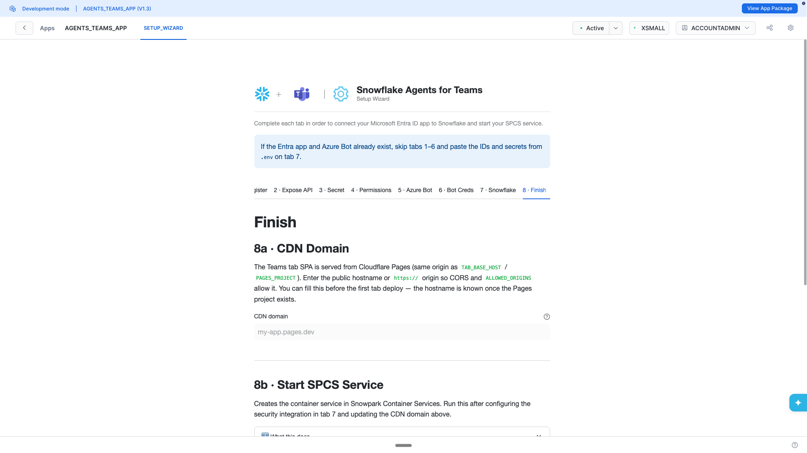

> Tab 9: CDN domain (`TAB_BASE_HOST`) then Create Service. The screenshot predates the Network tab, so its tab is labelled 8.

### B.4 Cloudflare Worker

Continue here right after finishing tab 9. This is where the edge Worker for the host you entered there is deployed.

Leave [`packages/tab/.env.production`](../packages/tab/.env.production) `VITE_SPCS_BASE` empty so the SPA uses relative `/api/*`.

[`apps/teams/scripts/deploy-tab.sh`](../apps/teams/scripts/deploy-tab.sh) builds the tab, then runs `wrangler deploy` from [`packages/teams-edge`](../packages/teams-edge). One Worker serves the tab's static assets and the edge routes (`/api/*`, `/token/exchange`, `/token/link`). The first deploy creates the Worker, so there is nothing to create beforehand. The Worker name is `EDGE_WORKER_NAME` if set, else a legacy `PAGES_PROJECT`, else the first label of a `*.workers.dev` `TAB_BASE_HOST`, else `agents-embed-teams`. `set-edge-secrets.sh` resolves the same name.

Pick the host:

- **Custom domain (recommended)**: needs a zone on the same Cloudflare account. After the first deploy, add it under the Worker → **Settings** → **Domains & Routes** → **Add** → **Custom domain**, or set `EDGE_CUSTOM_DOMAIN=teams.example.com` in `apps/teams/.env` so `deploy-tab.sh` adds the route on every deploy.
- **workers.dev**: `<worker-name>.<your-subdomain>.workers.dev`. Register the account's workers.dev subdomain once in the dashboard (Workers & Pages), or the first deploy fails ([I14](#i14-wrangler-deploy-workersdev-subdomain-or-worker-name)).

Either way the host must be **the same origin** as:

- wizard tab 9 / `CREATE_SERVER_SERVICE` (CORS + `ALLOWED_ORIGINS`)
- `apps/teams/.env` `TAB_BASE_HOST` / `TAB_BASE_URL` (manifest `contentUrl` via `zip.sh`)
- the Entra / Teams SSO app's Application ID URI, `api://<TAB_BASE_HOST>/<OBO_CLIENT_ID>` (check with `az ad app show --id <OBO_CLIENT_ID> --query identifierUris`). The manifest `webApplicationInfo.resource` is built from `TAB_BASE_HOST`, so a different host is `AADSTS500011`

A **new** hostname that Entra does not already authorize fails tab SSO with the generic "Couldn't sign you in" banner. Reuse the host that is already on the Entra app (`TAB_BASE_HOST`), or add the new one first ([§ 6](#6-pages-to-worker-cutover) step 1). Moving from an existing `*.pages.dev` install follows [§ 6](#6-pages-to-worker-cutover).

Set the runtime secrets, then deploy. [`apps/teams/scripts/set-edge-secrets.sh`](../apps/teams/scripts/set-edge-secrets.sh) sends all 10 from `apps/teams/.env` in one `wrangler secret bulk` call (`AZURE_TENANT_ID`, `OBO_CLIENT_ID`, `OBO_CLIENT_SECRET`, `SNOWFLAKE_SCOPE`, `ENTRA_AUDIENCE_URI`, `SPCS_BASE`, `SPCS_PAT`, `EDGE_SESSION_SECRET`, `BOT_LINK_SECRET`, `BOT_APP_ID`). It generates `EDGE_SESSION_SECRET` and `BOT_LINK_SECRET` into `.env` if they are absent. On a first install Wrangler asks whether to create the Worker so it can hold the secrets; answer yes, and the deploy replaces that placeholder and keeps the secrets. The script does not deploy, so run `deploy-tab.sh` after it:

```bash
bash apps/teams/scripts/set-edge-secrets.sh
bash apps/teams/scripts/deploy-tab.sh                # privatelink: deploy-tab.sh --privatelink (§ 7.6)
```

Confirm it in Cloudflare: **Workers & Pages** → the Worker → **Deployments** lists the new version as active. Secret names (never values) are under **Settings** → **Variables and Secrets**, or from the CLI:

```bash
cd packages/teams-edge
npx wrangler secret list --name <worker-name>       # EDGE_WORKER_NAME; no --env
```

Do not pass `--env privatelink` to `secret` or `tail` commands. Wrangler then targets `<worker-name>-privatelink`, a Worker that does not exist. `deploy-tab.sh` is the only command that passes `--env`, and it pins `--name` too, so both modes deploy to the same Worker and share its secrets, KV and custom domain.

`SNOWFLAKE_SCOPE` is `api://<snowflake-resource-app-id>/session:role-any` - the **Snowflake OAuth resource** app (tab 7 audience), not the Teams SSO / bot app (`OBO_CLIENT_ID` / `BOT_APP_ID`). Scope value is lowercase; `SESSION:ROLE-ANY` is AADSTS65005. `SPCS_BASE` is the SPCS ingress (the private ingress in privatelink). `SPCS_PAT` authenticates edge → that ingress only. The Worker returns 500 if either `SPCS_BASE` or `SPCS_PAT` is missing.

After rotating a secret, run `deploy-tab.sh` again so warm isolates pick up the new value.

The wizard needs the edge hostname before Create Service; the Worker needs `SPCS_BASE` and `SPCS_PAT` after the ingress exists. Decide the host, put it in wizard tab 9, start the service, then set the secrets and deploy.

Continue at [§ 3](#3-teams-app).

### B.5 Native App failures

Errors that only occur on a Native App install (B1 to B4), then the Native App variants of entries in [§ 4](#4-verify-and-common-failures) (B5).

#### B1. `093118`: `CREATE INTEGRATION` cannot be granted

**Symptom.** Granting `CREATE INTEGRATION` to the application fails with `093118`.

**Cause.** That privilege is not on the app manifest.

**Fix.** Use the [Streamlit](#b3-streamlit) path: create `CORTEX_TEAMS_OAUTH` as `ACCOUNTADMIN`, then `GRANT MODIFY ON INTEGRATION CORTEX_TEAMS_OAUTH TO APPLICATION AGENTS_TEAMS_APP`.

#### B2. Create Service needs `USAGE` on `AGENTS_TEAMS_EAI`

**Symptom.** Create Service fails: the application must have `USAGE` on `AGENTS_TEAMS_EAI`.

**Cause.** An account-level integration of that name already exists.

**Fix.**

```sql
GRANT USAGE ON INTEGRATION AGENTS_TEAMS_EAI TO APPLICATION AGENTS_TEAMS_APP;
```

Retry Create Service.

#### B3. `395089` spec template / `Unknown function SYSTEM$GET_SECRET_STRING`

**Symptom.** `CREATE_SERVER_SERVICE` fails with `395089: spec template argument must be alphanumeric or valid JSON`, or `SET_SECRET` fails with `Unknown function SYSTEM$GET_SECRET_STRING`.

**Cause.** The installed app version is stale. It does not JSON-encode `cdn_origin` (`395089`), or it still reads secrets with the old function.

**Fix.** Upgrade with `./scripts/native-app-release.sh teams v1`, then retry `CREATE_SERVER_SERVICE` / `SET_SECRET`.

#### B4. Server logs `ENOTFOUND` for `*.snowflakecomputing.com`

**Symptom.** The container cannot resolve Cortex. `DESC SERVICE` still lists the EAI.

**Cause.** The `EXTERNAL_ACCESS` app specification (`cortex_and_entra_egress`) is still pending.

**Fix.** Confirm with the user, then approve it with that row's `sequence_number` (skip if there are no rows) and recreate the service:

```sql
SHOW PENDING SPECIFICATIONS IN APPLICATION AGENTS_TEAMS_APP;
ALTER APPLICATION AGENTS_TEAMS_APP APPROVE SPECIFICATION cortex_and_entra_egress SEQUENCE_NUMBER = <n>;
```

#### B5. Native App variants of the main-chapter entries

Use these in place of the matching fix in [§ 4](#4-verify-and-common-failures) when the service came from the Native App.

- **I3 (Docker):** the `docker build` in [B.1](#b1-deploy-the-native-app) fails the same way; same fix.
- **I4 (`<IMAGE_REPO>`):** copy `repository_url` from the `NA_IMAGE_REPO` row, not `IMAGE_REPO`.
- **I7 (`397012`):** the service reads `na_image_repo` (the manifest repo), not `IMAGE_REPO`. Push to `/agents_teams_app_db/public/na_image_repo/agents-teams-app:latest`.
- **I8 (never READY):** after pushing the amd64 image to `NA_IMAGE_REPO`, run `./scripts/native-app-release.sh teams v1`.
- **I12 (`ALLOWED_ORIGINS`):** `CREATE_SERVER_SERVICE` did not write `CONFIG.ALLOWED_ORIGINS` (old app version, or the CDN origin was omitted). Upgrade the app if needed, then recreate: `CREATE_SERVER_SERVICE('https://<TAB_BASE_HOST>')`.
- **I17 (`SPCS_INGRESS_HOST` placeholder):** take the host from wizard tab 9 (9c) / `GET_SERVER_STATUS` instead of `SHOW ENDPOINTS`.
- **I18 (no Bot Service):** create it as wizard tab 5 describes, or:

  ```bash
  az bot create -g agents-teams-rg -n agents-teams-bot --sku F0 --appid "$BOT_APP_ID" --app-type SingleTenant --tenant-id "$AZURE_TENANT_ID" --endpoint https://<TAB_BASE_HOST>/api/bot/messages --location global
  az bot msteams create -g agents-teams-rg -n agents-teams-bot
  ```

- **T2 (Couldn't sign you in):** keep wizard tab 9 (9a), `TAB_BASE_URL` and the manifest on the same origin.
- **T3 (AADSTS65005):** instead of the `fill-dev-secrets.sh` / `deploy-spcs.sh` step, run (`SNOWFLAKE_SCOPE` lives in `CONFIG.SNOWFLAKE_SCOPE`):

  ```sql
  CALL AGENTS_TEAMS_APP.CONFIG.CONFIGURE_OAUTH(
    '<AZURE_TENANT_ID>',
    'api://<snowflake-resource-app-id>',
    '<snowflake-resource-app-id>'
  );
  CALL AGENTS_TEAMS_APP.CONFIG.SET_SECRET('SNOWFLAKE_SCOPE', 'api://<snowflake-resource-app-id>/session:role-any');
  CALL AGENTS_TEAMS_APP.CONFIG.ROLL_SERVER_SERVICE('https://<TAB_BASE_HOST>');
  ```
- **T6 (the tab's `/api/*` at the ingress):** `403 Insufficient privileges to use <ingress>` means the `SPCS_PAT` user does not hold `APP_PUBLIC`: `GRANT APPLICATION ROLE AGENTS_TEAMS_APP.APP_PUBLIC TO USER "<pat-user>"`. `522` right after `CREATE_SERVER_SERVICE`: the new ingress is not routable yet; wait about a minute. A `404 Could not find the service associated with endpoint <old-id>` right after `deploy-tab.sh` can be a warm isolate holding the previous install's `SPCS_BASE`; retry after a minute, then re-run `set-edge-secrets.sh` and `deploy-tab.sh` if `SPCS_BASE` is stale.

### B.6 Tear down Path B

See [master guide § 6](install-guide.md#6-tear-down-semantics) for `--cascade` / `--force` semantics.

```bash
cd apps/teams/native-app
snow app teardown --cascade --force --no-interactive
```

`--cascade` drops the application and its owned objects (`AGENTS_TEAMS_APP_POOL`, `AGENTS_TEAMS_EAI`). `DROP APPLICATION PACKAGE` then fails if a listing is still attached ([Snowflake](https://docs.snowflake.com/en/sql-reference/sql/drop-application-package)). Unpublish and drop the listing, then drop the package. `SHOW LISTINGS` if the name is not `AGENTS_TEAMS_LISTING` (Provider Studio can pick another):

```sql
ALTER LISTING AGENTS_TEAMS_LISTING UNPUBLISH;
DROP LISTING AGENTS_TEAMS_LISTING;
DROP APPLICATION PACKAGE IF EXISTS AGENTS_TEAMS_PACKAGE;
```

A leftover package does not block [the standalone install](#2-install-standalone-spcs). Continue bootstrap as soon as the application is gone.

Then drop leftovers the CLI does not own:

```sql
DROP SERVICE IF EXISTS AGENTS_TEAMS_APP_DB.PUBLIC.AGENTS_TEAMS;
DROP SERVICE IF EXISTS AGENTS_TEAMS_APP_DB.PUBLIC.AGENTS_TEAMS_STAGING;

DROP COMPUTE POOL IF EXISTS COWORK_COMPUTE_POOL;
DROP COMPUTE POOL IF EXISTS AGENTS_TEAMS_APP_POOL;

DROP SECURITY INTEGRATION IF EXISTS CORTEX_TEAMS_OAUTH;

-- Account-level leftover that collides with the next install's app-owned EAI.
-- Cascade drops app-owned integrations (often named SNOWSERVICE-…), not this.
DROP EXTERNAL ACCESS INTEGRATION IF EXISTS AGENTS_TEAMS_EAI;
```

Keep `AGENTS_TEAMS_APP_DB` and `NA_IMAGE_REPO` so the next [push](#b1-deploy-the-native-app) has a registry. Keep Cortex agents and `AGENTS_TEAMS_USER`. Reinstall from [B.1](#b1-deploy-the-native-app). `--cascade` already drops the app-owned compute pool and `AGENTS_TEAMS_EAI`; the leftover `DROP`s are for names that survive when a prior standalone install used them.

The PAT that the edge presents to the ingress (`SPCS_PAT`) must belong to a user whose **user-level** network policy allows the edge's egress (Cloudflare IPs in public and hybrid, the private endpoint IDs through `AGENTS_TEAMS_PL_INGRESS_POLICY` in privatelink), and that user needs `APP_PUBLIC` (endpoint usage) on the installed app (`GRANT APPLICATION ROLE … TO USER`, not only to `AGENTS_TEAMS_USER`). Keep that policy restricted across reinstalls.

`--cascade` does not uninstall the Teams sideload, delete the edge Worker (or a legacy Pages project), or drop the `AGENTS_TEAMS_NETWORK` policies from [§ 7](#7-private-connectivity-optional). Uninstall the sideload from the Teams UI before the next run if you want a clean personal-app install. Leave Azure app registrations and the Worker in place; to remove private connectivity as well, follow [§ 7.8](#78-tear-down-private-connectivity).
