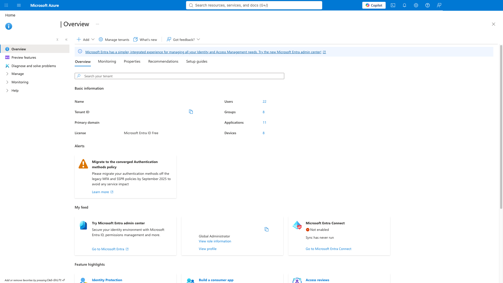
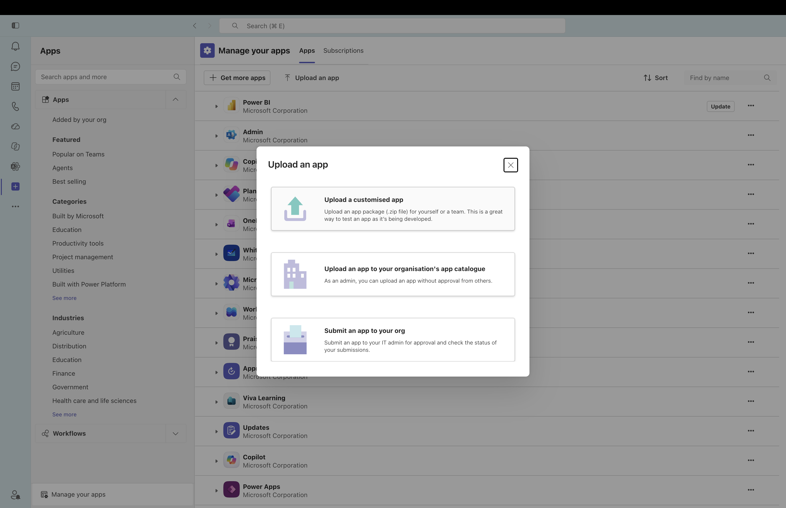
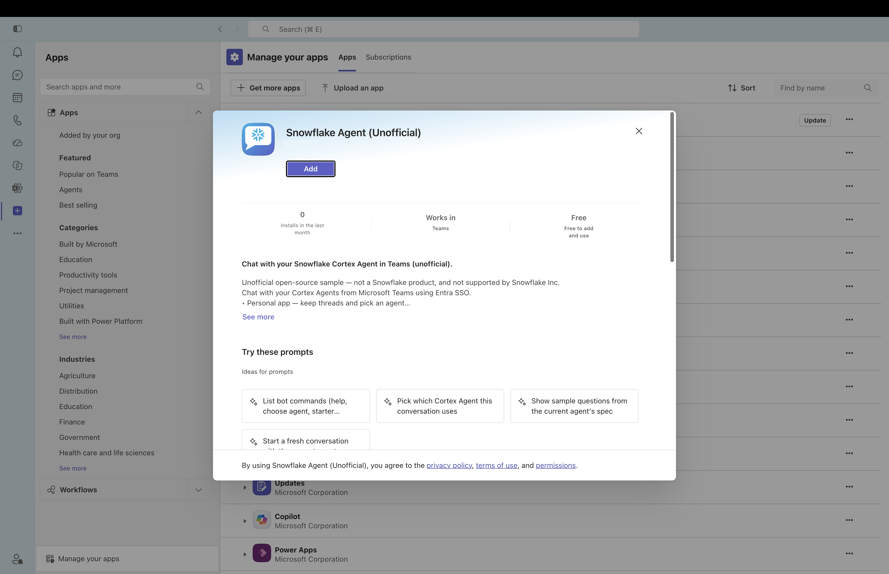

# Teams install guide

Complete the [master install guide](../install-guide.md) first.

Operator path for Snowflake Agents for Teams (Unofficial): SPCS server, the edge Cloudflare Worker (the Worker that owns `TAB_BASE_HOST`), Teams tab + bot. This guide installs the standalone SPCS service (**Path A**; the Native App is Path B). Packaging the Native App for distribution, or installing a published listing? Use [native-app.md](native-app.md) instead.

The Teams tab and the edge Worker share one origin, so the Single Page Application (SPA) stays on relative `/api/*` and the Worker attaches `SPCS_PAT` and `SPCS_BASE` server-side. See [`packages/tab/.env.production`](../../packages/tab/.env.production) and [`packages/teams-edge/src/core/api-proxy.ts`](../../packages/teams-edge/src/core/api-proxy.ts). Auth modes and token lifetime: [authentication-patterns.md](../authentication-patterns.md).

Already on a `*.pages.dev` host from an earlier install? It keeps working; move to a Worker with [§ 6](#6-pages-to-worker-cutover). Need Snowflake to stay off the public internet? The default install is `NETWORK_MODE=public`; [private-connectivity.md](private-connectivity.md) adds `hybrid` and `privatelink`.

## Contents

1. [Extra prerequisites](#1-extra-prerequisites)
2. [Install (standalone SPCS)](#2-install-standalone-spcs)
3. [Teams app](#3-teams-app)
4. [Verify](#4-verify)
5. [Tear down](#5-tear-down)
6. [Pages to Worker cutover](#6-pages-to-worker-cutover) (existing `*.pages.dev` installs)

Other Teams docs:

- [troubleshooting.md](troubleshooting.md): install errors (I1 to I21), tab errors (T1 to T14), diagnostics
- [private-connectivity.md](private-connectivity.md): `hybrid` and `privatelink` network modes (optional)
- [native-app.md](native-app.md): Native App install (Path B)

---

## 1. Extra prerequisites

| Tool               | Notes                                                                                                                                                                        |
| ------------------ | ---------------------------------------------------------------------------------------------------------------------------------------------------------------------------- |
| Wrangler           | `npx wrangler login` once. Invoke Wrangler from [`packages/teams-edge`](../../packages/teams-edge). Root-level `npx wrangler` is not the supported entry                   |
| Azure CLI (`az`) | Used by `create-bot.sh`, `set-bot-endpoint.sh` and `rotate-entra-secret.sh`. Always`az login --tenant "$AZURE_TENANT_ID"` from `apps/teams/.env` — do not use another tenant’s subscription |

- **Cloudflare** account for the edge Worker. If `TAB_BASE_HOST` will be a `*.workers.dev` host, register the account's workers.dev subdomain once (dashboard: Workers & Pages); a custom domain needs a zone on the same account ([B.4](native-app.md#b4-cloudflare-worker)).
- **Microsoft tenant** in `apps/teams/.env` `AZURE_TENANT_ID`. Every Azure CLI step (bot creation, bot endpoint, Entra) uses that value.
- The PAT’s **user-level** network policy must allow SPCS egress and Cloudflare egress (`public` and `hybrid`; `privatelink` uses private-endpoint IDs instead, [§ 7](private-connectivity.md)).

Minimum `apps/teams/.env` for Teams / Cloudflare Worker:

- `AZURE_TENANT_ID`, `BOT_APP_ID`, `BOT_APP_SECRET`, `OBO_CLIENT_ID`, `OBO_CLIENT_SECRET`, `SNOWFLAKE_SCOPE`, `TEAMS_APP_ID`
- `TAB_BASE_HOST` / `TAB_BASE_URL`: the edge origin already on the Entra app: the Worker's custom domain (recommended) or `<worker>.<subdomain>.workers.dev`. `zip.sh`, `deploy-tab.sh`, `set-edge-secrets.sh`, and `set-bot-endpoint.sh` all read it.
- `EDGE_WORKER_NAME` (optional): the Worker to deploy to. Blank falls back to a legacy `PAGES_PROJECT`, then the first label of a `*.workers.dev` `TAB_BASE_HOST`, then `agents-embed-teams`.
- `SNOWFLAKE_ENTRA_APP_ID` (Snowflake OAuth resource app), `DEFAULT_AGENT_FQN`, `APPS_API_HOST`
- `SNOWFLAKE_USER` / `SNOWFLAKE_PAT`: the service user (`AGENTS_TEAMS_SVC`) and its PAT. That PAT becomes the Worker secret `SPCS_PAT`.
- `SPCS_INGRESS_HOST` / `SPCS_BASE`: fill these in after the service is READY (`SHOW ENDPOINTS`). `set-edge-secrets.sh` and `zip.sh` need them. In `privatelink`, `SPCS_BASE` is required and is the `privatelink_ingress_url` ([§ 7](private-connectivity.md)).
- Teams Snowflake secret (`APPS_API_HOST`): written with `ALTER SECRET` on `AGENTS_TEAMS_APP_DB.CONFIG.APPS_API_HOST` (install step 3).

`APPS_API_HOST` is `apps-api.c1.<region>.<cloud>.app.snowflake.com` (for example `apps-api.c1.eu-west-2.aws.app.snowflake.com`). There's no SQL function that returns it directly — run `SELECT CURRENT_REGION();` (e.g. `AWS_EU_WEST_2`), lowercase the part before the first `_` as `<cloud>` and the rest with `_` → `-` as `<region>`, then substitute into the template above. `c1` is a deployment "cell" and is correct for the vast majority of accounts; if the security integration is configured but the bot can't resolve/call it, confirm the real value in Snowsight's browser DevTools → Network tab (any Native Apps/Marketplace page) by finding the host of the `apps-api...` requests Snowsight itself makes. `SNOWFLAKE_SCOPE` must be lowercase `api://<id>/session:role-any`.



> Microsoft Entra ID → Overview. Capture Tenant ID.

---

## 2. Install (standalone SPCS)

These scripts roll the standalone service `AGENTS_TEAMS_APP_DB.PUBLIC.AGENTS_TEAMS`. Already installed as a Native App in this account? Remove it first ([B.6](native-app.md#b6-tear-down-path-b)): its app-owned `AGENTS_TEAMS_EAI` blocks the bootstrap ([I9](troubleshooting.md#i9-bootstrap-003001--modify-on-agents_teams_eai), [I10](troubleshooting.md#i10-bootstrap-093154-copy-current-grants)).

**1. Bootstrap** account objects with [`apps/teams/scripts/bootstrap-dev-spcs.sql`](../../apps/teams/scripts/bootstrap-dev-spcs.sql) (ACCOUNTADMIN section): database, `IMAGE_REPO`, compute pool, Entra+Cortex EAI, empty secrets, placeholder `CORTEX_TEAMS_OAUTH`, role `AGENTS_TEAMS_USER`, service user `AGENTS_TEAMS_SVC`.

```bash
snow sql -f apps/teams/scripts/bootstrap-dev-spcs.sql
```

**2. Entra apps.** Create the bot, tab SSO/OBO and Snowflake resource app registrations in `AZURE_TENANT_ID` with Snowsight wizard tabs 1-6, or by hand in Entra, and put their IDs and secrets in `apps/teams/.env` (`BOT_APP_ID`, `BOT_APP_SECRET`, `OBO_CLIENT_ID`, `OBO_CLIENT_SECRET`, `SNOWFLAKE_ENTRA_APP_ID`). Set `SNOWFLAKE_SCOPE` to `api://<SNOWFLAKE_ENTRA_APP_ID>/session:role-any` (lowercase `session`; never the OBO or bot app id). Use `az login --tenant "$AZURE_TENANT_ID"` for any Azure CLI step. The Azure Bot resource itself is created in [§ 3](#3-teams-app) with `create-bot.sh`.

**3. Fill secrets and configure OAuth** from `apps/teams/.env` (no `CONFIG.SET_SECRET`):

[`apps/teams/scripts/fill-dev-secrets.sh`](../../apps/teams/scripts/fill-dev-secrets.sh) applies `apps/teams/.env` into Snowflake (`snow sql --silent` on a mktemp file that is deleted afterwards). Use `--keep` / `-o` only if you need to review the SQL; that file holds secrets, so delete it after applying. `SNOWFLAKE_SCOPE` is `api://<SNOWFLAKE_ENTRA_APP_ID>/session:role-any`, or `.../session:role:<SNOWFLAKE_OAUTH_ROLE>` with `ANY_ROLE_MODE = 'DISABLE'` when `SNOWFLAKE_OAUTH_ROLE` is set in `apps/teams/.env`. `ALLOWED_ORIGINS` is `https://<TAB_BASE_HOST>`. `AGENT_ALLOW_LIST` comes from `apps/teams/.env`, or `[]` if unset.

```bash
bash apps/teams/scripts/fill-dev-secrets.sh
snow sql --silent --enable-templating none -f temp/alter-teams-secrets.sql
```

The generated file is this SQL with the placeholders filled:

```sql
ALTER SECRET AGENTS_TEAMS_APP_DB.CONFIG.BOT_APP_ID SET SECRET_STRING = '<BOT_APP_ID>';
ALTER SECRET AGENTS_TEAMS_APP_DB.CONFIG.BOT_APP_SECRET SET SECRET_STRING = '<BOT_APP_SECRET>';
ALTER SECRET AGENTS_TEAMS_APP_DB.CONFIG.OBO_CLIENT_ID SET SECRET_STRING = '<OBO_CLIENT_ID>';
ALTER SECRET AGENTS_TEAMS_APP_DB.CONFIG.OBO_CLIENT_SECRET SET SECRET_STRING = '<OBO_CLIENT_SECRET>';
ALTER SECRET AGENTS_TEAMS_APP_DB.CONFIG.DEFAULT_AGENT_FQN SET SECRET_STRING = '<DEFAULT_AGENT_FQN>';
ALTER SECRET AGENTS_TEAMS_APP_DB.CONFIG.TEAMS_APP_ID SET SECRET_STRING = '<TEAMS_APP_ID>';
ALTER SECRET AGENTS_TEAMS_APP_DB.CONFIG.AGENT_ALLOW_LIST SET SECRET_STRING = '[]';
ALTER SECRET AGENTS_TEAMS_APP_DB.CONFIG.AZURE_TENANT_ID SET SECRET_STRING = '<AZURE_TENANT_ID>';
ALTER SECRET AGENTS_TEAMS_APP_DB.CONFIG.SNOWFLAKE_SCOPE SET SECRET_STRING = 'api://<SNOWFLAKE_ENTRA_APP_ID>/session:role-any';
ALTER SECRET AGENTS_TEAMS_APP_DB.CONFIG.APPS_API_HOST SET SECRET_STRING = 'apps-api.c1.<region>.<cloud>.app.snowflake.com';
ALTER SECRET AGENTS_TEAMS_APP_DB.CONFIG.ALLOWED_ORIGINS SET SECRET_STRING = 'https://<TAB_BASE_HOST>';

ALTER SECURITY INTEGRATION CORTEX_TEAMS_OAUTH SET
  EXTERNAL_OAUTH_ISSUER = 'https://login.microsoftonline.com/<AZURE_TENANT_ID>/v2.0'
  EXTERNAL_OAUTH_JWS_KEYS_URL = 'https://login.microsoftonline.com/<AZURE_TENANT_ID>/discovery/v2.0/keys'
  EXTERNAL_OAUTH_AUDIENCE_LIST = ('api://<SNOWFLAKE_ENTRA_APP_ID>', '<SNOWFLAKE_ENTRA_APP_ID>')
  EXTERNAL_OAUTH_TOKEN_USER_MAPPING_CLAIM = ('upn')
  EXTERNAL_OAUTH_ANY_ROLE_MODE = 'ENABLE';
```

Mint a PAT on `AGENTS_TEAMS_SVC` if you do not already have one (printed once). That value is the Worker secret `SPCS_PAT` and `apps/teams/.env` `SNOWFLAKE_PAT`.

**4. Build and push** `linux/amd64` `:latest` to **`IMAGE_REPO`** (not `NA_IMAGE_REPO`):

Docker Desktop must be running first, or the build fails with `failed to connect to the docker API at unix:///Users/<you>/.docker/run/docker.sock`. Start it and wait until `docker info` succeeds:

```bash
open -a Docker          # macOS; on Windows/Linux start Docker Desktop from the app menu
docker info >/dev/null  # re-run until it exits 0 (the daemon can take ~30s to start)
```

If it still cannot connect, check `docker context ls` — the active context should be the Docker Desktop one.

[`apps/teams/scripts/push-dev-image.sh`](../../apps/teams/scripts/push-dev-image.sh) runs `SHOW IMAGE REPOSITORIES IN SCHEMA AGENTS_TEAMS_APP_DB.PUBLIC`, takes the `repository_url` for `IMAGE_REPO`, then login / build / tag / push. Do not paste `<IMAGE_REPO>` into the shell — zsh treats `<…>` as a redirect. This script does **not** roll a service; that is step 6 (`deploy-spcs.sh`) after the service exists.

```bash
bash apps/teams/scripts/push-dev-image.sh
```

To run the steps by hand instead, first get your `IMAGE_REPO` value — the `repository_url` of the `IMAGE_REPO` row:

```bash
snow sql -q "SHOW IMAGE REPOSITORIES IN SCHEMA AGENTS_TEAMS_APP_DB.PUBLIC"
```

Copy the `repository_url` column from the row whose `name` is `IMAGE_REPO` (not `NA_IMAGE_REPO`). It looks like:

```
<org>-<account>.registry.snowflakecomputing.com/agents_teams_app_db/public/image_repo
```

Use it exactly as shown: no `https://`, no trailing slash, and do not add `/agents-teams-app` (the commands below append that). Then substitute it for `<IMAGE_REPO>` — paste the real value, not the angle-bracket placeholder:

```bash
snow spcs image-registry login

docker build --platform linux/amd64 -f apps/teams/Dockerfile -t agents-teams-app:latest .
docker tag agents-teams-app:latest <IMAGE_REPO>/agents-teams-app:latest
docker push <IMAGE_REPO>/agents-teams-app:latest
```

**5. Create the service** as **SYSADMIN** (not ACCOUNTADMIN). SYSADMIN needs `READ` on all 12 `AGENTS_TEAMS_APP_DB.CONFIG` secrets; the bootstrap grants it. An account bootstrapped before that grant existed fails with [I21](troubleshooting.md#i21-create-service-secret--does-not-exist-or-not-authorized). The GRANT statements below only work after this exists. In [`apps/teams/scripts/create-dev-service.sql`](../../apps/teams/scripts/create-dev-service.sql) replace `REPLACE_WITH_TAB_BASE_HOST` with `TAB_BASE_HOST` (no scheme), then:

```bash
snow sql -f apps/teams/scripts/create-dev-service.sql
```

Installing in `hybrid` or `privatelink`? Apply the network SQL and edit the spec first ([§ 7.3](private-connectivity.md#73-path-a-standalone-spcs)), or every user call fails with `390422`.

That file also grants `ALL_ENDPOINTS_USAGE` and runs `SHOW ENDPOINTS`. zsh treats `!` as history expansion — if you paste the GRANTs yourself, use single quotes, not `snow sql -q "…!ALL_ENDPOINTS_USAGE"`.

Copy `ingress_url` into `apps/teams/.env` `SPCS_INGRESS_HOST` (no scheme) and `SPCS_BASE` (`https://…`) before [§ 3](#3-teams-app) `zip.sh`. In `privatelink`, `SPCS_BASE` is `https://` plus `privatelink_ingress_url` instead. Leaving the `.env.example` placeholder here makes every `/api/*` call 500 later ([I17](troubleshooting.md#i17-every-api-call-is-500-cloudflare-1101)).

**5a. Allow Cloudflare to reach the ingress** (`public` and `hybrid`). Once the service exists and `SNOWFLAKE_USER` in `apps/teams/.env` names the PAT user, attach the Cloudflare-range policy to that user. Without it every Worker call fails with `390422` ([T7](troubleshooting.md#t7-cloudflare-ip-is-not-allowed-to-access-snowflake)), and `smoke-test.sh` now fails on a PAT user with no user-level policy.

```bash
bash apps/teams/scripts/set-svc-network-policy.sh --apply
```

**6.** [`apps/teams/scripts/deploy-spcs.sh`](../../apps/teams/scripts/deploy-spcs.sh) — use the [`teams-deploy-spcs`](../../.claude/skills/teams-deploy-spcs/SKILL.md) skill. Builds, pushes, and rolls **standalone** `AGENTS_TEAMS_APP_DB.PUBLIC.AGENTS_TEAMS`. The service must already exist (step 5).

```bash
bash apps/teams/scripts/deploy-spcs.sh
```

**6a. Set token version 2 and add the `upn` optional claim on the Snowflake resource app.** The resource app must issue v2 tokens, and v2 tokens carry no `upn` unless requested. Without it Snowflake rejects the token (`Invalid OAuth access token`) and the tab shows `agent_forbidden` ([T9](troubleshooting.md#t9-you-do-not-have-access-to-that-resource)). Check, then fix if needed (this edits tenant config):

```bash
az ad app show --id "$SNOWFLAKE_ENTRA_APP_ID" \
  --query "{v:api.requestedAccessTokenVersion, c:optionalClaims.accessToken[].name}"   # expect 2 and ["upn"]

az ad app update --id "$SNOWFLAKE_ENTRA_APP_ID" \
  --requested-access-token-version 2 \
  --optional-claims '{"accessToken":[{"name":"upn","essential":false}]}'
```

Use `--requested-access-token-version 2`. `--set api.requestedAccessTokenVersion=2` fails with `Couldn't find 'api'`. `smoke-test.sh` checks both values.

Only new tokens carry the claim; reload the tab afterwards.

**7. Give each Teams user a Snowflake identity and the agent's grants.** The per-user token is checked against `CORTEX_TEAMS_OAUTH`, which maps the Entra `upn` claim (only; `email` and `preferred_username` are user-editable and not accepted) to a Snowflake `login_name`. No matching user means `agent_forbidden` ([T9](troubleshooting.md#t9-you-do-not-have-access-to-that-resource)). A user without the agent's grants gets a chat that works but tools that are "not available" ([T10](troubleshooting.md#t10-the-agent-says-a-tool-is-unavailable)). Run this once per Entra user, as `ACCOUNTADMIN`:

First check whether the person already has a Snowflake user under another name. `CREATE USER IF NOT EXISTS` only matches the user **name**, so an existing user with the same `login_name` makes it fail:

```sql
SHOW USERS;
SELECT "name", "login_name", "default_role" FROM TABLE(RESULT_SCAN(LAST_QUERY_ID()))
WHERE LOWER("login_name") = LOWER('<entra-upn>');
```

If a row comes back, do **not** create a user. Use that user's `default_role` as the role to grant to: `GRANT ROLE AGENTS_TEAMS_USER TO ROLE <default_role>` (or the object grants below directly to it), and leave their `DEFAULT_ROLE` alone. Otherwise create one:

```sql
SELECT CURRENT_ACCOUNT_NAME();   -- must be the account that hosts the SPCS ingress

CREATE USER IF NOT EXISTS <snowflake_user>
  LOGIN_NAME = '<entra-upn>'                 -- exactly the Entra UPN
  DEFAULT_ROLE = AGENTS_TEAMS_USER
  DEFAULT_WAREHOUSE = <warehouse>;           -- Cortex Agents need a default warehouse with USAGE
GRANT ROLE AGENTS_TEAMS_USER TO USER <snowflake_user>;

-- Reach the agent, and use every tool it declares.
GRANT USAGE ON DATABASE <db> TO ROLE AGENTS_TEAMS_USER;
GRANT USAGE ON SCHEMA <db>.<schema> TO ROLE AGENTS_TEAMS_USER;
GRANT USAGE ON AGENT <db>.<schema>.<agent> TO ROLE AGENTS_TEAMS_USER;
```

Cortex Agents resolve permissions from the user's **default** role, so the role above must be `DEFAULT_ROLE` (for a pre-existing user, the grants must reach their existing default role). The tool grants depend on the agent: semantic view and the tables it reads, Cortex Search services, functions, and the warehouse. Grant the Teams role each object the agent uses.

**8.** Edge secrets, then the tab. [`apps/teams/scripts/set-edge-secrets.sh`](../../apps/teams/scripts/set-edge-secrets.sh) puts `AZURE_TENANT_ID`, `OBO_*`, `SNOWFLAKE_SCOPE` (`api://<SNOWFLAKE_ENTRA_APP_ID>/session:role-any`), `ENTRA_AUDIENCE_URI` (`api://<TAB_BASE_HOST>/<OBO_CLIENT_ID>`), `SPCS_BASE`, `SPCS_PAT`, `EDGE_SESSION_SECRET`, `BOT_LINK_SECRET` and `BOT_APP_ID` on the Worker in one `wrangler secret bulk`. It does not deploy. [`deploy-tab.sh`](../../apps/teams/scripts/deploy-tab.sh) builds the tab and runs `wrangler deploy` from `packages/teams-edge`; it does **not** put secrets, so run it after every secret change. The first `wrangler deploy` creates the Worker. (`set-pages-secrets.sh` still works: it is a shim that runs `set-edge-secrets.sh`.) Missing `AZURE_TENANT_ID` / `OBO_*` / `SNOWFLAKE_SCOPE` is `POST /token/exchange` 500 `Edge misconfigured`. A Teams SSO token whose `aud` is the App ID URI (not the GUID) is `401 ERR_JWT_CLAIM_VALIDATION_FAILED` until `ENTRA_AUDIENCE_URI` is set. Continue at [§ 3](#3-teams-app).

**Security settings:**

- `EDGE_SESSION_SECRET` — HMAC key for the tab edge session; `set-edge-secrets.sh` generates it (saving it to `apps/teams/.env`) and stores it. Without it `/token/exchange` returns 500 and `/api/*` returns 401.
- `BOT_LINK_SECRET` / `BOT_APP_ID` + KV namespace `BOT_LINKS` — per-user identity for the bot in chat (`AUTH_MODE=production`). On the first message the bot replies with a sign-in card; the user opens the tab once (Teams SSO), and the edge stores their encrypted Entra refresh token in KV (90-day TTL, rotated on use) and injects a fresh Snowflake token on each bot turn. `set-edge-secrets.sh` generates `BOT_LINK_SECRET` and pushes `BOT_APP_ID`. The namespace id lives in `apps/teams/.env` as `BOT_LINKS_KV_ID`, not in the repo: [`packages/teams-edge/wrangler.jsonc`](../../packages/teams-edge/wrangler.jsonc) holds only a `REPLACE_WITH_KV_NAMESPACE_ID` placeholder, and `deploy-tab.sh` renders a gitignored `wrangler.local.jsonc` from it (both `kv_namespaces` entries, since Wrangler envs do not inherit bindings) and deploys that. Without the key the script refuses to deploy; `deploy-tab.sh --create` finds an existing `BOT_LINKS` namespace or creates one and writes the id to `.env`. If `BOT_LINKS_KV_ID` is not on the logged-in account the deploy stops. By hand: `cd packages/teams-edge && npx wrangler kv namespace create BOT_LINKS`, then put the id in `.env`. If the deploy token cannot read KV (Workers KV Storage: Read), the ownership check warns and skips. The OBO app must be able to issue `offline_access` (else `/token/link` returns 502 `no_refresh_token`). Rotating `BOT_LINK_SECRET` signs every bot user out; users can also send `sign out`. If any of the three is unset the bot path keeps its old behavior (shared PAT in `local-pat` only).
- `SHARE_SIGNING_SECRET` — the bot only unfurls `?s=` share links that carry a valid `&sig=` HMAC. URL builders must sign server-side; unsigned links produce no card.
- `ENTRA_ALLOWED_CLIENT_IDS` / `ENTRA_REQUIRED_SCOPE` — Entra `azp`/`appid` allow-list (defaults to the two Teams clients) and required `scp` (default `access_as_user`).
- `BOT_DEBUG_LOG_QUERIES=1` — debug only; otherwise user queries and agent FQNs are never logged.
- The service PAT must be minted with `ROLE_RESTRICTION`, and a recreated service changes the ingress host, so re-run `set-edge-secrets.sh`, `deploy-tab.sh` and the manifest step.
- **Known feature gap:** bot-channel per-user Snowflake identity (Bot Framework SSO) is not implemented. In `production` the bot fails closed with a single error message; use the tab for chat.
- **Snowflake token stays at the edge (F3):** `/token/exchange` returns only `{ edgeSession, expiresIn }`. The edge session is an encrypted JWE (key derived from `EDGE_SESSION_SECRET`) that carries the Snowflake token; the `/api/*` proxy decrypts it per request and sets `X-User-Access-Token`. The browser never sees the Snowflake token, so XSS or extension access cannot lift it. Rotating `EDGE_SESSION_SECRET` (or redeploying this change) invalidates existing sessions; users just re-sign-in.
- **Fixed role instead of role-any (F2):** set `SNOWFLAKE_OAUTH_ROLE=<ROLE>` in `apps/teams/.env` before running `fill-dev-secrets.sh` / `set-edge-secrets.sh`. The scope becomes `api://<SNOWFLAKE_ENTRA_APP_ID>/session:role:<ROLE>` (the Entra Snowflake app must expose it) and the integration gets `EXTERNAL_OAUTH_ANY_ROLE_MODE = 'DISABLE'`. On an installed native app, update the `SNOWFLAKE_SCOPE` secret and the Worker secret first (`set-edge-secrets.sh`, then `deploy-tab.sh`), then `CALL AGENTS_TEAMS_APP.CONFIG.SET_ANY_ROLE_MODE('DISABLE')`. Left blank, the install default stays role-any, mitigated by `upn`-only mapping, `BLOCKED_ROLES_LIST` and restricted per-user network policies.

```bash
bash apps/teams/scripts/set-edge-secrets.sh
bash apps/teams/scripts/deploy-tab.sh            # privatelink: deploy-tab.sh --privatelink (§ 7)
```

---

## 3. Teams app

1. **Azure Bot messaging endpoint** (needs an Azure Bot Service in `AZURE_TENANT_ID`; create it with `bash apps/teams/scripts/create-bot.sh --apply` if none exists. The personal tab works without it, but adding the app to a channel or chat fails with [`BulkMembershipRequest`](troubleshooting.md#i20-adding-the-app-to-a-channel-badrequest--bulkmembershiprequest) without a bot): Settings → Configuration → Messaging endpoint:

   `https://<TAB_BASE_HOST>/api/bot/messages`

   Never the SPCS ingress. The edge Worker authenticates to SPCS; the bot cannot. In `privatelink` the same public edge host stays the messaging endpoint: the Worker verifies the Bot Connector JWT itself before relaying to the private ingress.

   [`apps/teams/scripts/set-bot-endpoint.sh`](../../apps/teams/scripts/set-bot-endpoint.sh) injects `TAB_BASE_HOST` from `apps/teams/.env` and finds the Bot Service in `apps/teams/.env` `AZURE_TENANT_ID` (`az login --tenant "$AZURE_TENANT_ID"`). It does not use another tenant’s subscription. Override with `RESOURCE_GROUP` / `BOT_NAME` if that tenant has more than one bot. If none exists, create one first:

   ```bash
   bash apps/teams/scripts/create-bot.sh            # dry run: prints the az commands
   bash apps/teams/scripts/create-bot.sh --apply    # resource group, bot (F0), Teams channel
   ```

   It reads `BOT_APP_ID`, `AZURE_TENANT_ID` and `TAB_BASE_HOST` from `.env`, derives the bot's app type (single or multi tenant) from the Entra app's sign-in audience, and never changes an existing bot: if the endpoint differs it points you at `set-bot-endpoint.sh`.

   ```bash
   bash apps/teams/scripts/set-bot-endpoint.sh
   ```

   It is this command with the placeholders filled:

   ```bash
   az resource update -g <resource-group> -n <bot-name> \
     --resource-type Microsoft.BotService/botServices \
     --set properties.endpoint="https://<TAB_BASE_HOST>/api/bot/messages"
   ```
2. **Zip the manifest:**

   ```bash
   bash packages/teams-manifest/zip.sh
   ```

   Sideload: Teams → Apps → Manage your apps → Upload an app → `packages/teams-manifest/agents-teams-app.zip`. Or publish via Teams Admin Center. Teams rejects `name.short` longer than 30 characters (`UnableToParseTeamsAppManifest`); the template’s short name is `Snowflake Agent (Unofficial)`.

   No Azure Bot yet? Run `bash packages/teams-manifest/zip.sh --tab-only` and upload `agents-teams-app-tab-only.zip` instead. It drops the bot, message extension and channel tab, so it works as a personal app only. Create the bot with `create-bot.sh` and upload the full zip (bumping the manifest version) to use channels and chat.

   

   Choose **Upload a customised app** and select the zip. Teams then shows the app details page; select **Add**.

   

   `zip.sh` runs `generate.mjs`, which writes a gitignored `manifest.json` from `apps/teams/.env` (`TEAMS_APP_ID`, `BOT_APP_ID`, `TAB_BASE_HOST`, `SPCS_INGRESS_HOST`). Update `SPCS_INGRESS_HOST` first (`SHOW ENDPOINTS IN SERVICE AGENTS_TEAMS_APP_DB.PUBLIC.AGENTS_TEAMS`). A leftover hostname from a previous install will not match the new ingress. With `NETWORK_MODE=privatelink` in `apps/teams/.env`, `generate.mjs` leaves `SPCS_INGRESS_HOST` out of `validDomains` (Teams never loads the private ingress) and does not need it.
3. Open the **personal tab**. Teams SSO → Entra JWT → edge `/token/exchange` (OBO) → Snowflake-audience token → same-origin `/api/*`. Hard-refresh Teams (Cmd+Shift+R) after a sideload.
4. **Test the bot.** The tab passing does not prove the bot works: the bot path has its own JWT check at the edge. In a **channel or group chat** that has the app, @mention it (for example `@Snowflake Agent (Unofficial) revenue in 2023`). A user who has not linked yet gets a **sign-in card**; open the personal tab once, then @mention again to get an answer. No reply at all is [T13](troubleshooting.md#t13-the-bot-gets-no-reply). A 1:1 chat with the bot shows a Teams 404 `Conversation was not found`: that is expected ([T14](troubleshooting.md#t14-11-chat-with-the-bot-shows-conversation-was-not-found)).

---

## 4. Verify

Open the personal tab, complete SSO, confirm the agent list loads, ask a question, confirm the answer **streams** (thinking steps / tokens arriving over time), not a single dump after 20s. Then @mention the app in a channel or group chat and confirm it replies (sign-in card on first use; [§ 3](#3-teams-app) step 4).

Edge probe without a session (expects `401 {"error":"Unauthorized"}`):

```bash
curl -sS -w '\n%{http_code}\n' -H "Origin: https://<TAB_BASE_HOST>" \
  https://<TAB_BASE_HOST>/api/threads
```

This probe stops at the edge. With no `X-Edge-Session` the Worker answers `401` itself and never calls SPCS. A `401` proves that the Worker is deployed on that host, that `SPCS_BASE`, `SPCS_PAT` and `EDGE_SESSION_SECRET` are set, and that the `Origin` is allowed. It does not prove that `SPCS_BASE` is the right URL or that the ingress accepts the PAT. Those show up only on calls that reach the ingress: the tab's own `/api/*` requests (browser network panel), or a direct PAT request to the ingress from a host the PAT user's network policy allows. Match either result in [T6](troubleshooting.md#t6-api-fails-at-the-edge-or-the-ingress).

Anything else fails? See [troubleshooting.md](troubleshooting.md).

---

## 5. Tear down

Installed as a Native App? Use [B.6](native-app.md#b6-tear-down-path-b) instead; do **not** run `snow app teardown` for this install.

Do **not** run `snow app teardown`. Drop the standalone objects:

```sql
DROP SERVICE IF EXISTS AGENTS_TEAMS_APP_DB.PUBLIC.AGENTS_TEAMS;
DROP SERVICE IF EXISTS AGENTS_TEAMS_APP_DB.PUBLIC.AGENTS_TEAMS_STAGING;
DROP COMPUTE POOL IF EXISTS AGENTS_TEAMS_APP_POOL;
DROP SECURITY INTEGRATION IF EXISTS CORTEX_TEAMS_OAUTH;
DROP EXTERNAL ACCESS INTEGRATION IF EXISTS AGENTS_TEAMS_EAI;
```

Keep `AGENTS_TEAMS_APP_DB` and `IMAGE_REPO` so the next [push](#2-install-standalone-spcs) has a registry. Keep Cortex agents, `AGENTS_TEAMS_USER`, and `AGENTS_TEAMS_SVC`. Reinstall from [§ 2](#2-install-standalone-spcs).

`AGENTS_TEAMS_SPCS_POLICY` and `AGENTS_TEAMS_INGRESS_POLICY` are **not** created by `bootstrap-dev-spcs.sql`. `set-svc-network-policy.sh` creates the latter, and you create either by hand when [T7 or T8](troubleshooting.md#t7-cloudflare-ip-is-not-allowed-to-access-snowflake) (see also [T8](troubleshooting.md#t8-account-network-policy-blocks-the-spcs-to-cortex-call)) appears. If you did, and you want a clean slate, detach then drop them (drop the integration or user first, otherwise Snowflake refuses because the policy is still in use):

```sql
ALTER SECURITY INTEGRATION IF EXISTS CORTEX_TEAMS_OAUTH UNSET NETWORK_POLICY;
ALTER USER IF EXISTS <pat-user> UNSET NETWORK_POLICY;
DROP NETWORK POLICY IF EXISTS AGENTS_TEAMS_SPCS_POLICY;
DROP NETWORK POLICY IF EXISTS AGENTS_TEAMS_INGRESS_POLICY;
```

If you keep the install, re-attach after a reinstall that recreates the integration: `ALTER SECURITY INTEGRATION CORTEX_TEAMS_OAUTH SET NETWORK_POLICY = AGENTS_TEAMS_SPCS_POLICY;`. Per-user Snowflake users created in [install step 7](#2-install-standalone-spcs) are not dropped by teardown. If you ran the `hybrid` or `privatelink` network SQL, also drop its objects ([§ 7.8](private-connectivity.md#78-tear-down-private-connectivity)).

To remove the edge as well (it holds the service PAT as a secret):

```bash
cd packages/teams-edge
npx wrangler delete --name <worker-name>      # EDGE_WORKER_NAME; no --env
npx wrangler kv namespace delete --namespace-id <BOT_LINKS id>   # optional: signs every bot user out
```

Then revoke the PAT itself: `ALTER USER <pat-user> REMOVE PROGRAMMATIC ACCESS TOKEN AGENTS_TEAMS_INGRESS_PAT;`. A legacy `*.pages.dev` project is deleted from **Workers & Pages** in the dashboard.

---

## 6. Pages to Worker cutover

This section applies to installs whose `TAB_BASE_HOST` is a `*.pages.dev` host from before the edge moved to a Worker. The Pages project keeps serving until you retire it, but `deploy-tab.sh` now deploys only the Worker, so edge fixes reach users only after the cutover. A Pages Function also cannot use a Workers VPC binding, so `privatelink` ([§ 7](private-connectivity.md)) needs the Worker.

Four things are pinned to the edge host: the Entra Application ID URI, the Teams manifest (`webApplicationInfo.resource`, `validDomains`, the tab `contentUrl`), the Azure Bot messaging endpoint, and the service's `ALLOWED_ORIGINS`. Change them in this order. The old host keeps working until step 7, so users are not cut off midway.

1. **Add the new host to Entra; keep the old one.** `--identifier-uris` replaces the whole set, so list both:

   ```bash
   az ad app show --id <OBO_CLIENT_ID> --query identifierUris
   az ad app update --id <OBO_CLIENT_ID> \
     --identifier-uris "api://<old-host>.pages.dev/<OBO_CLIENT_ID>" "api://<new-host>/<OBO_CLIENT_ID>"
   ```
2. **Deploy the Worker on the new host.** In `apps/teams/.env` set `TAB_BASE_HOST` / `TAB_BASE_URL` to the new host and `EDGE_WORKER_NAME` to the Worker name (it takes precedence over a legacy `PAGES_PROJECT`). Then run the secrets script and the deploy, and attach the custom domain ([B.4](native-app.md#b4-cloudflare-worker)):

   ```bash
   bash apps/teams/scripts/set-edge-secrets.sh
   bash apps/teams/scripts/deploy-tab.sh
   ```

   Check that `https://<new-host>/` serves the tab and that the edge probe ([§ 4](#4-verify)) on the new host returns `401` ([T6](troubleshooting.md#t6-api-fails-at-the-edge-or-the-ingress)). `BOT_LINKS` keeps the same KV id, and `set-edge-secrets.sh` reuses `EDGE_SESSION_SECRET` and `BOT_LINK_SECRET` from `apps/teams/.env`. Existing bot links therefore keep working on the new host. Tab users sign in again silently on first load, because the browser keeps the edge session per origin.
3. **Rebuild the manifest** for the new host. `generate.mjs` writes `validDomains`, `webApplicationInfo` and the tab URLs from `TAB_BASE_HOST`. If the app is published in the org catalog, first raise `version` in [`manifest.template.json`](../../packages/teams-manifest/manifest.template.json), because Teams Admin Center does not accept an update with the same version:

   ```bash
   bash packages/teams-manifest/zip.sh
   ```
4. **Re-upload the app** (sideload, or Teams Admin Center → the app → **Update**).
5. **Move the bot**: `bash apps/teams/scripts/set-bot-endpoint.sh` points the messaging endpoint at `https://<new-host>/api/bot/messages`.
6. **Update the service origin.**

   - Native App: `CALL AGENTS_TEAMS_APP.CONFIG.ROLL_SERVER_SERVICE('https://<new-host>');`. A roll keeps the service, so the ingress host does not change.
   - Path A: set the secret, then roll. It takes a comma-separated list, so you can keep the old origin during the soak:

     ```sql
     ALTER SECRET AGENTS_TEAMS_APP_DB.CONFIG.ALLOWED_ORIGINS
       SET SECRET_STRING = 'https://<new-host>,https://<old-host>.pages.dev';
     ```

     Then run `bash apps/teams/scripts/deploy-spcs.sh`.
7. **Retire Pages after a soak** (a week of normal use is enough). Then:

   - Remove the old URI from Entra (step 1 with only the new URI).
   - Drop the old origin from `ALLOWED_ORIGINS` and roll.
   - Delete the Pages project from **Workers & Pages** in the dashboard. It still holds a copy of `SPCS_PAT`.
