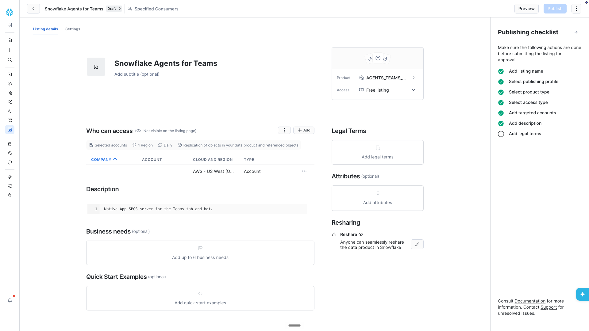
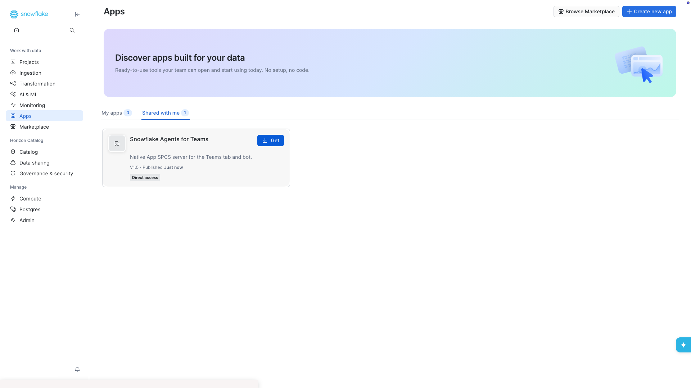
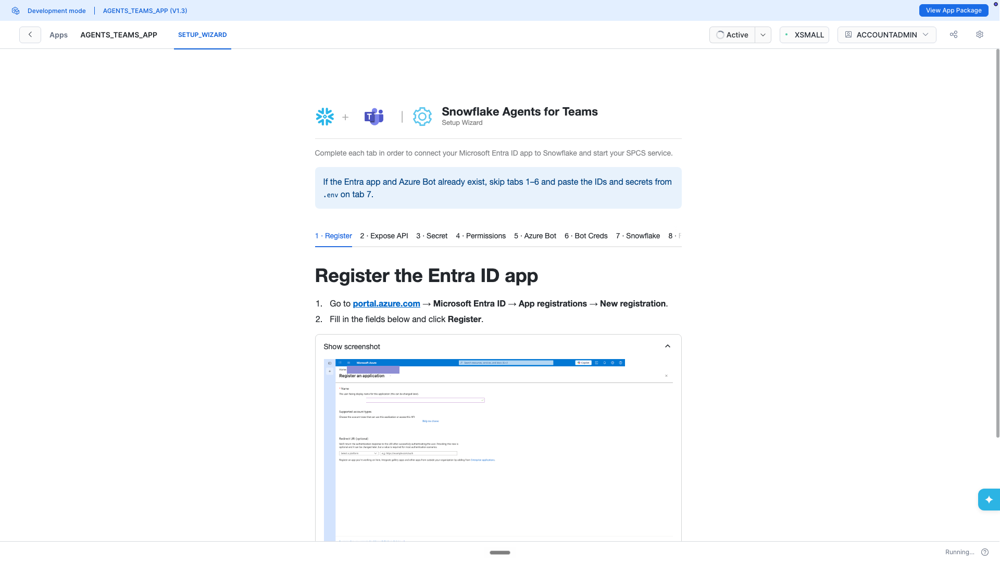
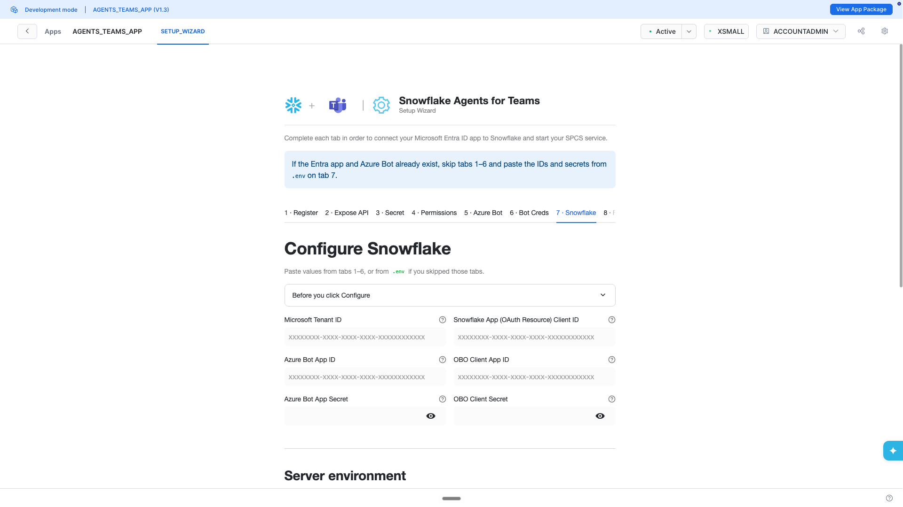
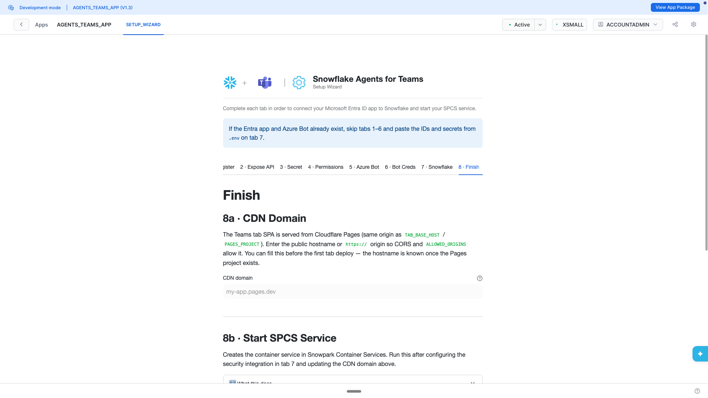

# Teams Native App install (Path B)

Complete the [master install guide](../install-guide.md) and the [prerequisites](install.md#1-extra-prerequisites) first.

Use this appendix only to package and distribute the app (Provider) or to install a published listing (Consumer). Most installs use the standalone flow in [§ 2](install.md#2-install-standalone-spcs). Everything below is specific to the Native App.

Differences from [§ 1](install.md#1-extra-prerequisites): fill `SPCS_INGRESS_HOST` / `SPCS_BASE` after the service is READY from wizard tab 9 (9c, Show Endpoint URL) / `GET_SERVER_STATUS`; the Teams Snowflake secret `APPS_API_HOST` is written by the wizard / `CONFIG.SET_SECRET`; the Azure CLI is needed only if you provision a new Entra tenant or Bot resource by hand.

Uses the [master guide § 5](../install-guide.md#5-native-app-path-only) pattern. Do not run `bootstrap-dev-spcs.sql` or `deploy-spcs.sh` on this path.

## B.1 Deploy the Native App

Two paths. Use **Provider (this repo)** when you are building the application package yourself. Use **Consumer (listing)** when the package is already published.

Manifest image: `/agents_teams_app_db/public/na_image_repo/agents-teams-app:latest`

### Provider path (this repo)

**1. Create the provider image repository** (once per account):

```sql
CREATE DATABASE IF NOT EXISTS AGENTS_TEAMS_APP_DB;
CREATE SCHEMA IF NOT EXISTS AGENTS_TEAMS_APP_DB.PUBLIC;
CREATE IMAGE REPOSITORY IF NOT EXISTS AGENTS_TEAMS_APP_DB.PUBLIC.NA_IMAGE_REPO;

SHOW IMAGE REPOSITORIES IN SCHEMA AGENTS_TEAMS_APP_DB.PUBLIC;
```

Copy the `repository_url` column from the row whose `name` is `NA_IMAGE_REPO` (not `IMAGE_REPO`) — this is `<teams_na_image_repo_url>` in step 2. It looks like `<org>-<account>.registry.snowflakecomputing.com/agents_teams_app_db/public/na_image_repo`: no `https://`, no trailing slash, and do not add `/agents-teams-app` (step 2 appends it). Paste the real value, not the angle-bracket placeholder.

**2. Build and push** `linux/amd64` `:latest`:

Docker Desktop must be running first, or the build fails with `failed to connect to the docker API at unix:///Users/<you>/.docker/run/docker.sock`. Start it and wait until `docker info` succeeds:

```bash
open -a Docker          # macOS; on Windows/Linux start Docker Desktop from the app menu
docker info >/dev/null  # re-run until it exits 0 (the daemon can take ~30s to start)
```

If it still cannot connect, check `docker context ls` — the active context should be the Docker Desktop one.

```bash
snow spcs image-registry login

docker build --platform linux/amd64 -f apps/teams/Dockerfile -t agents-teams-app:latest .
docker tag agents-teams-app:latest <teams_na_image_repo_url>/agents-teams-app:latest
docker push <teams_na_image_repo_url>/agents-teams-app:latest
```

**3. Register a version and create the application object** against [`apps/teams/native-app/`](../../apps/teams/native-app/):

```bash
./scripts/native-app-release.sh teams v1
```

**4. Grant account privileges**, then application roles. The Teams app needs `CREATE COMPUTE POOL`, `BIND SERVICE ENDPOINT`, `CREATE EXTERNAL ACCESS INTEGRATION`, `CREATE SECURITY INTEGRATION`, and `SNOWFLAKE.CORTEX_USER`.

```sql
GRANT CREATE COMPUTE POOL ON ACCOUNT TO APPLICATION AGENTS_TEAMS_APP;
GRANT BIND SERVICE ENDPOINT ON ACCOUNT TO APPLICATION AGENTS_TEAMS_APP;
GRANT CREATE EXTERNAL ACCESS INTEGRATION ON ACCOUNT TO APPLICATION AGENTS_TEAMS_APP;
GRANT CREATE SECURITY INTEGRATION ON ACCOUNT TO APPLICATION AGENTS_TEAMS_APP;
GRANT DATABASE ROLE SNOWFLAKE.CORTEX_USER TO APPLICATION AGENTS_TEAMS_APP;

CREATE ROLE IF NOT EXISTS AGENTS_TEAMS_USER;
GRANT APPLICATION ROLE AGENTS_TEAMS_APP.APP_ADMIN TO ROLE ACCOUNTADMIN;
GRANT APPLICATION ROLE AGENTS_TEAMS_APP.APP_PUBLIC TO ROLE AGENTS_TEAMS_USER;

-- Service user that owns the edge Worker's SPCS_PAT (skip CREATE if it already exists).
CREATE USER IF NOT EXISTS AGENTS_TEAMS_SVC
  TYPE = SERVICE
  DEFAULT_ROLE = AGENTS_TEAMS_USER;
GRANT ROLE AGENTS_TEAMS_USER TO USER AGENTS_TEAMS_SVC;
-- The edge SPCS_PAT is a user token. That user must hold APP_PUBLIC or ingress
-- returns 403 Insufficient privileges to use <ingress> instead of the app's 401.
GRANT APPLICATION ROLE AGENTS_TEAMS_APP.APP_PUBLIC TO USER "AGENTS_TEAMS_SVC";

-- Mint the PAT once (printed once) if that user has none. Its value is apps/teams/.env
-- SNOWFLAKE_PAT and the edge Worker's SPCS_PAT.
-- ALTER USER <pat-user> ADD PROGRAMMATIC ACCESS TOKEN AGENTS_TEAMS_INGRESS_PAT
--   ROLE_RESTRICTION = 'AGENTS_TEAMS_USER' DAYS_TO_EXPIRY = 90;
```

`APP_ADMIN` is required to set secrets and create/roll the SPCS service. Ordinary users get `APP_PUBLIC` only. The `snowflake.yml` identifier is `agents_teams_app`; Snowflake creates the object as `AGENTS_TEAMS_APP`. Use the uppercase name in SQL.

`AGENTS_TEAMS_SVC` (created above; the standalone bootstrap creates the same user) is the dedicated service user that owns the PAT you will store as the edge Worker secret `SPCS_PAT` in [Cloudflare Worker](#b4-cloudflare-worker) below. Put that username in `apps/teams/.env` as `SNOWFLAKE_USER` and reuse `SNOWFLAKE_PAT` as the ingress token. Grant `APP_PUBLIC` to that user directly (`TO USER`), not only to role `AGENTS_TEAMS_USER` — otherwise edge → ingress returns 403 `Insufficient privileges to use <ingress>`. This is not `TEAMS_USERNAME` (Entra) and not the Cortex identity.

**5. Give each Teams user a Snowflake identity and the agent's grants.** Same SQL as [install step 7](install.md#2-install-standalone-spcs) (once per Entra user, as `ACCOUNTADMIN`); run it after the application roles above.

### Publish the listing (provider, for another account)

You publish the **application package** `AGENTS_TEAMS_PACKAGE`, not the installed `AGENTS_TEAMS_APP` object. Same-account listing install is not a valid test. Official steps: [Publish an app to consumers](https://docs.snowflake.com/en/developer-guide/native-apps/ui-provider-publishing-app-package).

**1. Point the default release directive at the version** (from [`apps/teams/native-app/`](../../apps/teams/native-app/)):

```bash
cd apps/teams/native-app
snow app publish --version v1 --patch 0 --no-interactive
```

`snow app publish` sets the release directive. It does not create a Marketplace listing. Confirm with `snow app release-directive list`.

**2. External org only.** Skip if the consumer is in the same organization. Otherwise:

```sql
ALTER APPLICATION PACKAGE AGENTS_TEAMS_PACKAGE SET DISTRIBUTION = EXTERNAL;
DESC APPLICATION PACKAGE AGENTS_TEAMS_PACKAGE;
```

Wait until the automated security scan reports PASSED. A pending or failed scan blocks install outside the org.

**3. Create a private listing.** In Snowsight (provider account): Marketplace → Provider Studio → Create Listing → **Only specified consumers** → attach `AGENTS_TEAMS_PACKAGE` → add `ORGNAME.ACCOUNTNAME` (from the consumer: `SELECT CURRENT_ORGANIZATION_NAME(), CURRENT_ACCOUNT_NAME();`) → Publish. A provider profile is not required. If that account is in another region, accept Cross-Cloud Auto-Fulfillment (not available on trial accounts).

Or as ACCOUNTADMIN:

```sql
CREATE EXTERNAL LISTING IF NOT EXISTS AGENTS_TEAMS_LISTING
  APPLICATION PACKAGE AGENTS_TEAMS_PACKAGE
  AS $$
title: "Snowflake Agents for Teams (Unofficial)"
description: "Native App SPCS server for the Teams tab and bot."
listing_terms:
  type: "OFFLINE"
targets:
  accounts: ["ORGNAME.ACCOUNTNAME"]
auto_fulfillment:
  refresh_type: "SUB_DATABASE_WITH_REFERENCE_USAGE"
$$
PUBLISH = FALSE
REVIEW = FALSE;
```



> Marketplace → Provider Studio. Private listing attached to `AGENTS_TEAMS_PACKAGE`, specified consumers.

### Consumer path (published listing)

In the **consumer** account (a role with `IMPORT SHARE` and `CREATE DATABASE`, usually ACCOUNTADMIN): Apps → Shared with me → Get. Accept the privilege requests (`CREATE COMPUTE POOL`, `BIND SERVICE ENDPOINT`, `CREATE EXTERNAL ACCESS INTEGRATION`, `CREATE SECURITY INTEGRATION`, `SNOWFLAKE.CORTEX_USER`). Name the installed app `AGENTS_TEAMS_APP` so the SQL above matches.



> Consumer account. Apps → Shared with me → Get, accepting the privilege requests before naming the installed app `AGENTS_TEAMS_APP`.

Then run that application-role SQL **in the consumer account**, against **that** account’s PAT user. Create a consumer-side service user; do not reuse the provider’s `AGENTS_TEAMS_SVC`. Continue from [Streamlit](#b3-streamlit).

The provider’s `AGENTS_TEAMS_APP` is unchanged. See the [master guide consumer path](../install-guide.md#consumer-path-published-listing).

## B.2 Pending spec and leftover EAI

The setup script creates the egress EAI **and** an `EXTERNAL_ACCESS` app specification (`cortex_and_entra_egress`). Until a role with `MANAGE APPLICATION SPECIFICATIONS` (ACCOUNTADMIN or SECURITYADMIN) approves it, SPCS cannot resolve the Cortex hostname (`ENOTFOUND`) even though `DESC SERVICE` lists the EAI. Approve after every install or host-list change, then recreate the service. Skip if `SHOW PENDING SPECIFICATIONS` returns no rows (already `APPROVED`). Use the `sequence_number` column from that SHOW — do not paste a placeholder:

```sql
SHOW PENDING SPECIFICATIONS IN APPLICATION AGENTS_TEAMS_APP;
-- only if a row is returned:
ALTER APPLICATION AGENTS_TEAMS_APP APPROVE SPECIFICATION cortex_and_entra_egress SEQUENCE_NUMBER = 1;
```

If Create Service reports that the application needs `USAGE` on `AGENTS_TEAMS_EAI` (an account-level integration of the same name already exists), grant it and retry:

```sql
GRANT USAGE ON INTEGRATION AGENTS_TEAMS_EAI TO APPLICATION AGENTS_TEAMS_APP;
```

## B.3 Streamlit

The wizard is `CONFIG.SETUP_WIZARD`, created by [`setup.sql`](../../apps/teams/native-app/setup/setup.sql) on install or upgrade. In Snowsight: **Apps → `AGENTS_TEAMS_APP` → SETUP_WIZARD** (pick a warehouse). Confirm with `SHOW STREAMLITS IN APPLICATION AGENTS_TEAMS_APP`. The SQL in this subsection is the equivalent of the wizard buttons; both require `APP_ADMIN`.

Nine tabs. Source: [`apps/teams/native-app/streamlit/setup_wizard.py`](../../apps/teams/native-app/streamlit/setup_wizard.py). The in-wizard expanders already include Azure screenshots under `native-app/streamlit/img/entra-setup/`; the slots below keep this guide self-contained.

If the Entra app and Azure Bot already exist, skip tabs 1–6 and paste the existing IDs and secrets from `apps/teams/.env` on tab 7.

**Tab 1: Register** the Entra app (`agents-teams-app`, single tenant, no redirect URI yet).



> Catalog → Apps → `AGENTS_TEAMS_APP` → SETUP_WIZARD, tab 1. Skip 1–6 if Entra and the bot already exist.

**Tab 2: Expose an API.** When Azure prompts for the Application ID URI, replace the default `api://<client-id>` with `api://<TAB_BASE_HOST>/<client-id>` (for example `api://teams.example.com/<client-id>`). Teams SSO requires the edge hostname in the URI, and `TAB_BASE_HOST` in `apps/teams/.env` must be that same host, so pick the Worker host first ([Cloudflare Worker](#b4-cloudflare-worker)). A mismatch fails sign-in with `AADSTS500011` ([T1](troubleshooting.md#t1-aadsts500011-and-nothing-is-here-yet)). Scope name `access_as_user`, admins and users can consent. This is the Teams SSO / OBO app, not the Snowflake OAuth resource app that tab 7 asks for.

**Tab 3: Client secret.** Copy the **Value** immediately; it is shown once. That is **OBO Client Secret**. Application (client) ID from Overview is **OBO Client App ID**.

**Tab 4: API permissions.** Microsoft Graph delegated `User.Read`. Optionally Grant admin consent.

**Tab 5: Azure Bot.** Create an Azure Bot resource (single tenant). You may reuse the app from tabs 1–4 or let Azure create a new App ID.

**Tab 6: Bot App ID and secret.** Settings → Configuration → Microsoft App ID. Manage Password → new client secret. Copy the Value once.

**Tab 7: Snowflake.** Paste tenant ID, bot + OBO credentials, Snowflake App (OAuth resource) client ID (UUID or `api://…`), Apps API host (`apps-api.c1.<region>.<cloud>.app.snowflake.com`), default agent FQN, optional allow-list, Teams App ID (default `<your-teams-app-id>`). Click **Configure Security Integration**. The integration maps the `upn` claim only; add `upn` as an access-token optional claim on the Snowflake resource app (see [T9](troubleshooting.md#t9-you-do-not-have-access-to-that-resource)) or Cortex returns `agent_forbidden`.

> **This button only `ALTER`s `CORTEX_TEAMS_OAUTH` - it does not create it.** Snowflake Native Apps have no manifest privilege that gets `CREATE SECURITY INTEGRATION` auto-granted to the app (`CREATE INTEGRATION` is rejected outright as an invalid privilege name; declaring `CREATE SECURITY INTEGRATION` under `privileges:` passes manifest validation but is never actually granted at run time — confirmed by testing, not assumed). So on every fresh install, before tab 7's button will work, an `ACCOUNTADMIN` in the consumer's account must run **one** of:
>
> - The manual SQL below (creates the integration directly, then grants the app `MODIFY` on it), or
> - The app's own creation path, which keeps the integration's definition inside the versioned app rather than hand-typed by every installer:
>   ```sql
>   GRANT CREATE INTEGRATION ON ACCOUNT TO APPLICATION <installed-app-name>;
>   CALL <installed-app-name>.CONFIG.CREATE_OAUTH_INTEGRATION();
>   REVOKE CREATE INTEGRATION ON ACCOUNT FROM APPLICATION <installed-app-name>;
>   ```
>
> Symptom if you skip this: tab 7's button (or the equivalent `CALL CONFIG.CONFIGURE_OAUTH(...)`) fails with `Integration 'CORTEX_TEAMS_OAUTH' does not exist or not authorized ... The owning application <installed-app-name> must have at least one privilege granted on INTEGRATION CORTEX_TEAMS_OAUTH` — see the troubleshooting table (`093118`, [troubleshooting.md](troubleshooting.md)).
>
> `<installed-app-name>` is whatever `SHOW APPLICATIONS` shows for this install (for example `SNOWFLAKE_AGENTS_FOR_TEAMS` when installed from a Marketplace listing) — it is **not** always the placeholder `AGENTS_TEAMS_APP` this doc uses elsewhere.

SQL path (same outcome as the streamlit). Create the security integration as `ACCOUNTADMIN`, grant the application `MODIFY`, then configure and set secrets. Replace `AGENTS_TEAMS_APP` below with your actual installed app name (`SHOW APPLICATIONS`):

```sql
CREATE SECURITY INTEGRATION IF NOT EXISTS CORTEX_TEAMS_OAUTH
  TYPE = EXTERNAL_OAUTH
  ENABLED = TRUE
  EXTERNAL_OAUTH_TYPE = AZURE
  EXTERNAL_OAUTH_ISSUER = 'https://login.microsoftonline.com/PLACEHOLDER/v2.0'
  EXTERNAL_OAUTH_JWS_KEYS_URL = 'https://login.microsoftonline.com/PLACEHOLDER/discovery/v2.0/keys'
  EXTERNAL_OAUTH_AUDIENCE_LIST = ('api://PLACEHOLDER', 'PLACEHOLDER')
  EXTERNAL_OAUTH_TOKEN_USER_MAPPING_CLAIM = ('upn')
  EXTERNAL_OAUTH_SNOWFLAKE_USER_MAPPING_ATTRIBUTE = 'login_name'
  EXTERNAL_OAUTH_ANY_ROLE_MODE = 'ENABLE';

GRANT MODIFY ON INTEGRATION CORTEX_TEAMS_OAUTH TO APPLICATION AGENTS_TEAMS_APP;

CALL AGENTS_TEAMS_APP.CONFIG.CONFIGURE_OAUTH(
  '<AZURE_TENANT_ID>',
  'api://<snowflake-app-id>',
  '<snowflake-app-id>'
);

CALL AGENTS_TEAMS_APP.CONFIG.SET_SECRET('BOT_APP_ID', '<BOT_APP_ID>');
CALL AGENTS_TEAMS_APP.CONFIG.SET_SECRET('BOT_APP_SECRET', '<BOT_APP_SECRET>');
CALL AGENTS_TEAMS_APP.CONFIG.SET_SECRET('OBO_CLIENT_ID', '<OBO_CLIENT_ID>');
CALL AGENTS_TEAMS_APP.CONFIG.SET_SECRET('OBO_CLIENT_SECRET', '<OBO_CLIENT_SECRET>');
CALL AGENTS_TEAMS_APP.CONFIG.SET_SECRET('DEFAULT_AGENT_FQN', 'MY_DB.MY_SCHEMA.MY_AGENT');
CALL AGENTS_TEAMS_APP.CONFIG.SET_SECRET('TEAMS_APP_ID', '<your-teams-app-id>');
CALL AGENTS_TEAMS_APP.CONFIG.SET_SECRET('AGENT_ALLOW_LIST', '[]');
CALL AGENTS_TEAMS_APP.CONFIG.SET_SECRET('AZURE_TENANT_ID', '<AZURE_TENANT_ID>');
CALL AGENTS_TEAMS_APP.CONFIG.SET_SECRET('SNOWFLAKE_SCOPE', 'api://<snowflake-resource-app-id>/session:role-any');
CALL AGENTS_TEAMS_APP.CONFIG.SET_SECRET('APPS_API_HOST', 'apps-api.c1.<region>.<cloud>.app.snowflake.com');
```



> Tab 7: tenant, bot, OBO, and Snowflake OAuth resource fields.

**Tab 8: Network.** Leave the mode on **public** (the default) unless the account restricts Snowflake to private connectivity; public needs nothing else on this tab. For **hybrid** and **privatelink**, read [§ 7](private-connectivity.md) first. Pick the mode and click **Save network mode** (`CONFIG.SET_NETWORK_MODE`). The mode only takes effect on the next **Create Service** or **Roll service** on tab 9, and a roll keeps the saved mode. In hybrid and privatelink the tab shows three more steps:

- **8a · Detect**: the cloud (from `CURRENT_REGION()`) and the account's PrivateLink configuration. The app usually cannot run `SYSTEM$GET_PRIVATELINK_CONFIG()` itself; run the query it shows as `ACCOUNTADMIN` and paste the JSON back. **Read private ingress URL** shows `privatelink_ingress_url` once the service is running.
- **8b · Private DNS**: one record per host for your private zone ([§ 7.5](private-connectivity.md#75-private-dns)).
- **8c · ACCOUNTADMIN SQL**: the compute pool network rule on `CORTEX_TEAMS_OAUTH` and, in privatelink, the endpoint-ID policy on the service PAT user ([§ 7.4](private-connectivity.md#74-network-sql-accountadmin)). Apply it **before** Create Service or Roll service, or every user call fails with `390422`.

SQL path: `CALL AGENTS_TEAMS_APP.CONFIG.SET_NETWORK_MODE('hybrid');` (`public`, `hybrid` or `privatelink`) and `CALL AGENTS_TEAMS_APP.CONFIG.GET_NETWORK_MODE();`. A value outside those three returns a `refuse:` string and changes nothing.

**Tab 9: Finish**

The edge Worker does **not** need to exist yet to complete this tab. Its hostname is known in advance: a custom domain you choose, or `<worker-name>.<your-subdomain>.workers.dev` (see [Cloudflare Worker](#b4-cloudflare-worker)). Decide it now and use it below. The first `deploy-tab.sh` happens after this tab.

1. **9a · CDN domain**: the edge hostname (`teams.example.com`) or `https://teams.example.com` (no path). Same origin as `TAB_BASE_HOST`. A self-hosted edge uses its own public hostname here.
2. **9b · Create Service**: `CONFIG.CREATE_SERVER_SERVICE` + `CONFIG.GRANT_ENDPOINT_ACCESS`. The procedure accepts the origin string or the bare hostname. It applies `services/service_spec.yml` in public mode and `services/service_spec_private.yml` in hybrid and privatelink. It also writes `CONFIG.ALLOWED_ORIGINS` from that origin. Production `TEAMS_AUTH_MODE` refuses to boot without it, and the container exits `1` (`Missing required environment variable: ALLOWED_ORIGINS`). Wait until `GET_SERVER_STATUS` shows `READY` (often ~60s). Approve `cortex_and_entra_egress` only if `SHOW PENDING SPECIFICATIONS` still has a row. **Roll service** remounts the container after a secret or network mode change. If it reports a new ingress host, update `SPCS_BASE` as in step 3.
3. **9c · Show Endpoint URL**: shows the public ingress and, on an account with PrivateLink, the private ingress (`privatelink_ingress_url`). The edge secret `SPCS_BASE` is the public ingress in public and hybrid, and the private ingress copied verbatim in privatelink. Do **not** put it in `VITE_SPCS_BASE`. Do **not** use it as the Azure Bot messaging endpoint (`https://<TAB_BASE_HOST>/api/bot/messages`). `CREATE_SERVER_SERVICE` drops and recreates the service, so the ingress hostname **changes every install**. Copy the public ingress host into `apps/teams/.env` `SPCS_INGRESS_HOST` (no scheme) before [§ 3](install.md#3-teams-app) `zip.sh`; in privatelink the manifest leaves it out and it may stay empty.

```sql
CALL AGENTS_TEAMS_APP.CONFIG.CREATE_SERVER_SERVICE('https://teams.example.com');
CALL AGENTS_TEAMS_APP.CONFIG.GRANT_ENDPOINT_ACCESS();
CALL AGENTS_TEAMS_APP.CONFIG.GET_SERVER_STATUS();
-- status=… endpoint=<ingress_url from SHOW ENDPOINTS> [privatelink=<privatelink_ingress_url>]
```



> Tab 9: CDN domain (`TAB_BASE_HOST`) then Create Service. The screenshot predates the Network tab, so its tab is labelled 8.

## B.4 Cloudflare Worker

Continue here right after finishing tab 9. This is where the edge Worker for the host you entered there is deployed.

Leave [`packages/tab/.env.production`](../../packages/tab/.env.production) `VITE_SPCS_BASE` empty so the SPA uses relative `/api/*`.

[`apps/teams/scripts/deploy-tab.sh`](../../apps/teams/scripts/deploy-tab.sh) builds the tab, then runs `wrangler deploy` from [`packages/teams-edge`](../../packages/teams-edge). One Worker serves the tab's static assets and the edge routes (`/api/*`, `/token/exchange`, `/token/link`). The first deploy creates the Worker, so there is nothing to create beforehand. The Worker name is `EDGE_WORKER_NAME` if set, else a legacy `PAGES_PROJECT`, else the first label of a `*.workers.dev` `TAB_BASE_HOST`, else `agents-embed-teams`. `set-edge-secrets.sh` resolves the same name.

Pick the host:

- **Custom domain (recommended)**: needs a zone on the same Cloudflare account. After the first deploy, add it under the Worker → **Settings** → **Domains & Routes** → **Add** → **Custom domain**, or set `EDGE_CUSTOM_DOMAIN=teams.example.com` in `apps/teams/.env` so `deploy-tab.sh` adds the route on every deploy.
- **workers.dev**: `<worker-name>.<your-subdomain>.workers.dev`. Register the account's workers.dev subdomain once in the dashboard (Workers & Pages), or the first deploy fails ([I14](troubleshooting.md#i14-wrangler-deploy-workersdev-subdomain-or-worker-name)).

Either way the host must be **the same origin** as:

- wizard tab 9 / `CREATE_SERVER_SERVICE` (CORS + `ALLOWED_ORIGINS`)
- `apps/teams/.env` `TAB_BASE_HOST` / `TAB_BASE_URL` (manifest `contentUrl` via `zip.sh`)
- the Entra / Teams SSO app's Application ID URI, `api://<TAB_BASE_HOST>/<OBO_CLIENT_ID>` (check with `az ad app show --id <OBO_CLIENT_ID> --query identifierUris`). The manifest `webApplicationInfo.resource` is built from `TAB_BASE_HOST`, so a different host is `AADSTS500011`

A **new** hostname that Entra does not already authorize fails tab SSO with the generic "Couldn't sign you in" banner. Reuse the host that is already on the Entra app (`TAB_BASE_HOST`), or add the new one first ([§ 6](install.md#6-pages-to-worker-cutover) step 1). Moving from an existing `*.pages.dev` install follows [§ 6](install.md#6-pages-to-worker-cutover).

Set the runtime secrets, then deploy. [`apps/teams/scripts/set-edge-secrets.sh`](../../apps/teams/scripts/set-edge-secrets.sh) sends all 10 from `apps/teams/.env` in one `wrangler secret bulk` call (`AZURE_TENANT_ID`, `OBO_CLIENT_ID`, `OBO_CLIENT_SECRET`, `SNOWFLAKE_SCOPE`, `ENTRA_AUDIENCE_URI`, `SPCS_BASE`, `SPCS_PAT`, `EDGE_SESSION_SECRET`, `BOT_LINK_SECRET`, `BOT_APP_ID`). It generates `EDGE_SESSION_SECRET` and `BOT_LINK_SECRET` into `.env` if they are absent. On a first install Wrangler asks whether to create the Worker so it can hold the secrets; answer yes, and the deploy replaces that placeholder and keeps the secrets. The script does not deploy, so run `deploy-tab.sh` after it:

```bash
bash apps/teams/scripts/set-edge-secrets.sh
bash apps/teams/scripts/deploy-tab.sh                # privatelink: deploy-tab.sh --privatelink (§ 7.6)
```

Confirm it in Cloudflare: **Workers & Pages** → the Worker → **Deployments** lists the new version as active. Secret names (never values) are under **Settings** → **Variables and Secrets**, or from the CLI:

```bash
cd packages/teams-edge
npx wrangler secret list --name <worker-name>       # EDGE_WORKER_NAME; no --env
```

Do not pass `--env privatelink` to `secret` or `tail` commands. Wrangler then targets `<worker-name>-privatelink`, a Worker that does not exist. `deploy-tab.sh` is the only command that passes `--env`, and it pins `--name` too, so both modes deploy to the same Worker and share its secrets, KV and custom domain.

`SNOWFLAKE_SCOPE` is `api://<snowflake-resource-app-id>/session:role-any` - the **Snowflake OAuth resource** app (tab 7 audience), not the Teams SSO / bot app (`OBO_CLIENT_ID` / `BOT_APP_ID`). Scope value is lowercase; `SESSION:ROLE-ANY` is AADSTS65005. `SPCS_BASE` is the SPCS ingress (the private ingress in privatelink). `SPCS_PAT` authenticates edge → that ingress only. The Worker returns 500 if either `SPCS_BASE` or `SPCS_PAT` is missing.

After rotating a secret, run `deploy-tab.sh` again so warm isolates pick up the new value.

The wizard needs the edge hostname before Create Service; the Worker needs `SPCS_BASE` and `SPCS_PAT` after the ingress exists. Decide the host, put it in wizard tab 9, start the service, then set the secrets and deploy.

Continue at [§ 3](install.md#3-teams-app).

## B.5 Native App failures

Errors that only occur on a Native App install (B1 to B4), then the Native App variants of entries in [troubleshooting.md](troubleshooting.md) (B5).

### B1. `093118`: `CREATE INTEGRATION` cannot be granted

**Symptom.** Granting `CREATE INTEGRATION` to the application fails with `093118`.

**Cause.** That privilege is not on the app manifest.

**Fix.** Use the [Streamlit](#b3-streamlit) path: create `CORTEX_TEAMS_OAUTH` as `ACCOUNTADMIN`, then `GRANT MODIFY ON INTEGRATION CORTEX_TEAMS_OAUTH TO APPLICATION AGENTS_TEAMS_APP`.

### B2. Create Service needs `USAGE` on `AGENTS_TEAMS_EAI`

**Symptom.** Create Service fails: the application must have `USAGE` on `AGENTS_TEAMS_EAI`.

**Cause.** An account-level integration of that name already exists.

**Fix.**

```sql
GRANT USAGE ON INTEGRATION AGENTS_TEAMS_EAI TO APPLICATION AGENTS_TEAMS_APP;
```

Retry Create Service.

### B3. `395089` spec template / `Unknown function SYSTEM$GET_SECRET_STRING`

**Symptom.** `CREATE_SERVER_SERVICE` fails with `395089: spec template argument must be alphanumeric or valid JSON`, or `SET_SECRET` fails with `Unknown function SYSTEM$GET_SECRET_STRING`.

**Cause.** The installed app version is stale. It does not JSON-encode `cdn_origin` (`395089`), or it still reads secrets with the old function.

**Fix.** Upgrade with `./scripts/native-app-release.sh teams v1`, then retry `CREATE_SERVER_SERVICE` / `SET_SECRET`.

### B4. Server logs `ENOTFOUND` for `*.snowflakecomputing.com`

**Symptom.** The container cannot resolve Cortex. `DESC SERVICE` still lists the EAI.

**Cause.** The `EXTERNAL_ACCESS` app specification (`cortex_and_entra_egress`) is still pending.

**Fix.** Confirm with the user, then approve it with that row's `sequence_number` (skip if there are no rows) and recreate the service:

```sql
SHOW PENDING SPECIFICATIONS IN APPLICATION AGENTS_TEAMS_APP;
ALTER APPLICATION AGENTS_TEAMS_APP APPROVE SPECIFICATION cortex_and_entra_egress SEQUENCE_NUMBER = <n>;
```

### B5. Native App variants of the main-chapter entries

Use these in place of the matching fix in [troubleshooting.md](troubleshooting.md) when the service came from the Native App.

- **I3 (Docker):** the `docker build` in [B.1](#b1-deploy-the-native-app) fails the same way; same fix.
- **I4 (`<IMAGE_REPO>`):** copy `repository_url` from the `NA_IMAGE_REPO` row, not `IMAGE_REPO`.
- **I7 (`397012`):** the service reads `na_image_repo` (the manifest repo), not `IMAGE_REPO`. Push to `/agents_teams_app_db/public/na_image_repo/agents-teams-app:latest`.
- **I8 (never READY):** after pushing the amd64 image to `NA_IMAGE_REPO`, run `./scripts/native-app-release.sh teams v1`.
- **I12 (`ALLOWED_ORIGINS`):** `CREATE_SERVER_SERVICE` did not write `CONFIG.ALLOWED_ORIGINS` (old app version, or the CDN origin was omitted). Upgrade the app if needed, then recreate: `CREATE_SERVER_SERVICE('https://<TAB_BASE_HOST>')`.
- **I17 (`SPCS_INGRESS_HOST` placeholder):** take the host from wizard tab 9 (9c) / `GET_SERVER_STATUS` instead of `SHOW ENDPOINTS`.
- **I18 (no Bot Service):** create it as wizard tab 5 describes, or:

  ```bash
  az bot create -g agents-teams-rg -n agents-teams-bot --sku F0 --appid "$BOT_APP_ID" --app-type SingleTenant --tenant-id "$AZURE_TENANT_ID" --endpoint https://<TAB_BASE_HOST>/api/bot/messages --location global
  az bot msteams create -g agents-teams-rg -n agents-teams-bot
  ```

- **T2 (Couldn't sign you in):** keep wizard tab 9 (9a), `TAB_BASE_URL` and the manifest on the same origin.
- **T3 (AADSTS65005):** instead of the `fill-dev-secrets.sh` / `deploy-spcs.sh` step, run (`SNOWFLAKE_SCOPE` lives in `CONFIG.SNOWFLAKE_SCOPE`):

  ```sql
  CALL AGENTS_TEAMS_APP.CONFIG.CONFIGURE_OAUTH(
    '<AZURE_TENANT_ID>',
    'api://<snowflake-resource-app-id>',
    '<snowflake-resource-app-id>'
  );
  CALL AGENTS_TEAMS_APP.CONFIG.SET_SECRET('SNOWFLAKE_SCOPE', 'api://<snowflake-resource-app-id>/session:role-any');
  CALL AGENTS_TEAMS_APP.CONFIG.ROLL_SERVER_SERVICE('https://<TAB_BASE_HOST>');
  ```
- **T6 (the tab's `/api/*` at the ingress):** `403 Insufficient privileges to use <ingress>` means the `SPCS_PAT` user does not hold `APP_PUBLIC`: `GRANT APPLICATION ROLE AGENTS_TEAMS_APP.APP_PUBLIC TO USER "<pat-user>"`. `522` right after `CREATE_SERVER_SERVICE`: the new ingress is not routable yet; wait about a minute. A `404 Could not find the service associated with endpoint <old-id>` right after `deploy-tab.sh` can be a warm isolate holding the previous install's `SPCS_BASE`; retry after a minute, then re-run `set-edge-secrets.sh` and `deploy-tab.sh` if `SPCS_BASE` is stale.

## B.6 Tear down Path B

See [master guide § 6](../install-guide.md#6-tear-down-semantics) for `--cascade` / `--force` semantics.

```bash
cd apps/teams/native-app
snow app teardown --cascade --force --no-interactive
```

`--cascade` drops the application and its owned objects (`AGENTS_TEAMS_APP_POOL`, `AGENTS_TEAMS_EAI`). `DROP APPLICATION PACKAGE` then fails if a listing is still attached ([Snowflake](https://docs.snowflake.com/en/sql-reference/sql/drop-application-package)). Unpublish and drop the listing, then drop the package. `SHOW LISTINGS` if the name is not `AGENTS_TEAMS_LISTING` (Provider Studio can pick another):

```sql
ALTER LISTING AGENTS_TEAMS_LISTING UNPUBLISH;
DROP LISTING AGENTS_TEAMS_LISTING;
DROP APPLICATION PACKAGE IF EXISTS AGENTS_TEAMS_PACKAGE;
```

A leftover package does not block [the standalone install](install.md#2-install-standalone-spcs). Continue bootstrap as soon as the application is gone.

Then drop leftovers the CLI does not own:

```sql
DROP SERVICE IF EXISTS AGENTS_TEAMS_APP_DB.PUBLIC.AGENTS_TEAMS;
DROP SERVICE IF EXISTS AGENTS_TEAMS_APP_DB.PUBLIC.AGENTS_TEAMS_STAGING;

DROP COMPUTE POOL IF EXISTS COWORK_COMPUTE_POOL;
DROP COMPUTE POOL IF EXISTS AGENTS_TEAMS_APP_POOL;

DROP SECURITY INTEGRATION IF EXISTS CORTEX_TEAMS_OAUTH;

-- Account-level leftover that collides with the next install's app-owned EAI.
-- Cascade drops app-owned integrations (often named SNOWSERVICE-…), not this.
DROP EXTERNAL ACCESS INTEGRATION IF EXISTS AGENTS_TEAMS_EAI;
```

Keep `AGENTS_TEAMS_APP_DB` and `NA_IMAGE_REPO` so the next [push](#b1-deploy-the-native-app) has a registry. Keep Cortex agents and `AGENTS_TEAMS_USER`. Reinstall from [B.1](#b1-deploy-the-native-app). `--cascade` already drops the app-owned compute pool and `AGENTS_TEAMS_EAI`; the leftover `DROP`s are for names that survive when a prior standalone install used them.

The PAT that the edge presents to the ingress (`SPCS_PAT`) must belong to a user whose **user-level** network policy allows the edge's egress (Cloudflare IPs in public and hybrid, the private endpoint IDs through `AGENTS_TEAMS_PL_INGRESS_POLICY` in privatelink), and that user needs `APP_PUBLIC` (endpoint usage) on the installed app (`GRANT APPLICATION ROLE … TO USER`, not only to `AGENTS_TEAMS_USER`). Keep that policy restricted across reinstalls.

`--cascade` does not uninstall the Teams sideload, delete the edge Worker (or a legacy Pages project), or drop the `AGENTS_TEAMS_NETWORK` policies from [§ 7](private-connectivity.md). Uninstall the sideload from the Teams UI before the next run if you want a clean personal-app install. Leave Azure app registrations and the Worker in place; to remove private connectivity as well, follow [§ 7.8](private-connectivity.md#78-tear-down-private-connectivity).
