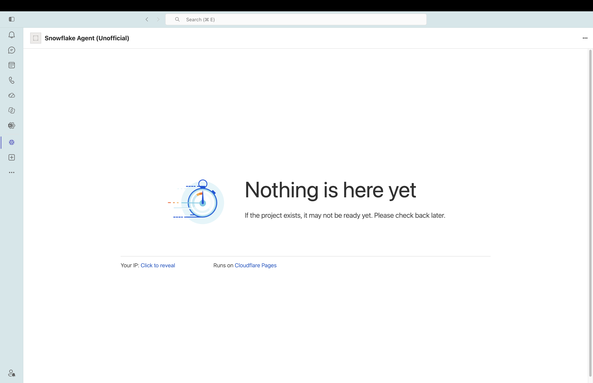
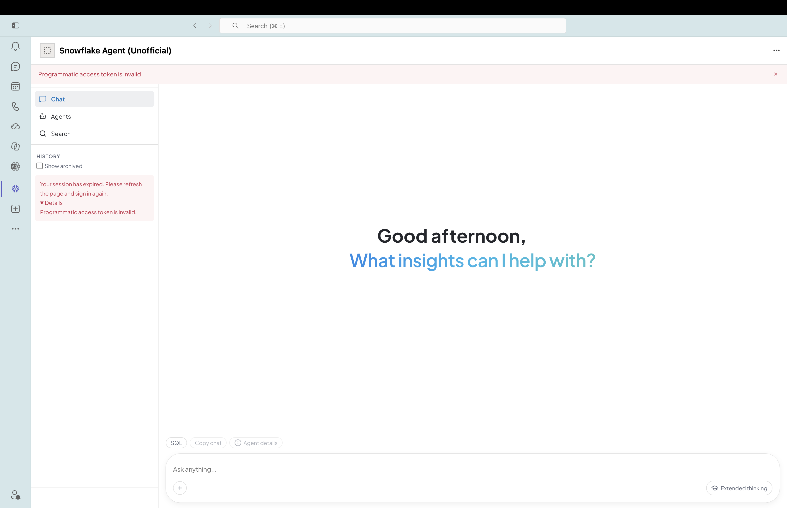
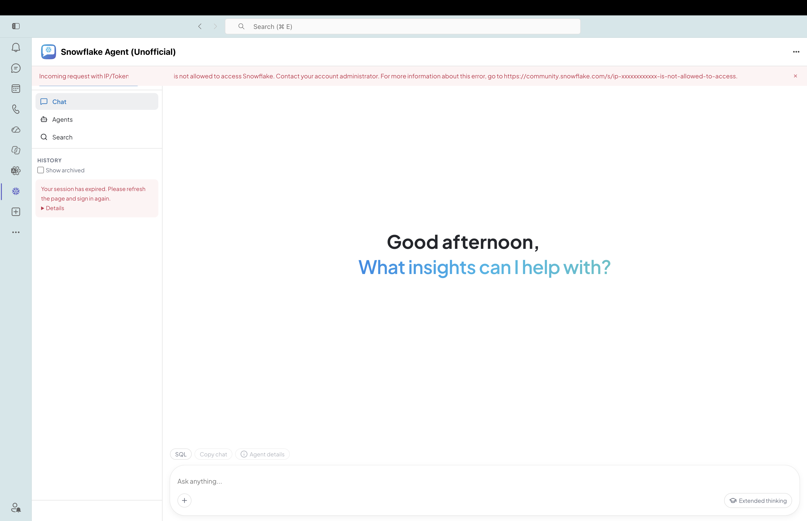
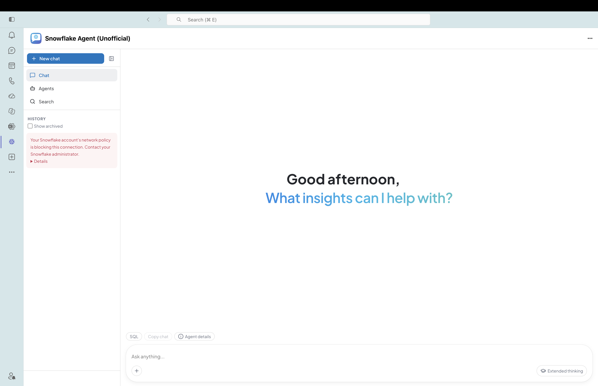
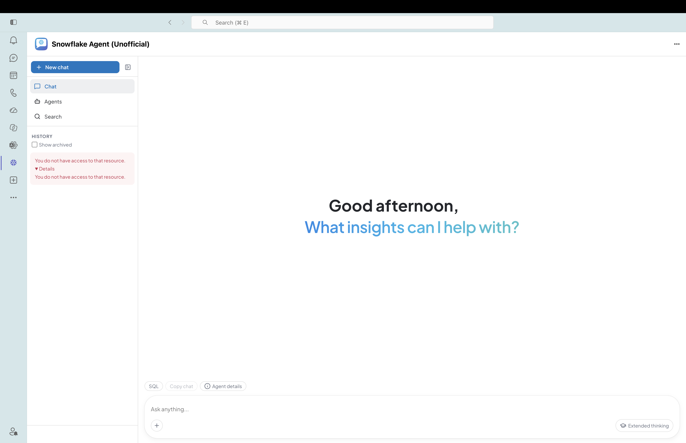
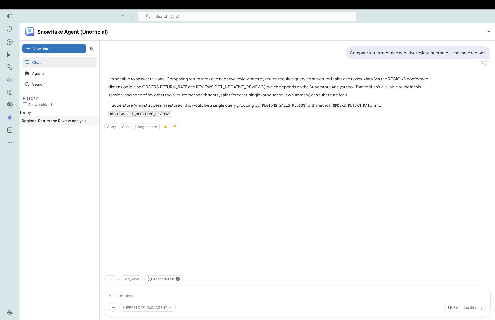

# Teams troubleshooting

Failures you can hit while installing or using Snowflake Agents for Teams (Unofficial). Install steps are in [install.md](install.md). Native App errors are in [native-app.md B.5](native-app.md#b5-native-app-failures); `hybrid` and `privatelink` errors are in [private-connectivity.md 7.7](private-connectivity.md#77-private-connectivity-failures).

## How the edge gates requests

- POSTs need an `Origin` on the allow-list. GET/HEAD without `Origin` are accepted only with `Sec-Fetch-Site: same-origin` (browsers omit `Origin` on same-origin reads).
- Every `/api/*` call except `/token/exchange` needs a valid `X-Edge-Session`; the proxy then attaches `SPCS_PAT`.
- `/token/exchange` needs a real Entra token in `entraToken` (Teams SSO), and is limited to 30/min per IP and 10/min per identity (429 with `Retry-After`).

So the edge probe in [install.md § 4](install.md#4-verify) gets the edge's own `401`, and scripts that omit `Origin` or `entraToken` fail with `Forbidden origin`; see [T11](#t11-forbidden-origin-on-api) and [T12](#t12-429-too-many-requests-on-tokenexchange).

## How to read this section

Errors are grouped by when you hit them, and numbered in the order you usually see them:

- [4.1 During install: script and deploy errors](#41-during-install-script-and-deploy-errors) (**I1 to I21**): a script, deploy or SQL step fails before you can open the tab.
- [4.2 After install: errors in the tab](#42-after-install-errors-in-the-tab) (**T1 to T14**): the tab loads, but sign-in, the agent list or a chat fails.
- [4.3 Diagnostics (not errors)](#43-diagnostics-not-errors): how to see the real error when the cause is not obvious
- [7.7 Private connectivity failures](private-connectivity.md#77-private-connectivity-failures) (**PL1 to PL6**): only in `hybrid` and `privatelink`

Every entry has the same shape: a heading with the error text, then **Symptom**, an optional screenshot, **Cause**, **Fix**, and **Verify** where a check exists.

Four rules save time:

- **Fix in order.** On a fresh install each error hides the next.
- **Re-run the same script.** Most install errors are a wrong or missing value in `apps/teams/.env`, and the scripts are idempotent, so after fixing the value, run the script again.
- **Confirm the account before changing anything.** `SELECT CURRENT_ACCOUNT_NAME();` must be the account that hosts the SPCS ingress. Run the SQL fixes below in that account only.
- **There are two separate network-policy hops.** Cloudflare → SPCS ingress is governed by the *PAT user's* policy ([T7](#t7-cloudflare-ip-is-not-allowed-to-access-snowflake)). SPCS → Cortex is governed by the policy on the *`CORTEX_TEAMS_OAUTH` integration* ([T8](#t8-account-network-policy-blocks-the-spcs-to-cortex-call)). In `hybrid` and `privatelink` the `COMPUTE_POOL` rule replaces T8's NAT range, and in `privatelink` an endpoint-ID rule replaces T7's Cloudflare ranges ([§ 7](private-connectivity.md)). Do not edit the managed `ACCOUNT_VPN_POLICY_SE`.

> **Redact before you screenshot.** Never capture bearer tokens, PATs, client secrets, or HAR/header dumps. Blur tenant, org and account identifiers.

## 4.1 During install: script and deploy errors

These happen while you run the [install](install.md#2-install-standalone-spcs) and [Teams app](install.md#3-teams-app) steps, before you reach the tab. Entries run in roughly the order of the install. Installed as a Native App? Its extra errors and differences are in [B.5](native-app.md#b5-native-app-failures).

### I1. Tenant setup with `az`: "Cannot find user or service principal"

**Symptom.** A tenant-setup step fails: `az role assignment create` reports `Cannot find user or service principal in graph database for 'TEAMS_USERNAME=user@yourtenant.onmicrosoft.com'`.

<!-- TODO screenshot: terminal showing the az "Cannot find user or service principal" error with the doubled 'TEAMS_USERNAME=' prefix. Redact tenant and user. -->

**Cause.** The line in `apps/teams/.env` is `TEAMS_USERNAME=TEAMS_USERNAME=user@domain` (invalid value). The parser splits on the first `=`, so the value becomes `TEAMS_USERNAME=user@domain`.

**Fix.** Make it a single `TEAMS_USERNAME=user@domain` and re-run the step.

### I2. `fill-dev-secrets.sh`: "APPS_API_HOST is not set"

**Symptom.** `APPS_API_HOST is not set — see apps/teams/.env.example`.

<!-- TODO screenshot: terminal showing "APPS_API_HOST is not set" from fill-dev-secrets.sh. -->

**Cause.** The key is blank or commented out in `apps/teams/.env`. `fill-dev-secrets.sh` requires it.

**Fix.** Set `APPS_API_HOST=apps-api.c1.<region>.<cloud>.app.snowflake.com` for your account's region, then re-run `bash apps/teams/scripts/fill-dev-secrets.sh`. It writes `temp/alter-teams-secrets.sql`; review it and run it in the account that hosts the service.

### I3. Docker daemon not running

**Symptom.** `push-dev-image.sh` fails with `failed to connect to the docker API at unix:///Users/<you>/.docker/run/docker.sock`.

<!-- TODO screenshot: terminal showing the docker.sock connection error. -->

**Cause.** Docker Desktop is not running.

**Fix.** `open -a Docker`, wait for the whale icon to settle, confirm with `docker info >/dev/null && echo ok`, then re-run. If `docker context ls` shows a different active context, switch with `docker context use desktop-linux`.

### I4. `<IMAGE_REPO>` is a placeholder, not a value

**Symptom.** You are unsure what to enter for `<IMAGE_REPO>` in the `docker tag` / `docker push` commands.

<!-- TODO screenshot: output of SHOW IMAGE REPOSITORIES with the repository_url of the IMAGE_REPO row highlighted. Redact org and account. -->

**Cause.** `<IMAGE_REPO>` stands for your registry URL. zsh also treats an unquoted `<...>` as a redirect, so pasting the placeholder as written fails.

**Fix.** Run `snow sql -q "SHOW IMAGE REPOSITORIES IN SCHEMA AGENTS_TEAMS_APP_DB.PUBLIC"` and copy `repository_url` from the `IMAGE_REPO` row. It looks like `<org>-<account>.registry.snowflakecomputing.com/agents_teams_app_db/public/image_repo`: no `https://`, no trailing slash, no `/agents-teams-app`. Substitute the real value and drop the angle brackets.

### I5. `snow: No such option: -c`

**Symptom.** `snow -c demo sql ...` fails with `No such option: -c`.

**Cause.** `-c` (connection) is an option of the subcommand, not of `snow` itself.

**Fix.** Put `-c` after the subcommand (`snow sql -c demo -q "..."`), or set `SNOWFLAKE_DEFAULT_CONNECTION_NAME`.

### I6. zsh: `event not found: ALL_ENDPOINTS_USAGE`

**Symptom.** Pasting a grant such as `AGENTS_TEAMS!ALL_ENDPOINTS_USAGE` in zsh fails with `event not found: ALL_ENDPOINTS_USAGE`.

**Cause.** zsh history expansion treats `!` inside double quotes as an event reference.

**Fix.** Quote the SQL in single quotes, or pass it in a `<<'EOF'` heredoc. Not double quotes.

### I7. `397012: Image … not found`

**Symptom.** Creating the service fails with `397012: Image … not found`.

**Cause.** `:latest` is missing from the image repository the service reads from.

**Fix.** The service reads `IMAGE_REPO`. Push to `/agents_teams_app_db/public/image_repo/agents-teams-app:latest`. (Native App installs read `na_image_repo` instead: see [B5](native-app.md#b5-native-app-variants-of-the-main-chapter-entries).)

### I8. Service never READY, `restartCount` keeps climbing

**Symptom.** `DESC SERVICE` / `SHOW SERVICE CONTAINERS` never reaches READY and `restartCount` increases. Container logs show `exec format error`.

**Cause.** The image was built for arm64 (Apple Silicon default). SPCS runs amd64.

**Fix.** Rebuild with `--platform linux/amd64`, retag, and push `:latest` to `IMAGE_REPO` ([I7](#i7-397012-image--not-found)), then roll the service with `deploy-spcs.sh`. (Native App: see [B5](native-app.md#b5-native-app-variants-of-the-main-chapter-entries).)

### I9. Bootstrap `003001` / `MODIFY` on `AGENTS_TEAMS_EAI`

**Symptom.** Bootstrap fails with `003001` on `MODIFY` for `AGENTS_TEAMS_EAI`.

**Cause.** A leftover EAI from a Native App install ([B.6](native-app.md#b6-tear-down-path-b)) or from another role.

**Fix.** Re-run bootstrap. It takes ownership (`REVOKE CURRENT GRANTS`) and then runs `ALTER`. If it fails with `093154`, see [I10](#i10-bootstrap-093154-copy-current-grants).

### I10. Bootstrap `093154` `COPY CURRENT GRANTS`

**Symptom.** Bootstrap fails with `093154` on `COPY CURRENT GRANTS`.

**Cause.** App-owned objects reject `COPY`.

**Fix.** Bootstrap uses `REVOKE CURRENT GRANTS`; re-run it. If that still fails, tear down the Native App ([B.6](native-app.md#b6-tear-down-path-b)) and re-run. Do not `DROP` the leftover while the app owns it.

### I11. `002003` Service `AGENTS_TEAMS` does not exist

**Symptom.** A grant fails with `002003`: service `AGENTS_TEAMS` does not exist.

**Cause.** The grants ran before `CREATE SERVICE`.

**Fix.** Push `:latest` to `IMAGE_REPO` ([I7](#i7-397012-image--not-found)), then `snow sql -f apps/teams/scripts/create-dev-service.sql`.

### I12. Service `FAILED`: `Missing required environment variable: ALLOWED_ORIGINS`

**Symptom.** The service is `FAILED` and its logs show `Missing required environment variable: ALLOWED_ORIGINS`.

**Cause.** `ALLOWED_ORIGINS` was never written. Production `TEAMS_AUTH_MODE` cannot boot without it.

**Fix.** `ALTER SECRET … ALLOWED_ORIGINS`, then roll with `deploy-spcs.sh`. (Native App: see [B5](native-app.md#b5-native-app-variants-of-the-main-chapter-entries).)

### I13. `Cannot find module 'miniflare'` / Wrangler fails at repo root

**Symptom.** `npx wrangler` fails with `Cannot find module 'miniflare'`.

**Cause.** Wrangler was run from the repo root, where it is not installed.

**Fix.** `cd packages/teams-edge` first, then `npx wrangler …`. The scripts already do this.

### I14. `wrangler deploy`: workers.dev subdomain or Worker name

**Symptom.** `deploy-tab.sh` fails with one of:

- `You need to register a workers.dev subdomain before publishing to workers.dev`
- `EDGE_WORKER_NAME "…" is not a valid Worker name (lowercase letters, digits, hyphens)`
- `set-edge-secrets.sh` succeeded but the deployed Worker answers `/token/exchange` with 500 `Edge misconfigured`: the secrets went to a different Worker.

**Cause.** The first `wrangler deploy` creates the Worker, so there is no project to create first (unlike Pages). It does need a workers.dev subdomain on the account when it publishes to workers.dev. Both scripts derive the same Worker name (`EDGE_WORKER_NAME`, else `PAGES_PROJECT`, else the first label of a `*.workers.dev` `TAB_BASE_HOST`, else `agents-embed-teams`), so a name passed by hand to one of them, or an `EDGE_WORKER_NAME` changed between the two runs, splits secrets from code.

**Fix.**

1. Register the subdomain once: dashboard → Workers & Pages → the account's workers.dev subdomain. Or use a custom domain ([B.4](native-app.md#b4-cloudflare-worker)).
2. Set `EDGE_WORKER_NAME` in `apps/teams/.env` to the Worker that owns `TAB_BASE_HOST` (a `*.workers.dev` host is `<worker>.<subdomain>.workers.dev`).
3. Re-run `bash apps/teams/scripts/set-edge-secrets.sh`, then `bash apps/teams/scripts/deploy-tab.sh`.

**Verify.** `cd packages/teams-edge && npx wrangler secret list --name <worker>` lists the ten secrets ([B.4](native-app.md#b4-cloudflare-worker)).

### I15. `set-edge-secrets.sh`: "SNOWFLAKE_PAT is not set"

**Symptom.** `✗ SNOWFLAKE_PAT is not set — see apps/teams/.env.example`.

<!-- TODO screenshot: terminal showing the SNOWFLAKE_PAT is not set error. -->

**Cause.** The ingress PAT was never minted or pasted into `apps/teams/.env`. The edge Worker uses it as `SPCS_PAT` to authenticate to the SPCS ingress. The same `✗ <NAME> is not set` message covers every value the script requires (`AZURE_TENANT_ID`, `BOT_APP_ID`, `OBO_*`, `SNOWFLAKE_ENTRA_APP_ID`, `TAB_BASE_HOST`); in `privatelink` it stops instead with `NETWORK_MODE=privatelink needs SPCS_BASE=https://<privatelink_ingress_url>` ([§ 7.6](private-connectivity.md#76-edge-in-privatelink-workers-vpc)).

**Fix.** Mint a PAT for the service user (the secret is shown **once**):

```sql
ALTER USER AGENTS_TEAMS_SVC ADD PROGRAMMATIC ACCESS TOKEN AGENTS_TEAMS_INGRESS_PAT_<YYYYMMDD>
  ROLE_RESTRICTION = '<role that holds APP_PUBLIC>' DAYS_TO_EXPIRY = 90;
```

Paste the `token_secret` into `SNOWFLAKE_PAT=` in `apps/teams/.env` (no whitespace, no quotes) and re-run the script. Once the new PAT works, drop the superseded one with `ALTER USER AGENTS_TEAMS_SVC REMOVE PROGRAMMATIC ACCESS TOKEN <old_name>`.

### I16. `deploy-tab.sh` fails with a DNS / network error

**Symptom.** Wrangler fails while uploading (for example `getaddrinfo ENOTFOUND` or a fetch failure to `api.cloudflare.com`).

**Cause.** A transient network error between your machine and Cloudflare.

**Fix.** Re-run `bash apps/teams/scripts/deploy-tab.sh`. If it repeats, check `cd packages/teams-edge && npx wrangler whoami` and your VPN/DNS.

### I17. Every `/api/*` call is 500 (Cloudflare 1101)

**Symptom.** The tab loads but the banner says "Cortex is temporarily unavailable. Please try again in a moment. Details: Failed to list threads: 500". In the browser network tab `GET /api/threads?page_size=20` is 500, and the body is Cloudflare error 1101 "Worker threw exception".

<!-- TODO screenshot: the Teams tab banner "Cortex is temporarily unavailable ... Failed to list threads: 500". -->

**Cause.** The Worker secret `SPCS_BASE` is a placeholder (it is derived from `SPCS_INGRESS_HOST`, which was still the `.env.example` value). The proxy builds `${SPCS_BASE}/api/...`, `new Request()` throws `Invalid URL`, and Cloudflare reports 1101. A changed secret also reaches only isolates started after it, so deploy after `set-edge-secrets.sh`. To see the exception itself, use [Diagnostics](#43-diagnostics-not-errors).

**Fix.**

1. Get the real ingress host: `snow sql -q "SHOW ENDPOINTS IN SERVICE AGENTS_TEAMS_APP_DB.PUBLIC.AGENTS_TEAMS"` and copy `ingress_url`.
2. Set `SPCS_INGRESS_HOST=<that host, no scheme>` in `apps/teams/.env` (in `privatelink`, set `SPCS_BASE=https://<privatelink_ingress_url>` instead).
3. `bash apps/teams/scripts/set-edge-secrets.sh`, then `bash apps/teams/scripts/deploy-tab.sh`.

**Verify.** Reload the tab. In the browser network panel `GET /api/threads?page_size=20` is 200, and the agent list loads. The edge probe in [install.md § 4](install.md#4-verify) cannot show this fix: it returns `401` before the proxy builds the upstream URL, so it passes even with a placeholder `SPCS_BASE`.

### I18. `set-bot-endpoint.sh`: could not resolve Bot Service

**Symptom.** `set-bot-endpoint.sh` reports it could not resolve the Bot Service in `AZURE_TENANT_ID`.

**Cause.** There is no Azure Bot in that tenant, or more than one.

**Fix.** Run `bash apps/teams/scripts/create-bot.sh --apply` ([§ 3](install.md#3-teams-app) step 1), or set `RESOURCE_GROUP` / `BOT_NAME` to pick the right one.

### I19. Sideload: `UnableToParseTeamsAppManifest` / `name.short` exceeds 30

**Symptom.** Uploading the app zip in Teams fails with `UnableToParseTeamsAppManifest`.

**Cause.** Teams caps `name.short` at 30 characters. The committed template uses `Snowflake Agent (Unofficial)`.

**Fix.** Rebuild the zip with `bash packages/teams-manifest/zip.sh`. Confirm `SPCS_INGRESS_HOST` matches the current ingress first ([§ 3](install.md#3-teams-app) step 2).

### I20. Adding the app to a channel: `BadRequest ... BulkMembershipRequest`

**Symptom.** Teams reports `BadRequest: Failed to execute Skype backend request BulkMembershipRequest` when you add the app to a channel, team or chat. Adding it as a personal app may still work.

**Cause.** The manifest declares a `bots` entry whose `botId` has no Azure Bot Service behind it (or its Teams channel is not enabled), so Teams cannot add the bot to the conversation.

**Fix.** `bash apps/teams/scripts/create-bot.sh` shows whether the bot exists and the Teams channel is on; add `--apply` to create what is missing. `smoke-test.sh` has a Bot check. If you only want the tab, build a tab-only package instead of a bot.

### I21. `CREATE SERVICE`: Secret ... does not exist or not authorized

**Symptom.** `create-dev-service.sql` fails as SYSADMIN with `Secret 'AGENTS_TEAMS_APP_DB.CONFIG.<NAME>' does not exist or not authorized`, although the secret exists.

**Cause.** `CREATE SERVICE` checks that the owner role can read every secret the spec references, and SYSADMIN had no `READ` on them. The bootstrap now grants `READ` on all 12 secrets to SYSADMIN; an account bootstrapped before that was added lacks the grants.

**Fix.** Re-run the bootstrap (it is idempotent), or grant by hand as ACCOUNTADMIN for each of the 12 secrets, then re-run `create-dev-service.sql`:

```sql
GRANT READ ON SECRET AGENTS_TEAMS_APP_DB.CONFIG.<SECRET_NAME> TO ROLE SYSADMIN;
```

**Verify.** `SHOW GRANTS ON SECRET AGENTS_TEAMS_APP_DB.CONFIG.BOT_APP_ID` lists `READ` for `SYSADMIN`.

## 4.2 After install: errors in the tab

The tab is reachable, but something fails once a user signs in or chats. A fresh install into a new Snowflake account tends to hit T1 to T10 one after another. Each hides the next, so fix them in order.

### T1. AADSTS500011 and "Nothing is here yet"

**Symptom.** Teams sign-in fails with `AADSTS500011` (resource principal `api://<host>/<id>` not found), or the tab shows Cloudflare "Nothing is here yet".



**Cause.** The manifest asks Entra for `api://<TAB_BASE_HOST>/<id>`, but the Entra Application ID URI uses a different host, and/or nothing is deployed at `TAB_BASE_HOST`. "Nothing is here yet" is what a legacy `*.pages.dev` project with no **Production** deployment shows. On a Worker host the equivalent is a Cloudflare 404 or 1042 until the first `deploy-tab.sh`.

**Fix.** Make `TAB_BASE_HOST` / `TAB_BASE_URL` match the registered host (`az ad app show --id <OBO_CLIENT_ID> --query identifierUris`), or add the new host to the registration with `az ad app update --id <OBO_CLIENT_ID> --identifier-uris api://<TAB_BASE_HOST>/<OBO_CLIENT_ID>` (list every URI you want to keep: the flag replaces the set). Then run `set-edge-secrets.sh` and `deploy-tab.sh`, `set-bot-endpoint.sh`, update `ALLOWED_ORIGINS` and roll the service, then `zip.sh` and re-upload the app. Moving off `*.pages.dev` follows the same order; see [§ 6](install.md#6-pages-to-worker-cutover).

### T2. Personal tab "Couldn't sign you in"

**Symptom.** The personal tab opens but shows "Couldn't sign you in".

**Cause.** The edge origin is not the Entra-authorized host.

**Fix.** Reuse the existing Worker (`EDGE_WORKER_NAME`) and `TAB_BASE_HOST`. Do not point the tab at a new custom domain or `*.workers.dev` host until that host is on the Entra app ([§ 6](install.md#6-pages-to-worker-cutover) step 1). Keep `TAB_BASE_URL` and the manifest on that same origin.

### T3. Token exchange fails with AADSTS65005

**Symptom.** The tab signs in, then `POST https://<TAB_BASE_HOST>/token/exchange` returns 401 with `{"error":"OBO exchange failed","status":400,"code":"AADSTS65005"}`. The 401 is from the edge; `status: 400` is Entra's token-endpoint response ("requested a scope that doesn't exist on the resource").

**Cause.** `SNOWFLAKE_SCOPE` (the Worker secret **and** the `SNOWFLAKE_SCOPE` Snowflake secret) must name the **Snowflake OAuth resource** app, not the Teams SSO / bot app. They are different Entra registrations:

| App                                                        | Exposes`session:role-any`? |
| ---------------------------------------------------------- | ---------------------------- |
| Teams SSO / bot (`BOT_APP_ID` / `OBO_CLIENT_ID`)       | No,`access_as_user` only   |
| Snowflake OAuth resource (`<snowflake-resource-app-id>`) | Yes                          |

The scope is also case-sensitive: Entra exposes `session:role-any` (lowercase); `SESSION:ROLE-ANY` does not exist.

**Fix.** Confirm the resource app, then set the same value everywhere:

```bash
az ad app show --id <snowflake-resource-app-id> \
  --query "{appId:appId,uris:identifierUris,scopes:api.oauth2PermissionScopes[].value,preAuth:api.preAuthorizedApplications}"
# expect api://<snowflake-resource-app-id>, scope session:role-any, and the Teams app pre-authorized
```

```bash
# SNOWFLAKE_SCOPE=api://<snowflake-resource-app-id>/session:role-any  in apps/teams/.env
bash apps/teams/scripts/set-edge-secrets.sh
bash apps/teams/scripts/deploy-tab.sh      # secret bulk alone leaves warm isolates
```

Then re-apply the Snowflake side (it updates the `SNOWFLAKE_SCOPE` secret and the `CORTEX_TEAMS_OAUTH` audience) and roll the service:

```bash
bash apps/teams/scripts/fill-dev-secrets.sh
snow sql --silent --enable-templating none -f temp/alter-teams-secrets.sql
bash apps/teams/scripts/deploy-spcs.sh
```

(Native App: the `CONFIGURE_OAUTH` / `SET_SECRET` / `ROLL_SERVER_SERVICE` calls are in [B5](native-app.md#b5-native-app-variants-of-the-main-chapter-entries).)

Pointing `CORTEX_TEAMS_OAUTH` at the bot's app id does not cause 65005; it fails later, when Snowflake rejects the token audience. Once the exchange succeeds, a Snowflake `EXTERNAL_OAUTH_USER_CLAIM_MISSING` means the token has no `upn` claim; add it as an optional claim, see [T9](#t9-you-do-not-have-access-to-that-resource).

**Verify.** Reload the tab. A healthy exchange returns `{ edgeSession, expiresIn }` (never the Snowflake token).

### T4. Programmatic access token is invalid

**Symptom.** The tab shows "Programmatic access token is invalid." The edge's `/api/*` fails at the ingress and nothing reaches the container.



**Cause.** `SPCS_PAT` was minted in a different Snowflake account from the one hosting the SPCS ingress (easy when several `snow` connections exist). Ingress rejects it before the app runs. A whitespace-wrapped PAT is a different failure; see the `FAULT` result in [T6](#t6-api-fails-at-the-edge-or-the-ingress).

**Fix.** In the ingress account, mint a token for the ingress user, put it in `apps/teams/.env` `SNOWFLAKE_PAT` (no whitespace), then push it to the Worker and redeploy:

```sql
SELECT CURRENT_ACCOUNT_NAME();
ALTER USER <pat-user> ADD PROGRAMMATIC ACCESS TOKEN AGENTS_TEAMS_INGRESS_PAT
  ROLE_RESTRICTION = 'AGENTS_TEAMS_USER' DAYS_TO_EXPIRY = 90;   -- value is shown once
```

```bash
bash apps/teams/scripts/set-edge-secrets.sh
bash apps/teams/scripts/deploy-tab.sh
```

**Verify.** Reload the tab. The error moves on: the agent list loads, or you see the Cloudflare IP error ([T7](#t7-cloudflare-ip-is-not-allowed-to-access-snowflake)), which is the next fix. The edge probe cannot show this, because it never sends the PAT to the ingress.

### T5. `Token expired` at the ingress

**Symptom.** Every `/api/*` call returns 401 `Token expired. …`. It often works for a few minutes after a PAT change, then fails. The JWT's own `exp` still looks far in the future.

**Cause.** The deployed `SPCS_PAT` is a **rotated-out** token. `ROTATE PROGRAMMATIC ACCESS TOKEN` renames the old one and leaves a short grace window, then Snowflake rejects it with `394401`. Decoding the JWT cannot show this; check server-side:

```sql
SHOW USER PROGRAMMATIC ACCESS TOKENS FOR USER "<pat-user>";   -- use the ACTIVE row, not *_ROTATED_*
```

**Fix.** Put the ACTIVE token in `apps/teams/.env` `SNOWFLAKE_PAT` (no whitespace), then `bash apps/teams/scripts/set-edge-secrets.sh` and `bash apps/teams/scripts/deploy-tab.sh`. Every rotation needs both steps or the app breaks again a few minutes later.

### T6. `/api/*` fails at the edge or the ingress

**Symptom.** The edge probe in [install.md § 4](install.md#4-verify) returns something other than `401 {"error":"Unauthorized"}`, or the tab's own `/api/*` requests fail in the browser network panel. The probe stops at the edge, so it can return only the **probe** rows. The **tab** rows come from requests that carry an edge session and reach the ingress; a direct PAT request also reaches the ingress, from any host the PAT user's network policy allows. Match the result:

| Result                                                                                              | Seen on    | Cause                                                                                                                                                                        | Fix                                                                                                                                                                                                                                                                      |
| --------------------------------------------------------------------------------------------------- | ---------- | ---------------------------------------------------------------------------------------------------------------------------------------------------------------------------- | ------------------------------------------------------------------------------------------------------------------------------------------------------------------------------------------------------------------------------------------------------------------------ |
| 403`{"error":"Forbidden origin"}`                                                                 | probe      | The`Origin` is not the Worker host.                                                                                                                                        | See[T11](#t11-forbidden-origin-on-api).                                                                                                                                                                                                                                   |
| 500`Proxy misconfigured: missing SPCS_BASE` (or `SPCS_PAT`, `EDGE_SESSION_SECRET`)            | probe      | That Worker secret is unset.                                                                                                                                                 | `set-edge-secrets.sh`, then `deploy-tab.sh`.                                                                                                                                                                                                                         |
| 500`{"error":"Edge misconfigured"}`                                                               | probe, tab | On every edge route: a privatelink deploy without the`SPCS_VPC` binding. On `/token/exchange` only: its secrets went to a different Worker.                              | See[PL6](private-connectivity.md#pl6-edge-misconfigured-500-in-privatelink), or [I14](#i14-wrangler-deploy-workersdev-subdomain-or-worker-name).                                                                                                                                                  |
| 404, or Cloudflare error 1042                                                                       | probe      | No Worker is deployed on that host yet, or`TAB_BASE_HOST` belongs to a different Worker.                                                                                   | See[I14](#i14-wrangler-deploy-workersdev-subdomain-or-worker-name), then `deploy-tab.sh`.                                                                                                                                                                               |
| 302 to`sfc-endpoint-login-…/sfc-oauth-begin`                                                     | tab        | The ingress saw no valid credential: the edge did not attach a usable`SPCS_PAT`.                                                                                           | `set-edge-secrets.sh`, then `deploy-tab.sh`.                                                                                                                                                                                                                         |
| 401`Incoming request with IP/Token … is not allowed`                                             | tab        | The PAT user's network policy rejects the edge's address.                                                                                                                    | See[T7](#t7-cloudflare-ip-is-not-allowed-to-access-snowflake) (`public`, `hybrid`) or [PL3](private-connectivity.md#pl3-the-private-ingress-rejects-the-edge-401-or-403) (`privatelink`).                                                                                                   |
| 403`Insufficient privileges to use <ingress>`                                                     | tab        | The`SPCS_PAT` user lacks endpoint access.                                                                                                                                  | Native App:`GRANT APPLICATION ROLE AGENTS_TEAMS_APP.APP_PUBLIC TO USER "<pat-user>"`. Path A: grant `AGENTS_TEAMS!ALL_ENDPOINTS_USAGE` plus `USAGE` on `AGENTS_TEAMS_APP_DB` / `PUBLIC` (quote the SQL, see [I6](#i6-zsh-event-not-found-all_endpoints_usage)). |
| 500`{"responseType":"FAULT","detail":""}`                                                         | tab        | The ingress rejected`SPCS_PAT` before the container (no service logs). Almost always whitespace in `apps/teams/.env` `SNOWFLAKE_PAT` (JWT signature wrapped on paste). | Strip the spaces, run`set-edge-secrets.sh`, then `deploy-tab.sh`.                                                                                                                                                                                                    |
| 500, Cloudflare 1101                                                                                | tab        | Placeholder`SPCS_BASE`.                                                                                                                                                    | See[I17](#i17-every-api-call-is-500-cloudflare-1101).                                                                                                                                                                                                                     |
| 522 right after`deploy-spcs.sh`                                                                   | tab        | The new ingress is not routable yet (origin timeout).                                                                                                                        | Wait about a minute and retry. The ingress called directly should return`302` first.                                                                                                                                                                                   |
| 404`Could not find the service associated with endpoint <old-id>…` right after `deploy-tab.sh` | tab        | A warm isolate still has the previous`SPCS_BASE` (for example, the ingress of an earlier install).                                                                         | Retry after about 20s. If it persists, check that`apps/teams/.env` `SPCS_BASE` is the new ingress, then re-run `set-edge-secrets.sh` and `deploy-tab.sh`.                                                                                                        |

Calling the **ingress** directly with no PAT also returns `302`. That is expected; the edge must attach the PAT, and the ingress is never the bot endpoint.

A single `net::ERR_CONNECTION_RESET` on `/api/agent/run` was seen once and cleared with no change. If it recurs, capture the time and gather both sides before changing anything: `wrangler tail` for the Worker ([Seeing the actual edge Worker error](#seeing-the-actual-edge-worker-error)) and the SPCS container log ([Reading the SPCS container log](#reading-the-spcs-container-log)) for the same minute.

**Verify.** The edge probe returns `401 {"error":"Unauthorized"}`. In the tab, `GET /api/agents` and `GET /api/threads` are 200 and the agent list loads.

### T7. Cloudflare IP is not allowed to access Snowflake

**Symptom.** The Teams tab shows "Incoming request with IP/Token is not allowed to access Snowflake". `/api/*` is 401 with `Incoming request with IP/Token <public-ip> is not allowed`, and the IP is a Cloudflare edge range (`104.16/13`, `172.64/13`, `162.158/15`, …), not the SPCS NAT and not `10.x`.



**Cause.** The edge Worker reaches the ingress with `SPCS_PAT`, so Snowflake checks the **PAT user's** network policy against a Cloudflare edge IP. The account policy has no Cloudflare ranges. The managed account policy is not the lever: do not edit `ACCOUNT_VPN_POLICY_SE` and do not add Cloudflare ranges to the account policy.

**Fix.** This is install step 5a; run it if it was skipped. The script prints the SQL by default and runs it with `--apply`; it leaves a user that already has a different user-level policy alone unless `--replace`, and never touches account-level policies:

```bash
bash apps/teams/scripts/set-svc-network-policy.sh [-c <snow connection>]            # dry run
bash apps/teams/scripts/set-svc-network-policy.sh [-c <snow connection>] --apply
```

Or do it by hand. Use the current IPv4 list from [https://www.cloudflare.com/ips-v4](https://www.cloudflare.com/ips-v4) (do not use `0.0.0.0/0`; the policy must stay restricted):

```sql
CREATE NETWORK POLICY IF NOT EXISTS AGENTS_TEAMS_INGRESS_POLICY
  ALLOWED_IP_LIST = ('173.245.48.0/20', '103.21.244.0/22' /* …paste the rest of ips-v4 */);
ALTER USER <pat-user> SET NETWORK_POLICY = AGENTS_TEAMS_INGRESS_POLICY;
```

Also confirm that the Worker's `SPCS_PAT` is that user's **ACTIVE** token ([T5](#t5-token-expired-at-the-ingress)) and redeploy.

This policy is for `public` and `hybrid`. In `privatelink` the edge reaches the private ingress, so the PAT user gets `AGENTS_TEAMS_PL_INGRESS_POLICY` (private-endpoint IDs, no Cloudflare ranges) instead ([§ 7.4](private-connectivity.md#74-network-sql-accountadmin)). A Cloudflare IP in this error in `privatelink` means the edge is still deployed without `--privatelink`.

**Verify.** Reload the tab: the IP error is gone and the agent list loads. The edge probe cannot show this, because it never reaches the ingress. A direct PAT request from a laptop is blocked by this same policy, as intended.

### T8. Account network policy blocks the SPCS to Cortex call

**Symptom.** The tab banner reads "Your Snowflake account's network policy is blocking this connection". The upstream error is `390422` on `/api/agent/run` or `/api/threads`.



**Cause.** The chat reaches the service, but the service's call to Cortex comes from the compute pool's public NAT range, which the account policy does not allow. The range differs by region, so do not copy one from another account. This is the SPCS → Cortex hop, not the Cloudflare → ingress hop ([T7](#t7-cloudflare-ip-is-not-allowed-to-access-snowflake)).

**Fix.** Read the blocked IP, then attach a scoped policy to the OAuth integration:

```sql
SELECT event_timestamp, client_ip, error_message
FROM SNOWFLAKE.ACCOUNT_USAGE.LOGIN_HISTORY      -- can lag; or use TABLE(SNOWFLAKE.INFORMATION_SCHEMA.LOGIN_HISTORY())
WHERE is_success = 'NO'
ORDER BY event_timestamp DESC LIMIT 5;

USE ROLE ACCOUNTADMIN;
CREATE NETWORK POLICY IF NOT EXISTS AGENTS_TEAMS_SPCS_POLICY
  ALLOWED_IP_LIST = ('<observed-nat-prefix>/24');     -- the /24 of the blocked client_ip
ALTER SECURITY INTEGRATION CORTEX_TEAMS_OAUTH SET NETWORK_POLICY = AGENTS_TEAMS_SPCS_POLICY;
```

Allow the `/24`, not the single IP, because the NAT address floats within it. Never allowlist a private `10.x` address.

If `LOGIN_HISTORY` shows a private `10.x` as the blocked `client_ip`, the call took the internal route instead of the public NAT. In `public` mode that means the Cortex URL was built from the injected `SNOWFLAKE_HOST`; `SNOWFLAKE_HOST_MODE=account` (the default) builds it from `SNOWFLAKE_ACCOUNT` (public NAT), so upgrade the app and roll the service rather than editing any policy.

In `hybrid` and `privatelink` the internal route is intentional (`SNOWFLAKE_HOST_MODE=internal`). A NAT `/24` cannot match it; the fix is the `COMPUTE_POOL` network rule on `CORTEX_TEAMS_OAUTH`, which replaces this policy. See [PL1](private-connectivity.md#pl1-390422-after-switching-to-hybrid-or-privatelink).

### T9. You do not have access to that resource

**Symptom.** The tab banner reads "You do not have access to that resource". `POST /api/threads` returns 401 `agent_forbidden` (upstream `390303` or `null`).



**Cause.** The tab shows `agent_forbidden` for **any** upstream 401/403 (only Snowflake `390422` becomes a network-policy error), so the banner alone does not tell you why. Read the container log first ([Reading the SPCS container log](#reading-the-spcs-container-log)). `CORTEX_TEAMS_OAUTH` could not map the token to a user, for one of two independent reasons:

1. **No Snowflake user for the Entra identity.** No user has a `login_name` equal to the token's `upn`.
2. **Token has no `upn` claim.** The log shows `Upstream 401: Invalid OAuth access token`. Entra v2 access tokens omit `upn` unless it is added as an optional claim ([install step 6a](install.md#2-install-standalone-spcs)).

**Fix.** For cause 1, create the user ([install step 7](install.md#2-install-standalone-spcs) grants), using the Entra UPN as `login_name`. Ask the user for the UPN; do not guess it. Check by `login_name` first: if a user already has that login under another name, do not create one, and grant `AGENTS_TEAMS_USER` access to that user's default role instead (install step 7).

```sql
SHOW USERS;
SELECT "name", "login_name", "default_role" FROM TABLE(RESULT_SCAN(LAST_QUERY_ID()))
WHERE LOWER("login_name") = LOWER('<entra-upn>');
CREATE USER IF NOT EXISTS <snowflake_user> LOGIN_NAME = '<entra-upn>'
  DEFAULT_ROLE = AGENTS_TEAMS_USER DEFAULT_WAREHOUSE = <warehouse>;
GRANT ROLE AGENTS_TEAMS_USER TO USER <snowflake_user>;
GRANT USAGE ON DATABASE <db> TO ROLE AGENTS_TEAMS_USER;
GRANT USAGE ON SCHEMA <db>.<schema> TO ROLE AGENTS_TEAMS_USER;
GRANT USAGE ON AGENT <db>.<schema>.<agent> TO ROLE AGENTS_TEAMS_USER;
```

For cause 2, add `upn` as an optional claim on the Snowflake resource app in Entra (Token configuration → Add optional claim → Access → `upn`, and allow the Graph permission prompt), or with the CLI command in [install step 6a](install.md#2-install-standalone-spcs). Only new tokens carry it, so reload the tab. Do **not** widen `EXTERNAL_OAUTH_TOKEN_USER_MAPPING_CLAIM` to `email` or `preferred_username`: those are attacker-influenceable and enable account takeover (security review F2). Keep it at `('upn')`.

Reload the tab (no sideload required). If chat then works but a tool is "unavailable", see [T10](#t10-the-agent-says-a-tool-is-unavailable).

### T10. The agent says a tool is unavailable

**Symptom.** The agent streams a reply, then says a tool (for the test agent, "Superstore Analyst") is not available. There is no error banner, so an HTTP-status check passes.



**Cause.** Sign-in and the agent now work, but the user's **default role** lacks a grant the agent's tools need (semantic view and its tables, search service, functions, warehouse, `SNOWFLAKE.CORTEX_USER`), or the user has no default warehouse. Cortex silently drops tools the caller cannot use, so the agent answers that the tool is unavailable instead of failing.

**Fix.** Grant `AGENTS_TEAMS_USER` everything the agent uses (semantic view and its tables, search service, functions, warehouse, `SNOWFLAKE.CORTEX_USER`), then:

```sql
ALTER USER <snowflake_user> SET DEFAULT_ROLE = AGENTS_TEAMS_USER, DEFAULT_WAREHOUSE = <warehouse>;
SHOW GRANTS TO ROLE AGENTS_TEAMS_USER;
```

**Verify.** Start a **new** chat and re-ask; an old thread keeps the earlier answer.

### T11. `Forbidden origin` on `/api/*`

**Symptom.** Same-origin GETs (threads, agent list) return `{"error":"Forbidden origin"}` with 403 while POSTs work.

**Cause.** Browsers omit `Origin` on same-origin GET/HEAD. The edge accepts that only when `Sec-Fetch-Site: same-origin`; POSTs always need an allowed `Origin`. An edge deploy older than that allowance rejects the GETs, and a new deploy can take about 15 seconds to reach every location.

**Fix.** `bash apps/teams/scripts/deploy-tab.sh`, wait, retry. A cross-site GET without `Origin` must still be refused.

### T12. `429 Too many requests` on `/token/exchange`

**Symptom.** Sign-in fails and `POST /token/exchange` returns 429 with a `Retry-After` header.

**Cause.** The limits are 30 requests/min per IP and 10/min per identity. The usual trigger is a loop: an upstream 401/403 (often [T9](#t9-you-do-not-have-access-to-that-resource)) makes the tab re-mint its edge session, and concurrent requests each re-mint. The tab now shares one in-flight exchange, so a remaining loop means a real 401/403 to fix.

**Fix.** Wait for `Retry-After`, fix the underlying 401/403, reload the tab.

### T13. The bot gets no reply

**Symptom.** You @mention the app in a channel or group chat and nothing comes back: no answer and no sign-in card. The tab works.

**Cause.** Bot Connector calls `POST /api/bot/messages` and the edge answers `401` before any bot logic runs, so Teams shows nothing. Since this install the Worker logs the reason as `bot request rejected: <reason>`. Known reasons:

| Log line                                                            | Cause                                                                                                                                              |
| ------------------------------------------------------------------- | -------------------------------------------------------------------------------------------------------------------------------------------------- |
| `jwt verification failed: ERR_JWT_CLAIM_VALIDATION_FAILED`          | Wrong audience or issuer (`BOT_APP_ID` Worker secret is not the bot's app id), or an age check. Real Bot Connector tokens have `exp`/`nbf` but **no `iat`**, so a `maxTokenAge` option in `jwtVerify` rejects every one of them; the verify code must not set it. |
| `jwt verification failed: ERR_JWT_EXPIRED`                          | Clock skew or a replayed token.                                                                                                                    |
| `serviceurl claim does not match activity`                          | The activity `serviceUrl` differs from the token claim: not a real Bot Connector call.                                                            |
| `activity has no from.aadObjectId or channelData.tenant.id`         | The activity carries no Entra identity (a conversation type or client that does not send it).                                                      |
| `missing or malformed Bearer token`                                 | The request did not come from Bot Connector (a probe, or the messaging endpoint points at the wrong host).                                         |

**Fix.** Watch the edge while you @mention again ([Seeing the actual edge Worker error](#seeing-the-actual-edge-worker-error)): `npx wrangler tail <worker-name> --format pretty --search "bot request rejected"`. No request at all means the messaging endpoint is wrong (`set-bot-endpoint.sh`) or the Teams channel is off (`create-bot.sh`). A `5xx` is [T6](#t6-api-fails-at-the-edge-or-the-ingress). Fix the cause in the table, `deploy-tab.sh`, and retry.

**Verify.** The @mention returns a sign-in card (or an answer once linked).

### T14. 1:1 chat with the bot shows "Conversation was not found"

**Symptom.** Messaging the app from its 1:1 (personal) chat shows a Teams 404 `Conversation was not found`.

**Cause.** By design. The manifest bot scopes are `team` and `groupChat` only, not `personal`, so Teams has no personal conversation to deliver to. Per-user chat is the personal tab.

**Fix.** None needed. Use the personal tab for 1:1, or @mention the app in a channel or group chat.

## 4.3 Diagnostics (not errors)

### Reading the SPCS container log

The container log holds the real upstream error that the UI redacts (`Upstream 401: Invalid OAuth access token`). As SYSADMIN (the service owner):

```bash
snow sql --role SYSADMIN -q "SELECT SYSTEM\$GET_SERVICE_LOGS('AGENTS_TEAMS_APP_DB.PUBLIC.AGENTS_TEAMS',0,'agents-teams-app',400)" \
  | grep -E "Upstream|error|forbidden"
```

### Profiling a HAR without leaking tokens

A HAR export contains live bearer tokens and edge sessions. Extract metadata only: method, path, status, timing, response-body error strings, and whether a header is present (never its value). Do not paste the HAR or raw headers into chat, tickets or the repo (`*.har` is gitignored, but keep captures outside the repo anyway), and delete it when done. Repeated `/token/exchange` calls followed by 429 point to [T12](#t12-429-too-many-requests-on-tokenexchange); 403 `Forbidden origin` on GETs points to [T11](#t11-forbidden-origin-on-api).

### Seeing the actual edge Worker error

Use this when `/api/*` is 500 and the cause is not obvious (as in [I17](#i17-every-api-call-is-500-cloudflare-1101) or [PL6](private-connectivity.md#pl6-edge-misconfigured-500-in-privatelink)).

<!-- TODO screenshot: `wrangler tail` output showing the "Invalid URL" exception. Redact tokens and hostnames. -->

```bash
cd packages/teams-edge
npx wrangler tail <worker-name>             # EDGE_WORKER_NAME; no --env, even in privatelink
npx wrangler secret list --name <worker-name>
```

Then reproduce the failing request in the tab. Do not pass `--env privatelink` to `tail` or `secret` commands: for those, Wrangler targets `<worker-name>-privatelink`, a Worker that does not exist. Only `deploy-tab.sh` passes `--env`, and it pins `--name` as well. In the dashboard the same view is **Workers & Pages** → the Worker → **Logs**, and secrets are under **Settings** → **Variables and Secrets**.

Reading `tail` output:

- `--format json` prints pretty-printed **multi-line** JSON, so line-based filters (`grep`, `jq -c` per line) see nothing. Parse the whole stream with a JSON parser, or use `--format pretty`.
- Narrow the stream with `--search "<text>"` (matches log text) and `--status error` (failed invocations only).
- Wrangler redacts the `Authorization` header, so a bot call's token never shows. Bot Connector requests are recognisable by user-agent `Microsoft-SkypeBotApi`.
- The edge logs bot rejections as `bot request rejected: <reason>` ([T13](#t13-the-bot-gets-no-reply)); it never logs token or header values.

macOS notes: there is no `timeout` command, so stop `tail` with Ctrl-C. In zsh always replace `<...>` placeholders (unquoted angle brackets are redirects).

### Quick fixes

One-line fixes and behaviours that are not failures.

| Symptom                                         | Fix                                                                                                                                                                                |
| ----------------------------------------------- | ---------------------------------------------------------------------------------------------------------------------------------------------------------------------------------- |
| Edge secret rotated, old behaviour persists     | Isolates stay warm. Redeploy after`set-edge-secrets.sh`: `bash apps/teams/scripts/deploy-tab.sh`.                                                                              |
| No dictation (mic) button in the Teams composer | By design, not a failure. Chrome blocks the Web Speech API inside cross-origin iframes, which every Teams tab is, so dictation is disabled on Teams. |
